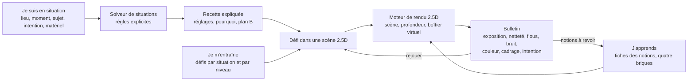

# REPRISE — Simulateur photo open source (FR/EN) · référentiel v0.2

Fichier unique de reprise, produit le 7 novembre 2026. Il contient les instructions pour Claude Code, le cadrage, l'architecture, le référentiel v0.2 complet sous forme de fichiers de données (191 notions, 42 situations V1, 7 situations V2), les questions ouvertes, l'historique des décisions et les sources. Il remplace le Claude Doc « Simulateur photo open source — référentiel et cadrage », qui reste en v0.1 et n'est plus mis à jour.

Sommaire

0. Instructions pour Claude Code
1. Cadrage
2. Architecture produit
3. Lire le référentiel
4. Référentiel v0.2 (données)
5. Situations (données)
6. Ce que la 3D débloque
7. Couverture
8. Questions ouvertes et prochaines étapes
9. Historique des décisions et des audits
10. Sources (données)

---

## 0. Instructions pour Claude Code

### 0.1 Le projet en cinq lignes

- Une boîte à outils open source, bilingue français et anglais, qui apprend la photo aux débutants par la simulation : régler son appareil, faire la mise au point, choisir ses collimateurs, et réussir une photo dans une situation donnée (où, quand, quoi, pourquoi).
- Porteur : Julien, tech lead DevOps. Il décide ; tu proposes et tu exécutes.
- V1 en 2.5D : de vraies photos et leur carte de profondeur. V2 : uniquement le passage en 3D et ce qu'il débloque.
- État au 7 novembre 2026 : cadrage et référentiel v0.2 validés. Aucun code, aucun contenu rédigé, couverture 0 sur 191.
- Ce fichier fait foi. Le Claude Doc d'origine (lien privé retiré le 7 novembre 2026, avant la publication du dépôt) est privé et figé en v0.1 : tu n'en as pas besoin.

### 0.2 Lire ce fichier

- Il fait environ 3600 lignes : lis-le en entier, par tranches, avant toute action.
- Les sections 4, 5 et 10 sont des blocs YAML. Chaque bloc commence par `# fichier: <chemin>` : c'est le fichier qu'il devient dans le dépôt. Ces blocs sont la source de vérité du référentiel ; les sections en prose en donnent les raisons.

### 0.3 En arrivant

1. Lis tout le fichier.
2. Résume à Julien en dix lignes au plus : le projet, l'état, ce qui est acté, ce qui reste ouvert.
3. Propose le plan de la session 1 (section 0.7) en listant ce que tu vas créer, et attends son accord avant de créer ou de modifier quoi que ce soit.

### 0.4 Règles de travail

- Français, tutoiement, ton direct et structuré. Pas d'emoji, pas de formules emphatiques.
- Toujours dire la vérité : ne jamais inventer, extrapoler ou deviner. Si une information n'est pas vérifiable, écris « Je ne sais pas ».
- Toute affirmation factuelle (photo, optique, droit, constructeurs, bibliothèques, licences) s'appuie sur une source crédible, récente et vérifiable, citée avec auteur, date et lien quand la page les donne. Pas de source vague, obsolète ou douteuse. Toute nouvelle source entre dans `data/sources.yaml` avec un identifiant.
- Explique le raisonnement ou le calcul de toute donnée discutable (exemples : notes d'EXP-03, OPT-12, OPT-16).
- L'exactitude passe avant la vitesse. Avant de répondre : « Tout est-il factuel, sourcé et vérifiable ? » Sinon, corrige d'abord.
- Reste neutre : aucune marque favorisée ; le vocabulaire de chaque marque vient du manuel du constructeur.
- Co-construis : propose l'approche, avec ses options et leurs compromis, avant de produire. Julien tranche.
- Contenu juridique : écrit pays par pays, à partir des textes officiels, sans chiffre, article ou règlement inventé.
- Pose une question ouverte (section 8) quand elle bloque l'étape en cours, avec une option par défaut argumentée, plutôt que toutes d'un coup.

### 0.5 Git

- Jamais de push direct sur `main` : une branche par sujet, une pull request par livrable, que Julien relit et fusionne.
- Commits petits et explicites. Pas de réécriture d'un historique publié, pas de `--force`.
- Ne versionne ni secret ni fichier lourd (scènes, modèles) sans accord : leur stockage est une question ouverte.
- Toute modification de `data/` passe par `scripts/validate.py` en local et en CI.

### 0.6 Ce qui est acté

Ne le rouvre pas sans demande de Julien.

- 6 novembre 2026 : bilingue FR/EN dès la V1, chaque texte ayant une clé stable et deux langues ; V1 en 2.5D, maquette validée avant la 3D ; les situations sont le cœur de la V1 ; la V2 n'est que le passage en 3D et ses contenus ; toute la maîtrise du boîtier est au programme (modes, menus, mise au point, modes AF, collimateurs, mesure, obturateur, fichiers).
- 7 novembre 2026 : règle de découpage V1/V2 (section 1) ; format de scène 2.5D (section 2) ; flash en V1 par captures ambiante et flash seul, à valider pendant la preuve du moteur ; solveur de situations à règles explicites, sans IA ; « garde tout » sur la liste consolidée de l'audit indépendant, d'où la v0.2 (section 9).
- Identifiants stables : jamais renumérotés. Un identifiant retiré n'est jamais réutilisé et reste listé dans `data/referentiel/retired.yaml`.

### 0.7 Session 1 : amorcer le dépôt

À proposer à Julien tel quel ou ajusté. Livrable : une pull request « bootstrap du référentiel v0.2 ».

1. Créer l'arborescence :

```text
README.md                    présentation courte en français, lien vers README.en.md
README.en.md                 présentation en anglais
CLAUDE.md                    règles de travail (texte en 0.9)
REPRISE.md                   ce fichier, gardé tel quel comme archive
docs/
  cadrage.md                 section 1
  architecture.md            section 2
  lire-le-referentiel.md     section 3
  v2-3d.md                   section 6
  questions-ouvertes.md      section 8
  historique.md              section 9
data/
  referentiel/*.yaml         13 domaines + retired.yaml (section 4)
  situations.yaml            section 5
  sources.yaml               section 10
schemas/                     JSON Schema du référentiel, des situations et des sources
scripts/
  extract_reprise.py         extraction des blocs YAML (code en 0.8)
  validate.py                contrôles du référentiel
  coverage.py                comptes et couverture
.github/workflows/validate.yml
```

2. Extraire les blocs YAML avec `scripts/extract_reprise.py`, sans les retoucher à la main. Copier les sections en prose dans `docs/` sans les réécrire.
3. Écrire les schémas et `scripts/validate.py`. Contrôles attendus, tous en erreur sauf mention :
   - identifiants uniques et bien formés (`XXX-NN`, `SIT-NN`, `SIT-V2-NN`), préfixe égal au domaine du fichier ;
   - `version` parmi V1, V1→V2, V2 ; `level` parmi N1, N2, N3 ;
   - toute situation citée par une notion existe, et toute situation est citée par au moins une notion ;
   - toute notion clé d'une situation existe et renvoie à cette situation, sauf si la notion a `situations: all` ;
   - aucune situation V1 n'a de notion clé V2 ; une notion V2 ne renvoie à une situation V1 que si une note l'explique (cas d'OPT-17) ;
   - une notion sans situation a un champ `practice_outside` ;
   - toute source citée existe dans `sources.yaml` ; une source citée ni par une notion, ni par un domaine, ni par une situation, ni dans son champ `used_in` donne un avertissement ;
   - aucun identifiant retiré n'est utilisé ;
   - le niveau d'une situation suit la règle de `situations.yaml` ; un écart sans note donne un avertissement.
4. Écrire `scripts/coverage.py` : comptes par domaine et par version, qui doivent redonner les tableaux de la section 7, et couverture des quatre briques en français et en anglais. Proposer à Julien où vivront les contenus (par exemple `content/fr/notions/EXP-01.md`) ; tant qu'il n'y en a pas, la couverture vaut 0 sur 191.
5. Ajouter le workflow GitHub Actions qui lance `validate.py` et `coverage.py` sur chaque pull request.
6. Critères d'acceptation : `validate.py` sort sans erreur ; il compte 191 notions (177 V1, 12 V1→V2, 2 V2), 42 situations V1, 7 situations V2, 78 sources et 1 identifiant retiré ; les fichiers extraits sont identiques aux blocs de ce fichier.

### 0.8 Script d'extraction

````python
#!/usr/bin/env python3
"""Extrait les blocs YAML de REPRISE.md vers les fichiers du dépôt.

Usage : python3 scripts/extract_reprise.py [REPRISE.md] [racine du dépôt]
"""
import pathlib
import re
import sys

src = pathlib.Path(sys.argv[1] if len(sys.argv) > 1 else "REPRISE.md")
root = pathlib.Path(sys.argv[2] if len(sys.argv) > 2 else ".")
text = src.read_text(encoding="utf-8")
blocks = re.findall(r"^```yaml\n(# fichier: (\S+)\n.*?)^```$", text, flags=re.S | re.M)
if not blocks:
    sys.exit("Aucun bloc YAML avec « # fichier: » trouvé.")
for body, path in blocks:
    out = root / path
    out.parent.mkdir(parents=True, exist_ok=True)
    out.write_text(body, encoding="utf-8")
    print(f"{path} : {body.count(chr(10))} lignes")
````

### 0.9 CLAUDE.md à créer

````markdown
# CLAUDE.md

Simulateur photo open source, bilingue FR/EN, pour débutants. V1 en 2.5D ; V2 = passage en 3D.
Source de vérité : `data/` (référentiel, situations, sources). Contexte et décisions : `docs/`.
Archive de reprise : `REPRISE.md`.

## Règles
- Français, tutoiement, direct et structuré. Pas d'emoji, pas de formules emphatiques.
- Ne jamais inventer, extrapoler ou deviner. Information invérifiable : « Je ne sais pas ».
- Toute affirmation factuelle est sourcée (auteur, date, lien) ; les sources vont dans `data/sources.yaml`.
- Expliquer le calcul de toute donnée discutable.
- Proposer l'approche avant de produire ; Julien tranche.
- Contenu juridique pays par pays, à partir des textes officiels.

## Dépôt
- Jamais de push sur `main` : une branche et une pull request par sujet.
- `python3 scripts/validate.py` avant toute pull request qui touche `data/`.
- Identifiants stables, jamais renumérotés ; un identifiant retiré va dans `data/referentiel/retired.yaml`.
- Pas de 3D avant la validation de la maquette 2.5D.
- Vérifier la licence de toute dépendance, de tout modèle et de toute scène avant de l'ajouter.
````

### 0.10 Sessions suivantes

Dans cet ordre, chacune proposée puis validée par Julien.

1. Trancher les questions ouvertes qui bloquent la suite : licences (avant tout contenu), nom du projet, stockage des scènes, hébergement.
2. Proposer la pile technique de la maquette et du moteur de rendu 2.5D : deux ou trois options comparées sur le rendu dans le navigateur, le flou selon la profondeur, le bruit, les performances sur téléphone et les licences. Julien choisit.
3. Maquetter les écrans clés en 2.5D (étape 4 de la section 8), lisibles sur téléphone.
4. Prouver le moteur de rendu sur une seule scène (étape 5), flash par captures compris.
5. Rédiger les contenus FR/EN notion par notion (étape 6), sources à l'appui.

### 0.11 À ne pas faire

- Lancer la 3D avant la validation de la maquette 2.5D.
- Rédiger un contenu sans source, inventer une source, une règle de droit ou un chiffre.
- Renuméroter un identifiant, ou retirer une notion sans pull request qui l'explique et met à jour `retired.yaml`.
- Ajouter une dépendance ou un modèle sans en vérifier la licence. Depth Anything V2 Small est sous Apache-2.0 ; la licence de ses modèles métriques n'est pas vérifiée.
- Pousser sur `main`.

---

## 1. Cadrage

La V1 simule en 2.5D tout ce qui se fait sans déplacer l'appareil ni la lumière, avec les situations au centre. La V2 n'ajoute que ce que la 3D débloque.

### Décisions actées le 6 novembre 2026

- Bilingue français et anglais dès la V1 : chaque notion, situation et texte d'interface a une clé stable et deux langues.
- V1 en 2.5D : de vraies photos et leur carte de profondeur. La maquette 2.5D est validée avant de lancer la 3D.
- Les situations sont le cœur de la V1 : on part de « où, quand, quoi, pourquoi » pour arriver aux réglages.
- V2 : uniquement le passage en 3D et les contenus qu'il débloque.
- Toute la maîtrise du boîtier est au programme : modes, menus, mise au point, modes AF, collimateurs, mesure, obturateur, fichiers.

### Ce que « 100 % » veut dire

- Le référentiel liste toutes les notions, chacune avec un identifiant stable (ex. MAP-06).
- Une notion est couverte quand ses quatre briques existent en français et en anglais : explication, simulateur, exercice, situation réelle. Si une notion ne se simule pas, une activité interactive remplace le simulateur.
- Taux de couverture = notions couvertes ÷ notions du référentiel, affiché dans l'outil et dans le dépôt.
- Ajouter ou retirer une notion passe par une proposition de modification du référentiel, comme pour le code.

### Règle de découpage V1 / V2

Une notion est en V1 si elle se simule sans déplacer l'appareil ni la lumière. Zoomer revient à recadrer pour le cadrage et la perspective ; le flou, lui, est recalculé selon la focale. Avec la plupart des objectifs (pas les fisheyes), tourner l'appareil autour du centre de sa pupille d'entrée ne crée pas de parallaxe ([manuel Hugin](https://hugin.sourceforge.io/docs/manual/Entrance_pupil.html)) : une capture plus large que le cadre suffit, si elle couvre la rotation voulue et garde assez de définition pour la focale la plus longue. Dès qu'il faut changer librement de point de vue ou placer une lumière, c'est la V2. Exception : une translation de quelques centimètres pendant la pose, depuis un train par exemple (SIT-29), reste en V1, le flou se calculant selon la profondeur (à valider en maquette).

- V1 (177 notions) : réglages, exposition, mise au point, profondeur de champ, flous, bruit, couleur, cadrage par rotation et zoom, variantes capturées (heures, météo, flash seul).
- V1 → V2 (12 notions) : une base en V1 avec des variantes capturées depuis quelques points, la version libre en V2 : perspective, distance sujet-fond, point de vue, premiers plans, pose du modèle, qualité et direction de la lumière, lumière de fenêtre, flash direct et rebondi, réflecteurs, éclairage sous l'eau.
- V2 (2 notions) : flash déporté et studio, point sans parallaxe.

### Périmètre

- Dans le périmètre depuis le 7 novembre 2026 : la photo par drone (PLA-09, SIT-41), la photo sous l'eau près de la surface (COU-09, LUM-18, SIT-42), la restauration de photos anciennes (RET-15, hors catalogue).
- Hors périmètre proposé : la vidéo ; le développement argentique (les principes de prise de vue restent valables, la chimie non) ; l'activité professionnelle (tarifs, clients, contrats).
- À trancher : la photo au smartphone (section 8).

---

## 2. Architecture produit

Trois portes d'entrée mènent au même moteur de rendu. Une situation décrite passe par le solveur de situations, qui produit une recette expliquée ; un défi se joue dans une scène 2.5D ; une notion se manipule dans son simulateur. Chaque photo simulée reçoit un bulletin, qui renvoie aux notions à revoir.



### Les trois portes d'entrée

- Je suis en situation : quelques questions (lieu, moment, sujet, mouvement, intention, matériel), puis la recette de réglages expliquée.
- Je m'entraîne : des défis classés par situation et par niveau, joués dans une scène 2.5D et notés par le bulletin.
- J'apprends : le référentiel, notion par notion, avec ses quatre briques ; le simulateur de chaque notion tourne sur le moteur de rendu.

### Solveur de situations

- Entrées : intérieur ou extérieur, moment et météo, sujet et vitesse, distance, intention (figer, suggérer le mouvement, isoler, tout net, ambiance), matériel (capteur, objectifs, trépied, flash, filtres, télécommande, drone, caisson étanche).
- Recette : mode, vitesse, ouverture, ISO ou ISO auto avec vitesse minimale, correction d'exposition, mode et zone AF, collimateur ou mise au point manuelle, limiteur, mesure, balance des blancs, entraînement, type d'obturateur, stabilisation, format, focale, et selon la situation filtres, flash, bracketing ou pose B. Chaque réglage vient avec son pourquoi, ses compromis et un plan B si la lumière baisse.
- Calcul : un solveur à règles explicites, pas une IA. Il fixe d'abord les contraintes (vitesse pour figer, profondeur de champ voulue), puis répartit la lumière restante. Chaque recette est donc testable et explicable.
- Défi : la même situation dans une scène, avec un objectif et des contraintes. On règle, on déclenche, on reçoit son bulletin.

### Bulletin

Le moteur de rendu mesure chaque photo simulée, puis renvoie vers les notions à revoir.

- Exposition : écart en IL, part de hautes lumières et d'ombres écrêtées.
- Netteté : sujet dans la zone nette ou non, écart de mise au point.
- Flous : traînée de bougé et de sujet, en pixels.
- Bruit : rapport signal/bruit sur le sujet.
- Couleur : écart de balance des blancs sur une zone neutre annotée.
- Cadrage : inclinaison de l'horizon, éléments parasites dans le cadre.
- Intention : atteinte ou non, par exemple le flou d'arrière-plan mesuré.

### Boîtier virtuel

- Générique : il porte tous les réglages des domaines EXP, BOI, MAP, MES, COU et LUM, et les réglages d'objectif d'OPT (focale, filtres).
- Profils d'appareil génériques : format de capteur (plein format, APS-C, Micro 4/3, 1 pouce), bruit, plage dynamique, vitesse de synchro flash, type d'obturateur, type d'AF, viseur optique ou électronique.
- Profils d'objectif génériques : focale, ouverture maximale et sa variation au zoom, distance minimale, distorsion, vignetage, piqué, nombre de lamelles, stabilisation.
- Vocabulaire de ta marque : un réglage affiche les termes de Canon, Nikon, Sony, Fujifilm ou d'autres. Les noms changent même d'un modèle à l'autre : le réglage de la zone AF s'appelle « AF method » sur le [Canon EOS R5](https://cam.start.canon/en/C003/manual/html/UG-04_AF-Drive_0050.html) et « AF area » sur l'[EOS R5 Mark II](https://cam.start.canon/en/C017/manual/html/UG-04_AF-Drive_0060.html). La correspondance se tient donc par famille d'appareils, chaque terme sourcé par le manuel du constructeur.

Exemple de correspondance par famille d'appareils, d'après les manuels anglais des constructeurs (termes des manuels français à relever) :

| Réglage générique | Canon | Nikon | Sony | Fujifilm |
| --- | --- | --- | --- | --- |
| AF ponctuel | [One-Shot AF](https://cam.start.canon/en/C003/manual/html/UG-04_AF-Drive_0040.html) | [AF-S](https://onlinemanual.nikonimglib.com/zr/en/18-02.html) | [AF-S](https://helpguide.sony.net/ilc/1650/v1/en/contents/TP0001486782.html) | [S (AF-S)](https://fujifilm-dsc.com/en-int/manual/gfx100/taking_photo/autofocus/index.html) |
| AF continu | [Servo AF](https://cam.start.canon/en/C003/manual/html/UG-04_AF-Drive_0040.html) (hybrides), [AI Servo AF](https://www.manualslib.com/manual/1063993/Canon-Eos-80d.html?page=499) (reflex) | [AF-C](https://onlinemanual.nikonimglib.com/zr/en/18-02.html) | [AF-C](https://helpguide.sony.net/ilc/1650/v1/en/contents/TP0001486782.html) | [C (AF-C)](https://fujifilm-dsc.com/en-int/manual/gfx100/taking_photo/autofocus/index.html) |
| Mode de zone AF | [AF area](https://cam.start.canon/en/C017/manual/html/UG-04_AF-Drive_0060.html) | [AF-area mode](https://onlinemanual.nikonimglib.com/zr/en/18-02.html) | [Focus Area](https://helpguide.sony.net/ilc/2110/v1/en/contents/TP1000640179.html) | [AF MODE](https://fujifilm-dsc.com/en-int/manual/gfx100/taking_photo/autofocus/index.html) |
| Mesure multizone | [Evaluative](https://cam.start.canon/fa/C007/manual/html/UG-04_AF-Drive_0080.html) | [Matrix](https://onlinemanual.nikonimglib.com/zr/en/09-03-21.html) | [Multi](https://helpguide.sony.net/ilc/1830/v1/en/contents/TP0002351792.html) | [Multi](https://fujifilm-dsc.com/en-int/manual/x-t4/taking_photo/photometry/index.html) |
| Mesure pondérée centrale | [Center-weighted average](https://cam.start.canon/fa/C007/manual/html/UG-04_AF-Drive_0080.html) | [Center-weighted](https://onlinemanual.nikonimglib.com/zr/en/09-03-21.html) | [Center](https://helpguide.sony.net/ilc/1830/v1/en/contents/TP0002351792.html) | [Center weighted](https://fujifilm-dsc.com/en-int/manual/x-t4/taking_photo/photometry/index.html) |
| Mesure spot | [Spot](https://cam.start.canon/fa/C007/manual/html/UG-04_AF-Drive_0080.html) | [Spot](https://onlinemanual.nikonimglib.com/zr/en/09-03-21.html) | [Spot](https://helpguide.sony.net/ilc/1830/v1/en/contents/TP0002351792.html) | [Spot](https://fujifilm-dsc.com/en-int/manual/x-t4/taking_photo/photometry/index.html) |

Propres à certaines marques ou à certains modèles :

- AF qui bascule seul entre ponctuel et continu : [AI Focus AF](https://www.manualslib.com/manual/1063993/Canon-Eos-80d.html?page=499) chez Canon (reflex), [AF-A](https://onlinemanual.nikonimglib.com/zr/en/18-02.html) chez Nikon, [Automatic AF](https://helpguide.sony.net/ilc/1930/v1/en/contents/TP0002720640.html) chez Sony.
- Mesure sélective : [Partial](https://cam.start.canon/fa/C007/manual/html/UG-04_AF-Drive_0080.html) chez Canon.
- Mesure qui protège les hautes lumières : [Highlight-weighted](https://onlinemanual.nikonimglib.com/zr/en/09-03-21.html) chez Nikon, [Highlight](https://helpguide.sony.net/dsc/1910/v1/en/contents/TP0002055602.html) chez Sony.
- Moyenne de toute l'image : [Entire Screen Avg.](https://helpguide.sony.net/ilc/1830/v1/en/contents/TP0002351792.html) chez Sony, [Average](https://fujifilm-dsc.com/en-int/manual/gfx100/taking_photo/photometry/index.html) chez Fujifilm.
- Mesure spot qui suit le collimateur : [Focus Point Link](https://helpguide.sony.net/ilc/2110/v1/en/contents/TP1000649034.html) chez Sony, [Interlock Spot AE & Focus Area](https://fujifilm-dsc.com/en/manual/x100t/shooting/photometry/index.html) chez Fujifilm (MES-12).

À terme, cette table devient un fichier de données (par exemple `data/vocabulaire.yaml`), un terme par marque et par famille d'appareils, chacun avec sa source.

### Format de scène 2.5D

- Capture HDR calibrée en luminance réelle, soleil et reflets compris (filtre ND, bracketing étendu) ; une source écrêtée est signalée dans les métadonnées.
- Capture nette de bout en bout, à bas ISO et sans flou : le moteur ajoute flou et bruit, il ne sait pas en retirer.
- Capture plus large que le cadre simulé, assemblée en panorama autour de la pupille d'entrée si la rotation dépasse le champ de l'objectif. Recadrer ×k divise la définition par k : chaque scène déclare sa plage de focales et de rotation, et la définition source qui va avec.
- Carte de profondeur en mètres. Le modèle Depth Anything V2 Small, sous licence Apache-2.0, peut servir d'estimateur ([dépôt officiel](https://github.com/DepthAnything/Depth-Anything-V2)) ; il donne une profondeur inverse connue à une échelle et un décalage près ([Jiang et al., CVPR 2025](https://openaccess.thecvf.com/content/CVPR2025/supplemental/Jiang_DEFOM-Stereo_Depth_Foundation_CVPR_2025_supplemental.pdf)), recalée en 1/distance sur au moins deux distances mesurées sur place.
- Premier plan flou qui déborde sur le sujet (grillage, branche, feuillage) : fond et premier plan capturés en couches, car le flou laisse voir une partie de ce qui est caché derrière. L'occlusion partielle est l'une des deux difficultés majeures du rendu du bokeh ([Sheng et al., 2023](https://arxiv.org/abs/2308.08843)).
- Sujets mobiles détourés, avec trajectoire et vitesse : flous de mouvement et suivi AF.
- Annotations : visages, yeux, sujets et leur orientation, horizon, lignes, éléments parasites, zones neutres pour juger la balance des blancs, sources de lumière avec leur couleur et leur scintillement, éclairement mesuré sur le sujet (MES-11).
- Variantes depuis le même point : heures, météo, polarisant, flash seul (direct et rebondi), reflets, voilage, réflecteur. Variantes depuis quelques points voisins, pour les notions V1→V2 : distance du sujet à la fenêtre ou au fond, hauteur de prise de vue, poses du modèle, profondeur sous l'eau.
- Séquences d'images sans trou entre les images pour les poses longues, ou flou interpolé entre elles ([Tabellion et al., 2023](https://arxiv.org/abs/2308.01379)).
- Métadonnées : lieu, date, heure, matériel, auteur, licence, plage de focales et de rotation.

### Bilinguisme

- Chaque texte passe par une clé. Une notion n'est couverte que si ses quatre briques existent en français et en anglais.
- Les intitulés du référentiel forment la première version du glossaire FR/EN.
- Les contenus juridiques s'écrivent pays par pays, ils ne se traduisent pas.

### Droits

- Chaque scène porte son auteur et sa licence.
- En France, utiliser l'image d'une personne identifiable demande en principe son autorisation expresse et spéciale, au titre du respect de la vie privée prévu par l'article 9 du Code civil ([Village de la Justice, Patrick Lingibé, 2019](https://www.village-justice.com/articles/droit-image-quelles-sont-les-regles-applicables,30783.html)). Dans un lieu public, l'accord est requis si la personne est isolée et reconnaissable ([Service-public.fr, vérifié le 6 mai 2022](https://www.service-public.gouv.fr/particuliers/vosdroits/F32103)) : un passant qu'un zoom peut isoler compte donc comme identifiable (autorisation, floutage ou figurant).
- Pour un mineur, les deux parents protègent en commun son droit à l'image et l'y associent selon son âge et sa maturité (art. 372-1 du Code civil, issu de la loi du 19 février 2024 : [Actu-Juridique, 20 février 2024](https://www.actu-juridique.fr/breves/personnes-famille/protection-du-droit-a-limage-de-lenfant-publication-de-la-loi/)). Une diffusion qui n'est pas un acte usuel demande l'accord des deux ([circulaire du 23 mai 2024](https://cnb.avocat.fr/sites/default/files/documents/circulaire_de_presentation_des_dispositions_de_loi_n_2024-120_du_19_fevrier_2024_visant_a_garantir_le_respect_du_droit_a_limage_des_enfants_-_240523.pdf)) : le projet le demande toujours.
- Une œuvre encore protégée visible dans une scène (architecture récente, sculpture, street art) demande l'accord de son auteur. L'exception de panorama ne couvre que les reproductions faites par des personnes physiques, hors de tout usage commercial (art. L122-5, 11° du CPI : [CMS, Prudence Cadio, 2017](https://cms.law/fr/fra/a-la-une/la-nouvelle-exception-de-panorama-et-la-reproduction-de-l-image-de-l-immeuble)), alors qu'une licence comme CC BY-SA permet l'usage commercial ([Creative Commons](https://creativecommons.org/licenses/by-sa/4.0/deed.en)).
- Chaque scène avec des personnes identifiables ou des œuvres protégées est donc livrée avec des autorisations écrites.
- Les scènes de drone suivent en plus les règles de vol du pays où elles sont prises (PLA-09) ; dans l'Union européenne, le cadre commun est fixé par les règlements (UE) 2019/947 et 2019/945 ([EASA, FAQ](https://www.easa.europa.eu/en/the-agency/faqs/regulations-uas-drone-explained)).

---

## 3. Lire le référentiel

191 notions en 13 domaines : 177 se simulent en V1, 12 commencent en V1 et s'achèvent en V2, 2 attendent la V2. 49 situations : 42 en V1, 7 en V2.

Champs d'une notion (section 4) :

- `id` : identifiant stable, préfixe du domaine et numéro, jamais renuméroté.
- `title.fr`, `title.en` : intitulés ; l'anglais amorce le glossaire FR/EN.
- `version` : V1 ; V1→V2 (base en V1 avec des variantes capturées, version libre en V2) ; V2.
- `level` : N1 débutant, N2 intermédiaire, N3 avancé.
- `spec` : la spécification des trois premières briques, pas leur contenu. `explanation` : ce que la personne doit comprendre. `simulator` : ce qu'elle manipule. `exercise` : ce qu'elle doit réussir. La quatrième brique est la situation réelle.
- `activity: true` : la notion ne se simule pas ; une activité interactive remplace le simulateur.
- `situations` : où la notion sert, en renvoi au catalogue ; `all` quand elle sert partout ; liste vide et `practice_outside` pour une notion qui se pratique ailleurs qu'en prise de vue (LEC-03, RET-15).
- `sources` : identifiants de `data/sources.yaml`. `notes` : calculs et précisions. `todo` : ce qui reste à sourcer ou à vérifier. `since` : version qui a introduit la notion.

Champs d'une situation (section 5) : `where_when`, `intention`, `key_notions`, `capture` (scène à produire, V1 seulement), `flash` (`required` ou `optional`), `level` et `level_max` (règle dans le bloc), `sources` quand la situation vient d'un cours.

Champs d'une source (section 10) : `id`, `group`, `label`, `url`, `note` éventuelle, et `used_in` quand elle n'est citée que dans un document en prose.

- Notions clés : celles qui sont propres à la situation. Les réglages de base (ouverture, vitesse, ISO, modes, mesure, AF, balance des blancs) servent dans toutes les recettes sans être répétés.
- Toute notion clé renvoie à sa situation. L'inverse n'est pas exigé : une notion peut servir dans une situation sans en être une notion clé.

Le squelette reprend l'ampleur du cours de photographie numérique de Marc Levoy à Stanford : science de l'image, technique des appareils, composition ([page du cours](https://graphics.stanford.edu/~levoy/teaching.html)), et exercices par genre ([liste des exercices](https://sites.google.com/site/marclevoylectures/assignments)).

---

## 4. Référentiel v0.2 (données)

Un bloc par domaine, dans l'ordre EXP, MES, BOI, MAP, NET, MVT, OPT, LUM, COU, CMP, PLA, RET, LEC, puis les identifiants retirés.

### EXP — Exposition (exposure)

14 notions.

```yaml
# fichier: data/referentiel/exp.yaml
domain:
  id: EXP
  title: {fr: "Exposition", en: "exposure"}
  intro: "Quatorze notions, toutes en V1 : la lumière captée d'abord, puis l'ISO, qui amplifie sans ajouter de lumière, et ce que le capteur enregistre. Le bruit vient surtout du manque de lumière captée."
  sources: [dpreview-iso-invariance, pl-iso-invariance]
notions:
  - id: EXP-01
    title: {fr: "Exposition et luminosité", en: "exposure vs brightness"}
    version: V1
    level: N1
    spec:
      explanation: "La lumière captée et la luminosité finale sont deux choses distinctes"
      simulator: "Jauge de lumière captée séparée de la luminosité affichée"
      exercise: "Même luminosité avec deux quantités de lumière, puis comparer le bruit"
    situations: [SIT-07, SIT-18]
    since: v0.1
  - id: EXP-02
    title: {fr: "Lumière de la scène", en: "scene brightness, EV"}
    version: V1
    level: N1
    spec:
      explanation: "Situer une scène de la nuit noire au soleil sur la neige"
      simulator: "Curseur de lumière ambiante sur une même scène"
      exercise: "Classer cinq scènes de la plus sombre à la plus claire"
    situations: [SIT-13, SIT-20]
    since: v0.1
  - id: EXP-03
    title: {fr: "Diaphs et IL", en: "stops, EV"}
    version: V1
    level: N1
    spec:
      explanation: "Un IL (un diaph) double ou divise par deux l'exposition : la lumière captée pour l'ouverture et la vitesse, l'amplification pour l'ISO. Un cran de molette vaut en général 1/3 d'IL, réglable sur les boîtiers"
      simulator: "Compteur d'IL qui additionne ouverture, vitesse et ISO"
      exercise: "Compenser +2 IL de vitesse par l'ouverture"
    situations: [SIT-10]
    sources: [canon-r5-custom]
    notes:
      - "1 IL = facteur 2 sur la lumière captée (ouverture, vitesse) ou sur l'amplification (ISO)."
    since: v0.1
  - id: EXP-04
    title: {fr: "Ouverture", en: "aperture"}
    version: V1
    level: N1
    spec:
      explanation: "La série des f/ ; un petit nombre laisse passer plus de lumière"
      simulator: "Diaphragme animé lié à l'image"
      exercise: "Trouver l'ouverture qui donne +1 IL depuis f/5.6"
    situations: [SIT-04, SIT-18]
    since: v0.1
  - id: EXP-05
    title: {fr: "Vitesse d'obturation", en: "shutter speed"}
    version: V1
    level: N1
    spec:
      explanation: "Temps de pose et quantité de lumière"
      simulator: "Rideau animé, durée visualisée"
      exercise: "Compenser le passage de f/4 à f/8 par la vitesse"
    situations: [SIT-17]
    since: v0.1
  - id: EXP-06
    title: {fr: "ISO", en: "ISO sensitivity"}
    version: V1
    level: N1
    spec:
      explanation: "L'ISO éclaircit sans ajouter de lumière ; le bruit vient surtout du manque de lumière, et chaque IL d'ISO en plus coûte environ un IL de marge dans les hautes lumières ; les ISO étendus coûtent en qualité : plage dynamique réduite en bas, bruit et couleurs irrégulières en haut"
      simulator: "Même lumière captée, ISO variable : la luminosité change, le rapport signal/bruit presque pas (selon le profil d'appareil)"
      exercise: "ISO le plus bas utilisable à vitesse et ouverture imposées"
    situations: [SIT-07, SIT-19]
    sources: [dpreview-iso-invariance, pl-iso-invariance, canon-5ds-iso]
    since: v0.1
  - id: EXP-07
    title: {fr: "Expositions équivalentes", en: "equivalent exposures"}
    version: V1
    level: N1
    spec:
      explanation: "Plusieurs couples donnent la même luminosité, pas la même image"
      simulator: "Exposition verrouillée, couples équivalents à parcourir"
      exercise: "Fond flou, mouvement figé puis filé, à exposition égale"
    situations: [SIT-06, SIT-12]
    since: v0.1
  - id: EXP-08
    title: {fr: "Bruit numérique", en: "digital noise"}
    version: V1
    level: N2
    spec:
      explanation: "Bruit photonique, bruit de lecture et, en pose longue, bruit thermique ; pourquoi les ombres sont plus bruitées, et les petits capteurs aussi à ouverture et vitesse égales"
      simulator: "Bruit calculé à partir des photons captés et du profil d'appareil"
      exercise: "Réduire le bruit d'une scène de nuit à luminosité finale égale"
    situations: [SIT-20, SIT-27, SIT-35]
    sources: [dpreview-iso-invariance, pl-iso-invariance]
    since: v0.1
  - id: EXP-09
    title: {fr: "Plage dynamique", en: "dynamic range"}
    version: V1
    level: N2
    spec:
      explanation: "L'écart en IL entre la saturation du capteur et son plancher de bruit ; quand la scène le dépasse, on sacrifie hautes lumières ou ombres"
      simulator: "Scène HDR, capteur limité, zones écrêtées signalées"
      exercise: "Choisir quoi sacrifier dans un contre-jour"
    situations: [SIT-03, SIT-10, SIT-32]
    since: v0.1
  - id: EXP-10
    title: {fr: "Exposition voulue", en: "high-key, low-key, silhouette"}
    version: V1
    level: N2
    spec:
      explanation: "La bonne exposition est celle qui sert l'intention"
      simulator: "Objectifs d'intention mesurés par le moteur"
      exercise: "Silhouette nette sur un ciel coloré"
    situations: [SIT-03, SIT-10]
    since: v0.1
  - id: EXP-11
    title: {fr: "Régler sans posemètre", en: "sunny 16, starting points"}
    version: V1
    level: N2
    spec:
      explanation: "Estimer une exposition de tête, et savoir quand ces règles cessent de marcher"
      simulator: "Mode « cellule cachée »"
      exercise: "Exposer trois scènes sans posemètre"
    situations: [SIT-13, SIT-31]
    since: v0.1
  - id: EXP-12
    title: {fr: "Exposer à droite", en: "expose to the right"}
    version: V1
    level: N3
    spec:
      explanation: "Capter le plus de lumière possible en RAW sans écrêter, et les limites de la méthode"
      simulator: "Histogrammes RAW et JPEG, développement après la prise"
      exercise: "Gagner en propreté sur une scène peu contrastée"
    situations: [SIT-14, SIT-17]
    since: v0.1
  - id: EXP-13
    title: {fr: "Le capteur : photosites, matrice de Bayer, profondeur de bits", en: "how a sensor works, bit depth"}
    version: V1
    level: N2
    spec:
      explanation: "Chaque photosite compte la lumière reçue ; la matrice de Bayer ne lui laisse voir qu'une couleur, l'appareil reconstitue les deux autres ; le RAW garde plus de niveaux que le JPEG, limité à 8 bits par couche (12 ou 14 bits en RAW chez Nikon)"
      simulator: "Capteur agrandi : photosites, filtres colorés, dématriçage, nombre de niveaux"
      exercise: "Prédire quelle image supporte le mieux un éclaircissement de 2 IL : RAW ou JPEG"
    situations: [SIT-10, SIT-17]
    sources: [cic-sensors, cic-bit-depth, nikon-d6-raw-bit-depth]
    since: v0.2
  - id: EXP-14
    title: {fr: "L'œil et l'appareil", en: "cameras vs the human eye"}
    version: V1
    level: N1
    spec:
      explanation: "L'œil balaie la scène et s'adapte zone par zone ; l'appareil capte une seule image, avec une seule exposition"
      simulator: "Même scène vue à l'œil puis par l'appareil : ombres bouchées ou ciel brûlé"
      exercise: "Repérer dans trois scènes ce que l'appareil ne rendra pas comme l'œil"
    situations: [SIT-03, SIT-32]
    sources: [cic-eye]
    since: v0.2
```

### MES — Mesure et contrôle de l'exposition (metering and exposure control)

13 notions.

```yaml
# fichier: data/referentiel/mes.yaml
domain:
  id: MES
  title: {fr: "Mesure et contrôle de l'exposition", en: "metering and exposure control"}
  intro: "Treize notions, toutes en V1 : comprendre ce que la cellule mesure, la corriger, puis placer ses tons."
notions:
  - id: MES-01
    title: {fr: "Ce que mesure la cellule", en: "how metering works"}
    version: V1
    level: N1
    spec:
      explanation: "La cellule mesure la lumière renvoyée et ramène la zone mesurée vers un gris moyen ; la mesure multizone corrige en partie selon la répartition des tons, mais une scène très claire ou très sombre la trompe encore"
      simulator: "Zone mesurée et valeur visée affichées"
      exercise: "Prédire si l'appareil va sous-exposer ou surexposer"
    situations: [SIT-13, SIT-31]
    since: v0.1
  - id: MES-02
    title: {fr: "Modes de mesure", en: "metering modes"}
    version: V1
    level: N1
    spec:
      explanation: "Multizone, pondérée centrale, spot et variantes de marque : quand utiliser chacune"
      simulator: "Motif de pondération superposé, exposition recalculée"
      exercise: "Exposer un visage en contre-jour avec le bon mode"
    situations: [SIT-03, SIT-19]
    sources: [canon-m50ii-metering, nikon-zr-metering, sony-a9-metering, fujifilm-xt4-photometry, sony-rx0ii-highlight, fujifilm-gfx100-photometry]
    since: v0.1
  - id: MES-03
    title: {fr: "Pièges de la mesure", en: "metering traps"}
    version: V1
    level: N1
    spec:
      explanation: "Neige, fond noir, contre-jour, nuit : pourquoi la cellule se trompe"
      simulator: "Scènes piégeuses, erreur affichée en IL"
      exercise: "Corriger cinq scènes piégeuses"
    situations: [SIT-13, SIT-19, SIT-31]
    since: v0.1
  - id: MES-04
    title: {fr: "Correction d'exposition", en: "exposure compensation"}
    version: V1
    level: N1
    spec:
      explanation: "Décaler la cible de la cellule en P, A et S, et en M avec ISO auto"
      simulator: "Molette de correction, effet immédiat"
      exercise: "Rendre la neige blanche"
    situations: [SIT-03, SIT-13]
    todo:
      - "Sourcer les affirmations à la rédaction de la fiche (audit A du 7 novembre 2026)."
    since: v0.1
  - id: MES-05
    title: {fr: "Mémorisation d'exposition", en: "AE lock"}
    version: V1
    level: N2
    spec:
      explanation: "Mesurer sur une zone, recadrer, garder l'exposition"
      simulator: "Bouton de mémorisation, mesure puis rotation dans la scène"
      exercise: "Mesurer sur le visage, recadrer au tiers"
    situations: [SIT-03, SIT-19, SIT-30]
    since: v0.1
  - id: MES-06
    title: {fr: "Histogramme", en: "histogram"}
    version: V1
    level: N1
    spec:
      explanation: "Lire la répartition des tons et repérer l'écrêtage, couche par couche"
      simulator: "Histogramme en direct et après la prise, relié aux zones de l'image"
      exercise: "Associer quatre histogrammes à quatre photos"
    situations: [SIT-10, SIT-13]
    since: v0.1
  - id: MES-07
    title: {fr: "Alertes de surexposition et zébras", en: "highlight alerts, zebras"}
    version: V1
    level: N1
    spec:
      explanation: "Repérer en direct les zones brûlées"
      simulator: "Clignotement et zébras réglables"
      exercise: "Exposer au plus clair sans brûler une robe blanche"
    situations: [SIT-02, SIT-13]
    since: v0.1
  - id: MES-08
    title: {fr: "Bracketing d'exposition", en: "exposure bracketing"}
    version: V1
    level: N2
    spec:
      explanation: "Sécuriser une prise ou préparer une fusion HDR : nombre de vues, écart ; certaines marques font aussi varier la balance des blancs ou l'optimiseur de plage dynamique"
      simulator: "Série visualisée et fusion simple"
      exercise: "Couvrir un coucher de soleil en un minimum de vues"
    situations: [SIT-10, SIT-18, SIT-32, SIT-41]
    sources: [nikon-z50ii-bracketing]
    since: v0.1
  - id: MES-09
    title: {fr: "Posemètre en manuel", en: "metering in manual mode"}
    version: V1
    level: N1
    spec:
      explanation: "Lire l'échelle d'exposition du viseur en M"
      simulator: "Échelle d'exposition virtuelle dans le viseur"
      exercise: "Régler à 0, puis à −1 IL volontairement"
    situations: [SIT-17, SIT-21]
    since: v0.1
  - id: MES-10
    title: {fr: "ISO auto", en: "auto ISO"}
    version: V1
    level: N2
    spec:
      explanation: "Plafond d'ISO, vitesse minimale, ISO auto en M avec correction"
      simulator: "Menu ISO auto, l'appareil explique son choix"
      exercise: "Régler l'ISO auto pour un enfant qui court en fin de journée"
    situations: [SIT-06, SIT-07, SIT-34, SIT-35, SIT-37, SIT-39]
    since: v0.1
  - id: MES-11
    title: {fr: "Mesure incidente", en: "incident metering"}
    version: V1
    level: N3
    spec:
      explanation: "Mesurer la lumière reçue par le sujet plutôt que celle qu'il renvoie"
      simulator: "Posemètre à main virtuel, valeur incidente notée dans la scène"
      exercise: "Exposer une personne en noir sur fond blanc"
    situations: [SIT-02, SIT-04]
    since: v0.1
  - id: MES-12
    title: {fr: "Mesure spot liée au collimateur", en: "spot metering linked to the focus point"}
    version: V1
    level: N2
    spec:
      explanation: "Sur certains boîtiers, la mesure spot se fait sous le collimateur choisi plutôt qu'au centre : un sujet décentré s'expose sans recadrer"
      simulator: "Cercle de mesure qui suit le collimateur, option activable"
      exercise: "Exposer en spot un visage décentré en contre-jour, sans mémorisation"
    situations: [SIT-03, SIT-19]
    sources: [sony-a7iv-spot-point, fujifilm-x100t-photometry]
    since: v0.2
  - id: MES-13
    title: {fr: "Système de zones", en: "zone system"}
    version: V1
    level: N3
    spec:
      explanation: "Placer un ton choisi sur une valeur voulue et prévoir où tombent les autres ; méthode d'Ansel Adams et Fred Archer, adaptée au numérique"
      simulator: "Échelle de zones superposée à l'image, mesure spot sur un ton choisi"
      exercise: "Exposer une scène de neige en plaçant la neige sur une zone choisie, puis vérifier où tombent les ombres"
    situations: [SIT-10, SIT-13]
    sources: [wikipedia-zone-system]
    todo:
      - "Ajouter une source primaire (Wikipedia est secondaire)."
    since: v0.2
```

### BOI — Maîtrise du boîtier (camera operation)

36 notions.

```yaml
# fichier: data/referentiel/boi.yaml
domain:
  id: BOI
  title: {fr: "Maîtrise du boîtier", en: "camera operation"}
  intro: "36 notions, toutes en V1 : le boîtier virtuel reproduit les commandes d'un vrai appareil et affiche le vocabulaire de chaque marque. L'autofocus, la mesure, la couleur et le flash ont leurs propres domaines (MAP, MES, COU, LUM)."
notions:
  - id: BOI-01
    title: {fr: "Anatomie du boîtier", en: "camera anatomy"}
    version: V1
    level: N1
    spec:
      explanation: "Molettes, déclencheur, viseur, écran, touches : ce que chacun commande"
      simulator: "Boîtier virtuel cliquable"
      exercise: "« Trouve le réglage » chronométré"
    situations: [SIT-28]
    since: v0.1
  - id: BOI-02
    title: {fr: "Déclencheur à mi-course", en: "half-press"}
    version: V1
    level: N1
    spec:
      explanation: "À mi-course, mise au point et mesure ; à fond, déclenchement"
      simulator: "Déclencheur à deux niveaux, confirmation de netteté"
      exercise: "Faire le point, recadrer, déclencher sans relâcher"
    situations: [SIT-05]
    since: v0.1
  - id: BOI-03
    title: {fr: "Viseur et écran", en: "OVF, EVF, LCD"}
    version: V1
    level: N1
    spec:
      explanation: "Le viseur électronique peut montrer l'exposition finale (aperçu activé), le viseur optique non ; la luminosité de l'écran et du viseur se règle et ne change pas la photo"
      simulator: "Bascule viseur optique ou électronique, luminosité de l'écran réglable"
      exercise: "Voir une surexposition avant de déclencher"
    situations: [SIT-02]
    sources: [nikon-zfc-d7]
    since: v0.1
  - id: BOI-04
    title: {fr: "Aides à l'affichage", en: "grid, level, live histogram"}
    version: V1
    level: N1
    spec:
      explanation: "Grille, niveau électronique, histogramme en direct"
      simulator: "Couches d'affichage activables"
      exercise: "Redresser un horizon au niveau électronique"
    situations: [SIT-10, SIT-16, SIT-32]
    since: v0.1
  - id: BOI-05
    title: {fr: "Modes auto et scènes", en: "auto, scene modes"}
    version: V1
    level: N1
    spec:
      explanation: "Ce que l'appareil décide à ta place, et où ça casse"
      simulator: "Mode auto qui affiche ses choix"
      exercise: "Expliquer trois photos ratées en mode auto"
    situations: [SIT-06, SIT-25]
    since: v0.1
  - id: BOI-06
    title: {fr: "Programme et décalage", en: "program mode, program shift"}
    version: V1
    level: N1
    spec:
      explanation: "P choisit un couple, la molette le décale à exposition égale"
      simulator: "Couples équivalents affichés pendant le décalage"
      exercise: "En P, obtenir un fond flou"
    situations: [SIT-01]
    since: v0.1
  - id: BOI-07
    title: {fr: "Priorité à l'ouverture", en: "aperture priority, A/Av"}
    version: V1
    level: N1
    spec:
      explanation: "Choisir la profondeur de champ, surveiller la vitesse"
      simulator: "Alerte de vitesse trop lente"
      exercise: "Portrait fond flou sans bougé"
    situations: [SIT-01, SIT-11]
    since: v0.1
  - id: BOI-08
    title: {fr: "Priorité à la vitesse", en: "shutter priority, S/Tv"}
    version: V1
    level: N1
    spec:
      explanation: "Choisir l'effet du mouvement, surveiller ouverture et ISO"
      simulator: "Ouverture qui atteint sa limite et clignote"
      exercise: "Figer un enfant qui court en fin de journée"
    situations: [SIT-06, SIT-09]
    since: v0.1
  - id: BOI-09
    title: {fr: "Mode manuel", en: "manual, M"}
    version: V1
    level: N1
    spec:
      explanation: "Tout fixer soi-même : lumière stable, panorama, nuit"
      simulator: "M avec posemètre et ISO auto en option"
      exercise: "Série d'un concert à lumière changeante"
    situations: [SIT-17, SIT-19, SIT-30]
    since: v0.1
  - id: BOI-10
    title: {fr: "Poses B et T", en: "bulb, time"}
    version: V1
    level: N2
    spec:
      explanation: "Poses plus longues que la vitesse la plus lente, avec télécommande ; en pose T, un premier appui ouvre l'obturateur, un second le ferme"
      simulator: "Poses B et T chronométrées"
      exercise: "Trois bouquets de feu d'artifice en une pose"
    situations: [SIT-20, SIT-21, SIT-33]
    sources: [nikon-z8-time]
    since: v0.1
  - id: BOI-11
    title: {fr: "Modes personnalisés", en: "custom modes"}
    version: V1
    level: N2
    spec:
      explanation: "Enregistrer une configuration par situation"
      simulator: "Sauvegarde et rappel de configurations"
      exercise: "Créer une configuration action et une paysage"
    situations: [SIT-06, SIT-10]
    since: v0.1
  - id: BOI-12
    title: {fr: "Modes d'entraînement", en: "drive modes"}
    version: V1
    level: N1
    spec:
      explanation: "Vue par vue, rafale, silencieux, retardateur"
      simulator: "Rafale qui produit une série à trier"
      exercise: "Capter le sommet d'un saut"
    situations: [SIT-06, SIT-28, SIT-37]
    since: v0.1
  - id: BOI-13
    title: {fr: "Mémoire tampon et cartes", en: "buffer, card speed"}
    version: V1
    level: N2
    spec:
      explanation: "Pourquoi la rafale ralentit : format, tampon, vitesse de carte"
      simulator: "Tampon qui se remplit et se vide"
      exercise: "Choisir format et rafale pour cinq secondes d'action"
    situations: [SIT-07, SIT-08, SIT-38]
    since: v0.1
  - id: BOI-14
    title: {fr: "Types d'obturateur", en: "mechanical, EFCS, electronic shutter"}
    version: V1
    level: N2
    spec:
      explanation: "Silence, déformation des sujets rapides, bandes sous LED, compatibilité flash"
      simulator: "Obturateur électronique qui déforme et crée des bandes"
      exercise: "Choisir l'obturateur pour un concert, un gymnase, une église"
    situations: [SIT-07, SIT-18, SIT-19, SIT-37, SIT-39]
    todo:
      - "Sourcer les affirmations à la rédaction de la fiche (audit A du 7 novembre 2026)."
    since: v0.1
  - id: BOI-15
    title: {fr: "Réglages de stabilisation", en: "stabilization settings"}
    version: V1
    level: N2
    spec:
      explanation: "Optique ou capteur, modes, cas du trépied et du filé"
      simulator: "Modes et effet sur le flou de bougé"
      exercise: "Choisir le mode pour un filé"
    situations: [SIT-09, SIT-18, SIT-35]
    since: v0.1
  - id: BOI-16
    title: {fr: "RAW, JPEG ou HEIF", en: "RAW vs JPEG vs HEIF"}
    version: V1
    level: N1
    spec:
      explanation: "Ce que contient chaque format, marge de rattrapage, poids ; le HEIF peut enregistrer 10 bits par couche, le JPEG 8 ; le RAW se compresse avec ou sans perte"
      simulator: "Même prise développée en RAW, en HEIF et en JPEG"
      exercise: "Récupérer un ciel en RAW, pas en JPEG"
    situations: [SIT-10, SIT-17]
    sources: [canon-hdr-heif, nikon-z7-raw-compression, sony-a7iv-raw-type]
    since: v0.1
  - id: BOI-17
    title: {fr: "Qualité et taille d'image", en: "image quality, size"}
    version: V1
    level: N1
    spec:
      explanation: "Définition, compression, marge de recadrage"
      simulator: "Comparaison à 100 %"
      exercise: "Choisir la qualité pour un voyage"
    situations: [SIT-24, SIT-36]
    since: v0.1
  - id: BOI-18
    title: {fr: "Traitements internes", en: "in-camera processing"}
    version: V1
    level: N2
    spec:
      explanation: "Réduction du bruit, corrections d'objectif, optimiseurs de plage dynamique : ce qu'ils changent en JPEG, et en RAW"
      simulator: "Options avec avant/après"
      exercise: "Configurer le boîtier pour un contre-jour en JPEG"
    situations: [SIT-03, SIT-20]
    since: v0.1
  - id: BOI-19
    title: {fr: "Réduction du bruit en pose longue", en: "long exposure noise reduction"}
    version: V1
    level: N2
    spec:
      explanation: "La seconde pose qui allonge l'attente ; quand l'activer"
      simulator: "Attente simulée, comparaison avec et sans"
      exercise: "Décider pour une série d'étoiles"
    situations: [SIT-20]
    todo:
      - "Sourcer les affirmations à la rédaction de la fiche (audit A du 7 novembre 2026)."
    since: v0.1
  - id: BOI-20
    title: {fr: "Personnaliser les commandes", en: "custom buttons, menus"}
    version: V1
    level: N2
    spec:
      explanation: "Mettre les réglages fréquents sous les doigts"
      simulator: "Assignation des touches du boîtier virtuel"
      exercise: "Changer de collimateur et d'ISO sans quitter le viseur"
    situations: [SIT-06, SIT-15]
    since: v0.1
  - id: BOI-21
    title: {fr: "Formater sa carte", en: "card formatting"}
    version: V1
    level: N1
    spec:
      explanation: "Formater la carte dans l'appareil, après avoir vérifié la sauvegarde des photos"
      simulator: "Menu de formatage, alerte si les photos ne sont pas sauvegardées"
      exercise: "Préparer une carte pour une journée de prise de vue"
    situations: [SIT-36]
    sources: [canon-format-card]
    notes:
      - "Scission de BOI-21 en v0.2 : les doubles emplacements passent dans BOI-36."
    since: v0.1
  - id: BOI-22
    title: {fr: "Configuration de base", en: "date, time zone, copyright, firmware, reset"}
    version: V1
    level: N1
    spec:
      explanation: "Date, fuseau, auteur, géolocalisation, microprogramme, réinitialisation"
      simulator: "Menu de première configuration"
      exercise: "Préparer le boîtier pour un voyage avec décalage horaire"
    situations: [SIT-24, SIT-36]
    since: v0.1
  - id: BOI-23
    title: {fr: "Batteries et autonomie", en: "batteries, power"}
    version: V1
    level: N1
    spec:
      explanation: "Ce qui consomme : écran, viseur, stabilisation, froid"
      simulator: "Jauge d'autonomie qui réagit aux réglages et au froid"
      exercise: "Tenir une journée de randonnée avec deux batteries"
    situations: [SIT-13, SIT-20, SIT-36]
    since: v0.1
  - id: BOI-24
    title: {fr: "Entretien et capteur", en: "sensor dust, care"}
    version: V1
    level: N2
    spec:
      explanation: "Poussières visibles aux petites ouvertures, changement d'objectif, condensation"
      simulator: "Poussières qui apparaissent à f/16 sur un ciel"
      exercise: "Diagnostiquer des taches sur une série"
    situations: [SIT-10, SIT-13, SIT-40]
    since: v0.1
  - id: BOI-25
    title: {fr: "Check-up avant de partir", en: "pre-shoot checklist"}
    version: V1
    level: N1
    spec:
      explanation: "Batterie, cartes, réglages remis à zéro, objectif propre"
      simulator: "Boîtier « piégé » laissé avec des réglages oubliés"
      exercise: "Trouver les réglages oubliés en moins d'une minute"
    situations: all
    since: v0.1
  - id: BOI-26
    title: {fr: "Télécommande et intervallomètre", en: "remote, intervalometer"}
    version: V1
    level: N2
    spec:
      explanation: "Déclencher sans toucher l'appareil, séries automatiques"
      simulator: "Intervallomètre qui produit une série"
      exercise: "Planifier une série d'étoiles à empiler"
    situations: [SIT-12, SIT-20, SIT-33]
    since: v0.1
  - id: BOI-27
    title: {fr: "Le vocabulaire de sa marque", en: "brand terminology"}
    version: V1
    level: N1
    spec:
      explanation: "Relier les termes génériques à ceux du manuel de son appareil"
      simulator: "Bascule de vocabulaire dans tout l'outil"
      exercise: "Retrouver cinq réglages clés dans son propre manuel"
    situations: all
    sources: [canon-r5-af-method, canon-r5ii-af-area]
    since: v0.1
  - id: BOI-28
    title: {fr: "Choisir son appareil : familles et formats", en: "choosing a camera"}
    version: V1
    level: N1
    spec:
      explanation: "Reflex, hybride, compact, bridge : viseur, taille de capteur, objectifs interchangeables ou non, encombrement"
      simulator: "Même situation simulée avec plusieurs profils d'appareil"
      exercise: "Choisir un appareil pour trois profils de photographe"
    situations: all
    sources: [cic-compact-dslr]
    todo:
      - "Dépend de la question ouverte sur le smartphone."
      - "Source ancienne, à compléter par une source récente."
    since: v0.2
  - id: BOI-29
    title: {fr: "Vérifier une photo à l'écran", en: "image review, playback zoom"}
    version: V1
    level: N1
    spec:
      explanation: "Agrandir en lecture pour juger la netteté et les yeux ; juger l'exposition à l'histogramme, pas à la luminosité de l'écran"
      simulator: "Lecture avec loupe à 100 %, histogramme et alertes"
      exercise: "Trier cinq photos nettes ou floues en lecture, sans ordinateur"
    situations: [SIT-05, SIT-37]
    since: v0.2
  - id: BOI-30
    title: {fr: "Réglage dioptrique du viseur", en: "viewfinder diopter adjustment"}
    version: V1
    level: N1
    spec:
      explanation: "Adapter le viseur à sa vue : sans ce réglage, l'image du viseur peut paraître floue alors que la mise au point est bonne"
      simulator: "Molette dioptrique virtuelle, viseur flou tant qu'elle n'est pas réglée"
      exercise: "Régler la dioptrie, puis vérifier la netteté à la loupe"
    situations: [SIT-22, SIT-31]
    sources: [nikon-faq-diopter]
    since: v0.2
  - id: BOI-31
    title: {fr: "Réduction du scintillement", en: "flicker reduction"}
    version: V1
    level: N2
    spec:
      explanation: "Sous tubes fluorescents ou lampes à vapeur de mercure, le scintillement rend l'exposition inégale, ou change exposition et couleur d'une vue à l'autre en rafale ; la fonction cale le déclenchement pour le limiter"
      simulator: "Gymnase aux lampes qui scintillent : série avec et sans la fonction"
      exercise: "Obtenir une série homogène sous un éclairage qui scintille"
    situations: [SIT-07, SIT-19]
    sources: [nikon-zf-flicker, nikon-d6-flicker]
    since: v0.2
  - id: BOI-32
    title: {fr: "Pré-capture", en: "pre-capture"}
    version: V1
    level: N2
    spec:
      explanation: "À mi-course, le boîtier met des images en mémoire ; à l'appui complet, il garde aussi celles prises juste avant"
      simulator: "Envol d'oiseau joué en temps réel, images d'avant l'appui récupérées"
      exercise: "Capter l'envol en réglant la durée de pré-capture"
    situations: [SIT-08, SIT-38]
    sources: [nikon-zf-prerelease]
    since: v0.2
  - id: BOI-33
    title: {fr: "Exposition multiple", en: "multiple exposure"}
    version: V1
    level: N2
    spec:
      explanation: "Combiner plusieurs vues en une image dans le boîtier ; chez Nikon, de 2 à 10 vues, par addition, moyenne, plus clair ou plus sombre"
      simulator: "Superposition de vues de scènes du catalogue, mode de fusion au choix"
      exercise: "Placer une Lune détaillée dans un paysage de crépuscule"
    situations: [SIT-21, SIT-31]
    sources: [nikon-zr-multiple-exposure]
    since: v0.2
  - id: BOI-34
    title: {fr: "Zone d'image, recadrage APS-C, zoom numérique", en: "image area, crop mode"}
    version: V1
    level: N2
    spec:
      explanation: "Recadrer dans le boîtier resserre le champ comme une focale plus longue mais réduit le nombre de pixels ; en DX, la focale équivalente est multipliée par 1,5 environ"
      simulator: "Zone d'image sélectionnable, définition restante affichée"
      exercise: "Choisir entre recadrage dans le boîtier et recadrage au développement pour un oiseau lointain"
    situations: [SIT-08, SIT-38]
    sources: [nikon-zf-image-area]
    since: v0.2
  - id: BOI-35
    title: {fr: "Connexion au smartphone", en: "smartphone connection"}
    version: V1
    level: N1
    spec:
      explanation: "Transférer les photos et déclencher à distance depuis l'application du constructeur"
      simulator: "Téléphone virtuel : visée et déclenchement à distance"
      exercise: "Faire un autoportrait déclenché depuis le téléphone"
    situations: [SIT-28, SIT-36]
    sources: [nikon-zf-snapbridge]
    since: v0.2
  - id: BOI-36
    title: {fr: "Doubles emplacements de carte", en: "dual card slots"}
    version: V1
    level: N2
    spec:
      explanation: "Sauvegarde en double, débordement, séparation RAW et JPEG"
      simulator: "Menu des emplacements"
      exercise: "Configurer une sauvegarde en temps réel pour un événement"
    situations: [SIT-25, SIT-37]
    notes:
      - "Issue de la scission de BOI-21 en v0.2."
    since: v0.2
```

### MAP — Mise au point et autofocus (focus and autofocus)

21 notions.

```yaml
# fichier: data/referentiel/map.yaml
domain:
  id: MAP
  title: {fr: "Mise au point et autofocus", en: "focus and autofocus"}
  intro: "21 notions, toutes en V1 : la carte de profondeur, les sujets détourés et les annotations (visages, yeux) suffisent à placer le plan net et à simuler chaque mode AF et chaque collimateur, options comprises. Un premier plan flou qui déborde sur le sujet (grillage, branche) demande en plus ce qui est caché derrière lui : scène capturée en couches."
  sources: [sheng-2023]
  todo:
    - "Faisabilité des scènes en couches à valider en maquette (étape 5)."
notions:
  - id: MAP-01
    title: {fr: "Plan de mise au point", en: "plane of focus"}
    version: V1
    level: N1
    spec:
      explanation: "La netteté maximale est un plan, à une distance donnée"
      simulator: "Bague qui déplace un plan coloré dans la scène"
      exercise: "Faire le point sur trois sujets à des distances différentes"
    situations: [SIT-01, SIT-22]
    since: v0.1
  - id: MAP-02
    title: {fr: "Mise au point manuelle et aides", en: "manual focus, magnification, peaking"}
    version: V1
    level: N1
    spec:
      explanation: "Quand passer en manuel ; loupe, surlignage de netteté, échelle des distances"
      simulator: "Loupe et surlignage calculés sur l'image simulée"
      exercise: "Faire le point à la loupe sur une étoile"
    situations: [SIT-20, SIT-21, SIT-22]
    since: v0.1
  - id: MAP-03
    title: {fr: "Comment l'AF voit", en: "contrast, phase, hybrid AF"}
    version: V1
    level: N2
    spec:
      explanation: "Détection de contraste et de phase ; pourquoi l'AF patine sur une surface unie ou dans le noir"
      simulator: "AF qui échoue faute de contraste dans la scène"
      exercise: "Faire accrocher l'AF dans une scène sombre"
    situations: [SIT-18, SIT-25]
    todo:
      - "Sourcer les affirmations à la rédaction de la fiche (audit A du 7 novembre 2026)."
    since: v0.1
  - id: MAP-04
    title: {fr: "AF ponctuel ou continu", en: "single AF, continuous AF"}
    version: V1
    level: N1
    spec:
      explanation: "Verrouiller une distance ou la suivre ; le mode automatique et ses hésitations"
      simulator: "Sujet qui approche : en ponctuel la netteté décroche, en continu elle suit"
      exercise: "Rafale nette sur un chien qui court vers soi"
    situations: [SIT-06, SIT-08, SIT-38, SIT-39]
    sources: [canon-r5-af-operation, canon-80d-manualslib, nikon-zr-focus, sony-a9-focus-mode, sony-a7riv-automatic-af, fujifilm-gfx100-af]
    since: v0.1
  - id: MAP-05
    title: {fr: "Modes de zone AF", en: "AF area modes"}
    version: V1
    level: N1
    spec:
      explanation: "Point unique, zone, large, suivi : quelle partie du cadre sert à faire le point"
      simulator: "Zones superposées dans le viseur, comportement de chaque mode"
      exercise: "Choisir le mode adapté à quatre scènes"
    situations: [SIT-05, SIT-06, SIT-08, SIT-38]
    sources: [canon-r5ii-af-area, nikon-zr-focus, sony-a7iv-focus-area, fujifilm-gfx100-af]
    since: v0.1
  - id: MAP-06
    title: {fr: "Collimateurs", en: "AF points"}
    version: V1
    level: N1
    spec:
      explanation: "Choisir soi-même le collimateur, le déplacer vite, connaître sa couverture"
      simulator: "Grille de collimateurs ; la netteté suit la profondeur sous le point choisi"
      exercise: "Point sur l'œil le plus proche à f/1.8, sujet décentré"
    situations: [SIT-01, SIT-04]
    since: v0.1
  - id: MAP-07
    title: {fr: "Quand l'appareil choisit", en: "auto-area pitfalls"}
    version: V1
    level: N1
    spec:
      explanation: "Sur quels critères l'appareil choisit, et pourquoi il se trompe de sujet"
      simulator: "Zone automatique qui accroche une branche au premier plan"
      exercise: "Corriger trois photos ratées en zone automatique"
    situations: [SIT-08, SIT-26, SIT-38]
    since: v0.1
  - id: MAP-08
    title: {fr: "Mémorisation AF, mise au point puis recadrage", en: "focus lock, focus and recompose"}
    version: V1
    level: N1
    spec:
      explanation: "Verrouiller la distance à mi-course ou par une touche, puis recadrer ; la limite de la technique à grande ouverture ; le lien avec la mémorisation d'exposition"
      simulator: "Touche de mémorisation configurable, rotation sur place, écart de netteté mesuré"
      exercise: "Verrouiller sur le sujet et recadrer avec un premier plan flou, puis comparer avec le déplacement du collimateur à f/1.4"
    situations: [SIT-01, SIT-04, SIT-26, SIT-28]
    notes:
      - "Fusion de MAP-13 (mémorisation AF) en v0.2 ; niveau N1 pour le geste, la limite fait partie de l'explication."
    since: v0.1
  - id: MAP-09
    title: {fr: "Détection des yeux et des sujets", en: "eye, face, subject detection"}
    version: V1
    level: N1
    spec:
      explanation: "Ce qu'apporte la détection, ses réglages, ses échecs"
      simulator: "Détection simulée à partir des visages et des yeux annotés"
      exercise: "Photo de groupe : choisir le bon visage"
    situations: [SIT-01, SIT-05, SIT-08, SIT-34, SIT-37, SIT-39]
    since: v0.1
  - id: MAP-10
    title: {fr: "Suivi du sujet", en: "subject tracking"}
    version: V1
    level: N2
    spec:
      explanation: "Suivi dans le cadre, sensibilité du suivi, obstacles"
      simulator: "Sujet mobile qui passe derrière un obstacle"
      exercise: "Garder la netteté sur un cycliste qui passe derrière un poteau"
    situations: [SIT-07, SIT-09, SIT-38]
    since: v0.1
  - id: MAP-11
    title: {fr: "Découplage AF", en: "back-button focus"}
    version: V1
    level: N2
    spec:
      explanation: "Séparer la mise au point du déclenchement"
      simulator: "Touche AF-ON assignable"
      exercise: "Passer d'un sujet fixe à un sujet mobile sans changer de mode"
    situations: [SIT-06, SIT-15]
    since: v0.1
  - id: MAP-12
    title: {fr: "Priorité au déclenchement ou à la netteté", en: "release vs focus priority"}
    version: V1
    level: N2
    spec:
      explanation: "Déclencher même flou, ou attendre la netteté"
      simulator: "Taux de photos nettes et moments ratés selon le réglage"
      exercise: "Choisir pour un mariage, puis pour un oiseau en vol"
    situations: [SIT-08, SIT-25, SIT-37]
    since: v0.1
  - id: MAP-14
    title: {fr: "Distance minimale et limiteur", en: "minimum focus distance, focus limiter"}
    version: V1
    level: N2
    spec:
      explanation: "Pourquoi l'AF refuse trop près ; le limiteur accélère l'AF sur les sujets lointains"
      simulator: "AF impossible sous la distance minimale, limiteur réglable"
      exercise: "Régler le limiteur pour des oiseaux lointains"
    situations: [SIT-08, SIT-22]
    sources: [sony-rx10iv-limiter]
    since: v0.1
  - id: MAP-15
    title: {fr: "Mise au point dans le noir et à l'infini", en: "low light, infinity focus"}
    version: V1
    level: N2
    spec:
      explanation: "Faisceau d'assistance, loupe ; vérifier l'infini à l'écran"
      simulator: "Ciel étoilé où l'infini se règle à la loupe"
      exercise: "Obtenir des étoiles ponctuelles et nettes"
    situations: [SIT-20, SIT-31, SIT-33]
    sources: [sony-a7iii-infinity]
    since: v0.1
  - id: MAP-16
    title: {fr: "Mise au point par zone", en: "zone focusing"}
    version: V1
    level: N2
    spec:
      explanation: "Prérégler distance et ouverture pour une plage nette sans AF"
      simulator: "Plage nette affichée sur la scène de rue"
      exercise: "Régler une zone nette de 2 à 5 m"
    situations: [SIT-15]
    since: v0.1
  - id: MAP-17
    title: {fr: "Réglage fin de l'AF", en: "AF fine-tune"}
    version: V1
    level: N3
    spec:
      explanation: "Surtout sur reflex, et sur certains hybrides : corriger un objectif qui fait le point devant ou derrière"
      simulator: "Objectif décalé à diagnostiquer sur une mire"
      exercise: "Diagnostiquer et corriger un décalage"
    situations: [SIT-01]
    sources: [nikon-zr-af-finetune]
    since: v0.1
  - id: MAP-18
    title: {fr: "Bracketing de mise au point", en: "focus bracketing"}
    version: V1
    level: N3
    spec:
      explanation: "Série de mises au point destinée à l'empilement"
      simulator: "Série automatique au pas réglable"
      exercise: "Couvrir une fleur de l'avant à l'arrière en un minimum de vues"
    situations: [SIT-11, SIT-22]
    since: v0.1
  - id: MAP-19
    title: {fr: "Déplacer son collimateur : joystick, écran tactile, retour au centre", en: "moving the focus point"}
    version: V1
    level: N1
    spec:
      explanation: "Les commandes qui déplacent le collimateur sans quitter le viseur : multicontrôleur, écran tactile, retour au centre"
      simulator: "Boîtier virtuel : joystick, pavé tactile, touche de retour au centre"
      exercise: "Suivre un sujet qui change de place dans le cadre en déplaçant le collimateur"
    situations: [SIT-01, SIT-08]
    sources: [canon-r5-af-method]
    since: v0.2
  - id: MAP-20
    title: {fr: "Collimateur selon l'orientation", en: "orientation-linked focus point"}
    version: V1
    level: N2
    spec:
      explanation: "Mémoriser un collimateur pour la position horizontale et un autre pour la verticale"
      simulator: "Rotation du boîtier virtuel, collimateur mémorisé par orientation"
      exercise: "Enchaîner portraits en vertical et en horizontal sans replacer le collimateur"
    situations: [SIT-01, SIT-37]
    sources: [canon-r5-af-method]
    since: v0.2
  - id: MAP-21
    title: {fr: "Retouche manuelle en AF", en: "manual focus override, AF+MF, DMF"}
    version: V1
    level: N2
    spec:
      explanation: "Corriger l'AF à la bague après l'accroche, sans changer de mode"
      simulator: "Bague de mise au point active après l'accroche de l'AF"
      exercise: "Reprendre à la main une mise au point accrochée sur le grillage"
    situations: [SIT-22, SIT-26]
    sources: [nikon-zr-mf-ring]
    since: v0.2
  - id: MAP-22
    title: {fr: "Options des collimateurs : nombre de points, bouclage, position mémorisée", en: "focus point options"}
    version: V1
    level: N3
    spec:
      explanation: "Réduire le nombre de collimateurs sélectionnables, faire boucler le déplacement d'un bord à l'autre, rappeler une position mémorisée"
      simulator: "Menu des options du collimateur, effet sur la vitesse de déplacement"
      exercise: "Configurer le collimateur pour passer d'un bord à l'autre en un geste"
    situations: [SIT-08, SIT-38]
    sources: [nikon-z8-guide, canon-r5ii-af-area]
    since: v0.2
```

### NET — Netteté et profondeur de champ (sharpness and depth of field)

9 notions.

```yaml
# fichier: data/referentiel/net.yaml
domain:
  id: NET
  title: {fr: "Netteté et profondeur de champ", en: "sharpness and depth of field"}
  intro: "Neuf notions ; seule la distance entre le sujet et le fond attend la V2 pour sa version libre. La profondeur de champ dépend de l'ouverture, de la focale, de la distance et de la taille du capteur."
  sources: [pl-lens-compression]
notions:
  - id: NET-01
    title: {fr: "Profondeur de champ", en: "depth of field"}
    version: V1
    level: N1
    spec:
      explanation: "La zone de netteté acceptable et ses quatre leviers"
      simulator: "Zone nette visualisée en vue de dessus et sur l'image"
      exercise: "Flouter le fond sans changer d'ouverture"
    situations: [SIT-01, SIT-05, SIT-11, SIT-26]
    sources: [pl-lens-compression]
    since: v0.1
  - id: NET-02
    title: {fr: "Netteté perçue", en: "circle of confusion, viewing size"}
    version: V1
    level: N3
    spec:
      explanation: "La netteté dépend aussi de la taille d'affichage"
      simulator: "Même image en vignette, plein écran et à 100 %"
      exercise: "Régler pour un tirage grand format"
    situations: [SIT-11]
    todo:
      - "Sourcer les affirmations à la rédaction de la fiche (audit A du 7 novembre 2026)."
    since: v0.1
  - id: NET-03
    title: {fr: "Hyperfocale", en: "hyperfocal distance"}
    version: V1
    level: N2
    spec:
      explanation: "Faire le point pour étendre la netteté jusqu'à l'infini"
      simulator: "Calcul et visualisation, comparés à un point sur l'infini"
      exercise: "Paysage net de 1,5 m à l'infini"
    situations: [SIT-11, SIT-15]
    todo:
      - "Sourcer les affirmations à la rédaction de la fiche (audit A du 7 novembre 2026)."
    since: v0.1
  - id: NET-04
    title: {fr: "Diffraction", en: "diffraction"}
    version: V1
    level: N2
    spec:
      explanation: "Pourquoi fermer au maximum fait perdre du piqué"
      simulator: "Flou de diffraction selon l'ouverture"
      exercise: "Trouver le compromis entre profondeur et piqué"
    situations: [SIT-11, SIT-22]
    todo:
      - "Sourcer les affirmations à la rédaction de la fiche (audit A du 7 novembre 2026)."
    since: v0.1
  - id: NET-05
    title: {fr: "Bokeh", en: "bokeh"}
    version: V1
    level: N2
    spec:
      explanation: "Qualité du flou, forme des points lumineux, lames du diaphragme"
      simulator: "Sources floues rendues selon l'ouverture et le diaphragme"
      exercise: "Obtenir des boules de lumière rondes"
    situations: [SIT-17, SIT-27, SIT-34]
    since: v0.1
  - id: NET-06
    title: {fr: "Distance sujet-fond", en: "subject-background distance"}
    version: V1→V2
    level: N1
    spec:
      explanation: "Plus le fond est loin du sujet, plus il est flou"
      simulator: "V1 : variantes capturées à plusieurs distances. V2 : sujet et appareil déplaçables"
      exercise: "Placer un portrait pour flouter le fond à f/4"
    situations: [SIT-01, SIT-V2-02]
    since: v0.1
  - id: NET-07
    title: {fr: "Pourquoi c'est flou", en: "diagnosing blur"}
    version: V1
    level: N1
    spec:
      explanation: "Distinguer bougé, flou de sujet, mise au point ratée, profondeur trop courte, diffraction"
      simulator: "Photos floues générées avec une cause cachée"
      exercise: "Trouver la cause de dix flous"
    situations: all
    since: v0.1
  - id: NET-08
    title: {fr: "Empilement de mise au point", en: "focus stacking"}
    version: V1
    level: N3
    spec:
      explanation: "Fusionner plusieurs mises au point quand la profondeur ne suffit pas"
      simulator: "Série et fusion dans l'outil"
      exercise: "Macro nette de bout en bout"
    situations: [SIT-11, SIT-22]
    since: v0.1
  - id: NET-09
    title: {fr: "Aperçu de profondeur de champ", en: "depth-of-field preview"}
    version: V1
    level: N2
    spec:
      explanation: "Fermer le diaphragme à la valeur choisie pour juger la zone nette avant de déclencher"
      simulator: "Touche d'aperçu : vue à pleine ouverture, puis à l'ouverture de prise de vue"
      exercise: "Choisir l'ouverture d'une macro en s'aidant de l'aperçu"
    situations: [SIT-11, SIT-22]
    sources: [canon-dof-preview]
    since: v0.2
```

### MVT — Mouvement et temps de pose (motion and exposure time)

12 notions.

```yaml
# fichier: data/referentiel/mvt.yaml
domain:
  id: MVT
  title: {fr: "Mouvement et temps de pose", en: "motion and exposure time"}
  intro: "Douze notions, toutes en V1 : sujets détourés en mouvement, séquences d'images et rotation sur place couvrent le figé, le flou, le filé et la pose longue ; le trépied et les appuis en font partie."
  sources: [tabellion-2023]
  todo:
    - "Flou reconstruit par séquences et flou de défilement (SIT-29) à valider en maquette."
notions:
  - id: MVT-01
    title: {fr: "Figer le mouvement", en: "freezing motion"}
    version: V1
    level: N1
    spec:
      explanation: "La vitesse nécessaire dépend de la vitesse du sujet, de sa direction et de sa taille dans l'image"
      simulator: "Sujets mobiles, traînée mesurée en pixels"
      exercise: "Figer un saut, puis un cycliste de profil"
    situations: [SIT-06, SIT-07, SIT-29, SIT-38, SIT-40]
    since: v0.1
  - id: MVT-02
    title: {fr: "Flou de bougé", en: "camera shake"}
    version: V1
    level: N1
    spec:
      explanation: "Vitesse de sécurité selon la focale, la tenue et la définition du capteur"
      simulator: "Tremblement selon focale, vitesse, posture et stabilisation"
      exercise: "Vitesse la plus lente utilisable à main levée au 200 mm"
    situations: [SIT-08, SIT-18, SIT-29, SIT-35]
    todo:
      - "Sourcer les affirmations à la rédaction de la fiche (audit A du 7 novembre 2026)."
    since: v0.1
  - id: MVT-03
    title: {fr: "Tenir son appareil", en: "handholding"}
    version: V1
    level: N1
    spec:
      explanation: "Posture, appui, respiration, déclenchement en douceur"
      simulator: "Postures qui changent l'amplitude du tremblement"
      exercise: "Mesurer ce que la posture fait gagner en vitesse"
    situations: [SIT-18, SIT-35]
    since: v0.1
  - id: MVT-04
    title: {fr: "Ce que la stabilisation ne fait pas", en: "stabilization limits"}
    version: V1
    level: N1
    spec:
      explanation: "Elle compense le bougé, pas le mouvement du sujet"
      simulator: "Stabilisation activable : le décor se fige, le sujet reste flou"
      exercise: "Intérieur sombre avec une personne qui marche"
    situations: [SIT-18, SIT-19, SIT-34, SIT-35]
    since: v0.1
  - id: MVT-05
    title: {fr: "Flou de mouvement créatif", en: "creative motion blur"}
    version: V1
    level: N2
    spec:
      explanation: "Suggérer le mouvement : eau, foule, nuages"
      simulator: "Poses longues reconstruites en moyennant des séquences sans trou entre les images, ou avec un flou interpolé entre elles"
      exercise: "Rivière soyeuse, rochers nets"
    situations: [SIT-12, SIT-24, SIT-40]
    sources: [tabellion-2023]
    since: v0.1
  - id: MVT-06
    title: {fr: "Filé", en: "panning"}
    version: V1
    level: N2
    spec:
      explanation: "Suivre le sujet pendant la pose : sujet net, fond étiré"
      simulator: "Rotation de l'appareil pendant la pose, sujet suivi"
      exercise: "Filé d'un cycliste au 1/30 s"
    situations: [SIT-09]
    since: v0.1
  - id: MVT-07
    title: {fr: "Pose longue de jour", en: "long exposure, ND filters"}
    version: V1
    level: N2
    spec:
      explanation: "Filtres ND, calcul du temps de pose, trépied"
      simulator: "Filtre ND en crans, temps recalculé"
      exercise: "Poser 30 s en plein jour"
    situations: [SIT-12, SIT-24]
    since: v0.1
  - id: MVT-08
    title: {fr: "Traînées lumineuses et light painting", en: "light trails, light painting"}
    version: V1
    level: N2
    spec:
      explanation: "Choisir la durée selon le trafic et les lumières ; dessiner avec une lampe tournée vers l'appareil (light painting). Éclairer la scène à la lampe relève de la V2"
      simulator: "Séquence de nuit accumulée, sans trou entre les images ; tracé lumineux dessiné pendant la pose"
      exercise: "Traînées continues sans brûler les lampadaires"
    situations: [SIT-17]
    sources: [tabellion-2023]
    since: v0.1
  - id: MVT-09
    title: {fr: "Étoiles ponctuelles ou filées", en: "star points, star trails"}
    version: V1
    level: N3
    spec:
      explanation: "La rotation de la Terre limite la pose ; règles empiriques et leurs limites ; filé par empilement"
      simulator: "Ciel qui tourne selon la focale et le temps de pose"
      exercise: "Pose maximale au 14 mm, puis au 50 mm"
    situations: [SIT-20]
    todo:
      - "Sourcer les affirmations à la rédaction de la fiche (audit A du 7 novembre 2026)."
    since: v0.1
  - id: MVT-10
    title: {fr: "L'instant décisif", en: "timing, burst"}
    version: V1
    level: N1
    spec:
      explanation: "Anticiper, pré-déclencher, utiliser la rafale sans la subir"
      simulator: "Séquence d'action notée selon l'instant capté"
      exercise: "Capter le ballon au contact du pied"
    situations: [SIT-06, SIT-07, SIT-37, SIT-38]
    since: v0.1
  - id: MVT-11
    title: {fr: "Zoom pendant la pose et mouvement volontaire", en: "zoom burst, ICM"}
    version: V1
    level: N3
    spec:
      explanation: "Tourner ou zoomer volontairement pendant la pose ; déplacer l'appareil relève de la V2"
      simulator: "Zoom et rotation pendant la pose"
      exercise: "Zoom pendant la pose sur des lumières de ville"
    situations: [SIT-17]
    since: v0.1
  - id: MVT-12
    title: {fr: "Trépied et appuis", en: "tripods and supports"}
    version: V1
    level: N1
    spec:
      explanation: "Quand le trépied s'impose, comment le rendre stable (colonne centrale basse, poids suspendu), et les appuis de fortune"
      simulator: "Bougé résiduel selon le support, la colonne centrale et le mode de déclenchement"
      exercise: "Réussir une pose de 2 s sans flou, avec puis sans trépied"
    situations: [SIT-12, SIT-20]
    sources: [cic-tripods]
    since: v0.2
```

### OPT — Optique et objectifs (optics and lenses)

17 notions.

```yaml
# fichier: data/referentiel/opt.yaml
domain:
  id: OPT
  title: {fr: "Optique et objectifs", en: "optics and lenses"}
  intro: "Dix-sept notions ; la perspective attend la V2 pour sa version libre, car elle dépend de la position de l'appareil, pas de la focale ; le point sans parallaxe, qui demande de déplacer l'axe de rotation, est entièrement en V2."
  sources: [petapixel-perspective, hugin-nopar]
notions:
  - id: OPT-01
    title: {fr: "Focale et angle de champ", en: "focal length, field of view"}
    version: V1
    level: N1
    spec:
      explanation: "Depuis un même point, la focale change le cadrage et la profondeur de champ, pas la perspective"
      simulator: "Zoom par recadrage d'une capture large"
      exercise: "Cadrer un monument entier depuis un point fixe"
    situations: [SIT-16, SIT-24, SIT-32]
    sources: [petapixel-perspective, pl-lens-compression]
    since: v0.1
  - id: OPT-02
    title: {fr: "Taille de capteur", en: "sensor size, crop factor"}
    version: V1
    level: N1
    spec:
      explanation: "Focale équivalente, champ, bruit et profondeur selon le format"
      simulator: "Profils plein format, APS-C, Micro 4/3, 1 pouce"
      exercise: "Même cadrage sur deux formats"
    situations: [SIT-08]
    since: v0.1
  - id: OPT-03
    title: {fr: "Équivalences entre formats", en: "format equivalence"}
    version: V1
    level: N3
    spec:
      explanation: "Même image sur deux formats : focale, ouverture et ISO équivalents"
      simulator: "Deux boîtiers côte à côte"
      exercise: "Reproduire sur APS-C une photo plein format"
    situations: [SIT-01]
    todo:
      - "Sourcer les affirmations à la rédaction de la fiche (audit A du 7 novembre 2026)."
    since: v0.1
  - id: OPT-04
    title: {fr: "Familles d'objectifs", en: "lens types"}
    version: V1
    level: N1
    spec:
      explanation: "Grand-angle, standard, téléobjectif, focale fixe, zoom, macro, fisheye"
      simulator: "Sac d'objectifs virtuels"
      exercise: "Choisir deux objectifs pour un voyage"
    situations: [SIT-08, SIT-24, SIT-36, SIT-38]
    since: v0.1
  - id: OPT-05
    title: {fr: "Luminosité d'un objectif", en: "maximum aperture"}
    version: V1
    level: N1
    spec:
      explanation: "Ouverture maximale ; zoom à ouverture constante ou variable"
      simulator: "Zoom dont l'ouverture maximale change avec la focale"
      exercise: "Comprendre pourquoi l'exposition bouge en zoomant en M"
    situations: [SIT-19]
    since: v0.1
  - id: OPT-06
    title: {fr: "Perspective", en: "perspective"}
    version: V1→V2
    level: N2
    spec:
      explanation: "La perspective dépend de la position, pas de la focale"
      simulator: "V1 : zoomer depuis un même point ne la change pas ; deux variantes capturées à deux distances la changent. V2 : se déplacer librement"
      exercise: "Portrait au 24 et au 85 mm à cadrage égal : sur deux variantes capturées en V1, en se déplaçant en V2 ; montrer aussi qu'un recadrage du grand-angle donne la même géométrie que le télé (le flou diffère)"
    situations: [SIT-16, SIT-V2-02]
    sources: [petapixel-perspective, pl-lens-compression]
    since: v0.1
  - id: OPT-07
    title: {fr: "Distorsions", en: "distortion"}
    version: V1
    level: N2
    spec:
      explanation: "Déformations dues à l'objectif ou au point de vue"
      simulator: "Profils d'objectifs, correction activable"
      exercise: "Dire si une ligne courbe vient de l'objectif ou du point de vue"
    situations: [SIT-16, SIT-32]
    since: v0.1
  - id: OPT-08
    title: {fr: "Vignetage", en: "vignetting"}
    version: V1
    level: N2
    spec:
      explanation: "Coins assombris selon l'ouverture ; le corriger ou s'en servir"
      simulator: "Vignetage selon l'ouverture et le profil"
      exercise: "Choisir l'ouverture pour un ciel uniforme"
    situations: [SIT-10]
    since: v0.1
  - id: OPT-09
    title: {fr: "Aberrations, reflets, pare-soleil", en: "aberrations, flare, lens hood"}
    version: V1
    level: N2
    spec:
      explanation: "Franges colorées, voile face au soleil, rôle du pare-soleil"
      simulator: "Soleil près du cadre, pare-soleil activable"
      exercise: "Contre-jour sans voile"
    situations: [SIT-03]
    since: v0.1
  - id: OPT-10
    title: {fr: "Piqué", en: "sharpness, best aperture"}
    version: V1
    level: N2
    spec:
      explanation: "Centre et bords, ouverture optimale d'un objectif"
      simulator: "Profils d'objectifs au piqué variable"
      exercise: "Trouver l'ouverture la plus nette d'un objectif"
    situations: [SIT-11]
    since: v0.1
  - id: OPT-11
    title: {fr: "Macro", en: "magnification ratio"}
    version: V1
    level: N2
    spec:
      explanation: "Rapport de grandissement, distance de travail, profondeur infime"
      simulator: "Scène macro au grandissement réglable"
      exercise: "Cadrer un insecte serré sans le perdre de la zone nette"
    situations: [SIT-22]
    since: v0.1
  - id: OPT-12
    title: {fr: "Filtres", en: "ND, polarizer, graduated ND"}
    version: V1
    level: N2
    spec:
      explanation: "À quoi sert chaque filtre ; le polarisant assombrit le ciel selon l'angle au soleil (au plus à 90°) et coupe les reflets selon l'angle de vue sur la surface (au plus vers 53 à 56°, sans effet de face)"
      simulator: "ND et dégradés calculés, polarisant sur variantes capturées"
      exercise: "Enlever le reflet d'une vitrine ; équilibrer ciel et sol"
    situations: [SIT-10, SIT-12, SIT-26, SIT-29]
    notes:
      - "Angle de Brewster = arctan(n) : verre n ≈ 1,5 donne 56,3° ; eau n ≈ 1,33 donne 53,1° (calcul refait le 7 novembre 2026)."
    todo:
      - "Ajouter une source pour la polarisation du ciel, maximale à 90° du soleil."
    since: v0.1
  - id: OPT-13
    title: {fr: "Bascule et décentrement", en: "tilt-shift"}
    version: V1
    level: N3
    spec:
      explanation: "Redresser les verticales, incliner le plan de netteté"
      simulator: "Décentrement dans une capture large, plan de netteté inclinable"
      exercise: "Bâtiment aux verticales parallèles"
    situations: [SIT-16, SIT-32]
    since: v0.1
  - id: OPT-14
    title: {fr: "Multiplicateurs, bagues allonge et bonnettes", en: "teleconverters, extension tubes, close-up lenses"}
    version: V1
    level: N3
    spec:
      explanation: "Gagner de la focale ou du grandissement, et ce qu'on y perd ; la bonnette se visse à l'avant comme un filtre et grossit d'autant plus que la focale est longue"
      simulator: "Multiplicateur : focale et ouverture effective multipliées, distance minimale inchangée. Bagues : mise au point plus proche, infini perdu, ouverture effective réduite. Bonnettes : dioptries au choix"
      exercise: "Choisir entre multiplicateur, bonnette et recadrage"
    situations: [SIT-08, SIT-22]
    sources: [fujifilm-teleconverters, cic-closeup]
    since: v0.1
  - id: OPT-15
    title: {fr: "Choisir son objectif", en: "choosing a lens"}
    version: V1
    level: N1
    spec:
      explanation: "Arbitrer focale, ouverture, poids, distance minimale ; monture et adaptateurs"
      simulator: "Sac d'objectifs et situation imposée"
      exercise: "Sac de deux objectifs pour trois situations"
    situations: all
    since: v0.1
  - id: OPT-16
    title: {fr: "Étoiles de soleil", en: "sunstars"}
    version: V1
    level: N2
    spec:
      explanation: "Une source ponctuelle prend des branches aux petites ouvertures : autant que de lamelles si leur nombre est pair, le double s'il est impair"
      simulator: "Soleil ou lampadaire rendu selon l'ouverture et le nombre de lamelles du profil d'objectif"
      exercise: "Obtenir une étoile à 14 branches avec un objectif à 7 lamelles"
    situations: [SIT-10, SIT-17]
    sources: [bh-sunstars]
    notes:
      - "7 lamelles, nombre impair : 2 × 7 = 14 branches."
    since: v0.2
  - id: OPT-17
    title: {fr: "Point sans parallaxe", en: "no-parallax point"}
    version: V2
    level: N3
    spec:
      explanation: "Tourner autour du centre de la pupille d'entrée évite la parallaxe ; tourner ailleurs décale premier plan et fond, ce qui gêne l'assemblage"
      simulator: "Rotule panoramique en 3D, axe de rotation réglable"
      exercise: "Régler l'axe pour assembler un panorama avec un premier plan proche"
    situations: [SIT-30]
    sources: [hugin-nopar]
    notes:
      - "Situation : SIT-30, rejouée en 3D en V2."
    since: v0.2
```

### LUM — Lumière et flash (light and flash)

18 notions.

```yaml
# fichier: data/referentiel/lum.yaml
domain:
  id: LUM
  title: {fr: "Lumière et flash", en: "light and flash"}
  intro: "Dix-huit notions : la V1 travaille sur des variantes capturées et sur le flash direct, la V2 ajoute les sources qu'on place soi-même. Le flash en V1 (LUM-09 à LUM-14, LUM-17, LUM-18) repose sur deux captures par scène, ambiante et flash seul : les lumières s'additionnent, ce qui suffit pour doser le flash, déboucher et mélanger flash et ambiance. Calculer le flash à partir de la seule carte de profondeur reste une piste : la profondeur donne la chute de lumière, pas la réflectance des surfaces."
  sources: [petschnigg-2004]
  todo:
    - "Flash par captures ambiante et flash seul à valider en maquette (étape 5) ; si aucune approche ne tient, le flash passe entièrement en V2."
notions:
  - id: LUM-01
    title: {fr: "Lire la lumière", en: "seeing light"}
    version: V1
    level: N1
    spec:
      explanation: "D'où vient la lumière, sa qualité, ses ombres, avant tout réglage"
      simulator: "Mode lumière qui révèle sources et ombres"
      exercise: "Décrire la lumière de cinq scènes"
    situations: all
    since: v0.1
  - id: LUM-02
    title: {fr: "Lumière dure ou douce", en: "hard, soft light"}
    version: V1→V2
    level: N1
    spec:
      explanation: "La douceur dépend de la taille apparente de la source"
      simulator: "V1 : soleil direct ou ciel couvert. V2 : taille de source réglable"
      exercise: "Choisir le lieu ou l'heure d'un portrait doux"
    situations: [SIT-01, SIT-02, SIT-V2-01]
    since: v0.1
  - id: LUM-03
    title: {fr: "Direction de la lumière", en: "front light, side light, backlight"}
    version: V1→V2
    level: N1
    spec:
      explanation: "Effet de chaque direction sur les volumes, les textures, l'ambiance"
      simulator: "V1 : captures à plusieurs heures. V2 : source déplaçable"
      exercise: "Faire ressortir une texture en lumière rasante"
    situations: [SIT-03, SIT-10, SIT-V2-04]
    since: v0.1
  - id: LUM-04
    title: {fr: "Heure dorée, heure bleue", en: "golden hour, blue hour"}
    version: V1
    level: N1
    spec:
      explanation: "Ce que ces moments changent : soleil bas, lumière chaude et rasante, puis ciel bleu dense après le coucher"
      simulator: "Même scène capturée à plusieurs moments"
      exercise: "Choisir le moment pour une scène de ville"
    situations: [SIT-10, SIT-17]
    sources: [suncalc]
    todo:
      - "Sourcer la qualité de la lumière à ces heures à la rédaction ; le calcul des horaires relève de PLA-01."
    since: v0.1
  - id: LUM-05
    title: {fr: "Météo et lumière", en: "weather and light"}
    version: V1
    level: N1
    spec:
      explanation: "Couvert, brouillard, pluie : contraintes et occasions"
      simulator: "Variantes météo d'une même scène"
      exercise: "Adapter ses réglages au brouillard"
    situations: [SIT-14, SIT-40]
    since: v0.1
  - id: LUM-06
    title: {fr: "Contre-jour et silhouettes", en: "backlight, silhouettes"}
    version: V1
    level: N1
    spec:
      explanation: "Silhouette, sujet exposé et ciel brûlé, ou débouchage"
      simulator: "Contre-jour HDR, trois stratégies"
      exercise: "Réussir les trois versions"
    situations: [SIT-03]
    since: v0.1
  - id: LUM-07
    title: {fr: "Lumière de fenêtre", en: "window light"}
    version: V1→V2
    level: N1
    spec:
      explanation: "Distance à la fenêtre, orientation du sujet, voilage"
      simulator: "V1 : variantes capturées à plusieurs distances, avec et sans voilage. V2 : sujet déplaçable, fenêtre réglable"
      exercise: "Portrait doux près d'une fenêtre"
    situations: [SIT-04, SIT-23, SIT-32, SIT-39]
    since: v0.1
  - id: LUM-08
    title: {fr: "Lumières artificielles", en: "artificial light, flicker"}
    version: V1
    level: N2
    spec:
      explanation: "Couleurs, scintillement, mélange avec la lumière du jour"
      simulator: "Sources identifiées ; bandes de scintillement selon la vitesse"
      exercise: "Intérieur éclairé aux LED sans bandes"
    situations: [SIT-07, SIT-19]
    todo:
      - "Sourcer les affirmations à la rédaction de la fiche (audit A du 7 novembre 2026)."
    since: v0.1
  - id: LUM-09
    title: {fr: "Flash : portée et chute", en: "flash range, inverse square law"}
    version: V1→V2
    level: N1
    spec:
      explanation: "Portée, chute de la lumière avec la distance, fond qui devient noir"
      simulator: "V1 : capture flash seul (flash sur l'appareil, puissance connue) ajoutée à l'ambiante. V2 : flash placé librement"
      exercise: "Flasher un sujet sans trou noir derrière"
    situations: [SIT-25, SIT-V2-05]
    since: v0.1
  - id: LUM-10
    title: {fr: "Flash TTL ou manuel", en: "TTL, manual, flash compensation"}
    version: V1
    level: N2
    spec:
      explanation: "Laisser le flash doser ou doser soi-même ; corriger ; mémoriser la puissance du flash sur le sujet avant de recadrer"
      simulator: "Modes de flash du boîtier virtuel, mémorisation de la puissance"
      exercise: "Flash discret sur un portrait en intérieur"
    situations: [SIT-25, SIT-34]
    sources: [nikon-zr-fv-lock]
    since: v0.1
  - id: LUM-11
    title: {fr: "Synchronisation", en: "sync speed, high-speed sync"}
    version: V1
    level: N2
    spec:
      explanation: "Pourquoi une vitesse maximale avec flash ; rôle de la synchro haute vitesse"
      simulator: "Bande noire au-delà de la vitesse de synchro avec un obturateur à rideaux ; pas de bande avec un obturateur central"
      exercise: "Débouchage au flash en plein soleil à grande ouverture"
    situations: [SIT-02]
    todo:
      - "Sourcer les affirmations à la rédaction de la fiche (audit A du 7 novembre 2026)."
    since: v0.1
  - id: LUM-12
    title: {fr: "Rideaux et synchro lente", en: "rear curtain, slow sync"}
    version: V1
    level: N2
    spec:
      explanation: "Mélanger flash et ambiance ; traînées derrière ou devant le sujet"
      simulator: "Sujet mobile, flash, choix du rideau"
      exercise: "Danseur net avec une traînée naturelle"
    situations: [SIT-17, SIT-25, SIT-34]
    todo:
      - "Sourcer les affirmations à la rédaction de la fiche (audit A du 7 novembre 2026)."
    since: v0.1
  - id: LUM-13
    title: {fr: "Flash de débouchage", en: "fill flash"}
    version: V1
    level: N2
    spec:
      explanation: "Adoucir les ombres d'un soleil dur ou d'un contre-jour"
      simulator: "Dosage entre flash et ambiance"
      exercise: "Déboucher les yeux d'un portrait en plein soleil"
    situations: [SIT-02, SIT-03]
    since: v0.1
  - id: LUM-14
    title: {fr: "Flash indirect", en: "bounce flash"}
    version: V1→V2
    level: N2
    spec:
      explanation: "Faire rebondir le flash pour adoucir la lumière"
      simulator: "V1 : captures flash seul dirigé vers le plafond, un mur ou une carte de rebond. V2 : tête de flash orientable dans une pièce en 3D"
      exercise: "Comparer plafond, mur et carte de rebond"
    situations: [SIT-25, SIT-V2-05]
    since: v0.1
  - id: LUM-15
    title: {fr: "Flash déporté et studio", en: "off-camera flash, studio lighting"}
    version: V2
    level: N3
    spec:
      explanation: "Placer une ou plusieurs sources, schémas d'éclairage classiques, modeleurs"
      simulator: "Studio en 3D, sources et modeleurs"
      exercise: "Reproduire un éclairage donné"
    situations: [SIT-V2-01, SIT-V2-04]
    since: v0.1
  - id: LUM-16
    title: {fr: "Réflecteurs et diffuseurs", en: "reflectors, diffusers"}
    version: V1→V2
    level: N2
    spec:
      explanation: "Rediriger ou adoucir la lumière existante"
      simulator: "V1 : variantes capturées avec un réflecteur à quelques positions. V2 : réflecteur positionnable en 3D"
      exercise: "Déboucher un visage en contre-jour"
    situations: [SIT-03, SIT-V2-07]
    since: v0.1
  - id: LUM-17
    title: {fr: "Yeux rouges", en: "red-eye reduction"}
    version: V1
    level: N1
    spec:
      explanation: "Défaut du flash direct ; la réduction des yeux rouges allume une lampe avant l'éclair"
      simulator: "Portrait au flash intégré, réduction des yeux rouges activable"
      exercise: "Éviter les yeux rouges dans une soirée au flash"
    situations: [SIT-25, SIT-34]
    sources: [nikon-zf-flash-modes]
    since: v0.2
  - id: LUM-18
    title: {fr: "Éclairage sous l'eau", en: "underwater lighting"}
    version: V1→V2
    level: N3
    spec:
      explanation: "Le flash rend leurs couleurs aux sujets proches ; les particules en suspension éclairées face à l'objectif font des taches, d'où l'intérêt d'écarter la source de l'axe"
      simulator: "V1 : captures flash seul ajoutées à l'ambiante. V2 : flashs positionnables"
      exercise: "Éclairer un sujet proche sans particules éclairées"
    situations: [SIT-42]
    sources: [noaa-red, adorama-backscatter]
    since: v0.2
```

### COU — Couleur (color)

9 notions.

```yaml
# fichier: data/referentiel/cou.yaml
domain:
  id: COU
  title: {fr: "Couleur", en: "color"}
  intro: "Neuf notions, toutes en V1 : la couleur se règle sur les captures, sans avoir besoin de la 3D, sous l'eau comprise."
notions:
  - id: COU-01
    title: {fr: "Température de couleur", en: "color temperature, tint"}
    version: V1
    level: N1
    spec:
      explanation: "La lumière a une couleur : kelvins et teinte"
      simulator: "Sources de températures différentes dans une même scène"
      exercise: "Classer des sources de la plus chaude à la plus froide"
    situations: [SIT-17, SIT-27]
    todo:
      - "Sourcer les affirmations à la rédaction de la fiche (audit A du 7 novembre 2026)."
    since: v0.1
  - id: COU-02
    title: {fr: "Balance des blancs", en: "white balance"}
    version: V1
    level: N1
    spec:
      explanation: "Auto, préréglages, kelvins, mesure sur une carte grise ; selon les marques, une balance auto qui garde l'ambiance chaude ou qui neutralise le blanc"
      simulator: "Tous les modes, pipette"
      exercise: "Neutraliser un intérieur éclairé à l'ampoule"
    situations: [SIT-18, SIT-23, SIT-42]
    sources: [canon-r5-wb]
    since: v0.1
  - id: COU-03
    title: {fr: "Lumière mixte", en: "mixed lighting"}
    version: V1
    level: N2
    spec:
      explanation: "Choisir quelle source neutraliser"
      simulator: "Fenêtre et ampoule dans la même scène"
      exercise: "Choisir et justifier une balance"
    situations: [SIT-04, SIT-19, SIT-32, SIT-34, SIT-37]
    since: v0.1
  - id: COU-04
    title: {fr: "Balance créative", en: "creative white balance"}
    version: V1
    level: N1
    spec:
      explanation: "Réchauffer, refroidir, servir l'ambiance"
      simulator: "Kelvins libres"
      exercise: "Renforcer une heure bleue sans la dénaturer"
    situations: [SIT-14, SIT-17]
    since: v0.1
  - id: COU-05
    title: {fr: "Styles d'image", en: "picture styles, profiles"}
    version: V1
    level: N1
    spec:
      explanation: "Ils changent le JPEG et l'aperçu ; en RAW, le style se choisit au développement, dans le logiciel"
      simulator: "Profils génériques : standard, neutre, vif, monochrome"
      exercise: "Choisir un profil pour juger l'exposition"
    situations: [SIT-10]
    sources: [canon-psp]
    todo:
      - "Remplacer Canon Print Studio Pro, source indirecte, par une source directe (audit A)."
    since: v0.1
  - id: COU-06
    title: {fr: "Espaces couleur et écrans", en: "color spaces, displays"}
    version: V1
    level: N3
    activity: true
    spec:
      explanation: "sRGB, Adobe RGB, Display P3 ; pourquoi les couleurs changent d'un écran à l'autre, calibrage de l'écran"
      simulator: "Activité interactive, le rendu dépendant de l'écran de chacun"
      exercise: "Choisir l'espace pour le web et pour un tirage"
    situations: [SIT-10]
    todo:
      - "Sourcer les affirmations à la rédaction de la fiche (audit A du 7 novembre 2026)."
    since: v0.1
  - id: COU-07
    title: {fr: "Couleur et composition", en: "color harmony"}
    version: V1
    level: N2
    spec:
      explanation: "Contrastes et harmonies, couleur dominante"
      simulator: "Cercle chromatique superposé à l'image"
      exercise: "Cadrer pour isoler une couleur"
    situations: [SIT-15]
    since: v0.1
  - id: COU-08
    title: {fr: "Penser en noir et blanc", en: "seeing in black and white"}
    version: V1
    level: N2
    spec:
      explanation: "Luminances, contrastes, filtres colorés en noir et blanc"
      simulator: "Conversion avec filtres virtuels"
      exercise: "Faire ressortir un ciel en noir et blanc"
    situations: [SIT-14, SIT-15]
    since: v0.1
  - id: COU-09
    title: {fr: "Couleur sous l'eau", en: "color underwater"}
    version: V1
    level: N2
    spec:
      explanation: "L'eau absorbe d'abord le rouge : les couleurs s'éteignent avec la profondeur et la distance au sujet ; la balance des blancs se corrige selon la profondeur"
      simulator: "Même sujet à plusieurs profondeurs et distances, balance des blancs réglable"
      exercise: "Retrouver des couleurs naturelles à faible profondeur"
    situations: [SIT-42]
    sources: [noaa-red]
    todo:
      - "Sourcer la pratique de la balance des blancs sous l'eau à la rédaction."
    since: v0.2
```

### CMP — Composition et cadrage (composition and framing)

14 notions.

```yaml
# fichier: data/referentiel/cmp.yaml
domain:
  id: CMP
  title: {fr: "Composition et cadrage", en: "composition and framing"}
  intro: "Quatorze notions : en V1 on compose en tournant et en zoomant dans une capture large, ou en choisissant parmi des variantes capturées (hauteur de prise de vue, poses) ; se déplacer librement attend la V2."
notions:
  - id: CMP-01
    title: {fr: "Cadrer", en: "framing, orientation, aspect ratio"}
    version: V1
    level: N1
    spec:
      explanation: "Ce qui entre dans le cadre, l'orientation, le format"
      simulator: "Cadre mobile (rotation, zoom) dans une capture large"
      exercise: "Trois cadrages d'une scène pour trois intentions"
    situations: all
    since: v0.1
  - id: CMP-02
    title: {fr: "Tiers, centre, symétrie", en: "rule of thirds, symmetry"}
    version: V1
    level: N1
    spec:
      explanation: "Placer le sujet ; savoir quand centrer"
      simulator: "Grilles superposables"
      exercise: "Comparer deux placements et justifier"
    situations: [SIT-01, SIT-16]
    since: v0.1
  - id: CMP-03
    title: {fr: "Lignes", en: "leading lines, diagonals"}
    version: V1
    level: N1
    spec:
      explanation: "Guider le regard"
      simulator: "Lignes annotées surlignées"
      exercise: "Cadrer pour qu'une route mène au sujet"
    situations: [SIT-10, SIT-15]
    since: v0.1
  - id: CMP-04
    title: {fr: "Horizon", en: "horizon placement, level"}
    version: V1
    level: N1
    spec:
      explanation: "Hauteur de l'horizon selon l'intérêt du ciel ; horizon droit"
      simulator: "Rotation du cadre et niveau"
      exercise: "Deux versions : ciel dominant, sol dominant"
    situations: [SIT-10]
    since: v0.1
  - id: CMP-05
    title: {fr: "Simplifier", en: "negative space, clean background"}
    version: V1
    level: N1
    spec:
      explanation: "Retirer les éléments parasites, laisser respirer le sujet"
      simulator: "Éléments parasites annotés, signalés après la prise"
      exercise: "Portrait devant un fond chargé : cadrer ou flouter pour le simplifier (le poteau qui sort de la tête se règle en se déplaçant : CMP-07, en V2)"
    situations: [SIT-15, SIT-23]
    since: v0.1
  - id: CMP-06
    title: {fr: "Profondeur et premiers plans", en: "depth, foreground"}
    version: V1→V2
    level: N2
    spec:
      explanation: "Construire des plans successifs"
      simulator: "V1 : cadrer avec un premier plan existant. V2 : se déplacer pour en créer un"
      exercise: "Intégrer un premier plan net ou flou"
    situations: [SIT-11, SIT-V2-03]
    since: v0.1
  - id: CMP-07
    title: {fr: "Point de vue", en: "point of view: height, angle, distance"}
    version: V1→V2
    level: N1
    spec:
      explanation: "Se baisser, monter, s'approcher change l'image"
      simulator: "V1 : variantes capturées à plusieurs hauteurs et distances. V2 : appareil déplaçable en 3D"
      exercise: "Photographier un enfant à sa hauteur"
    situations: [SIT-39, SIT-V2-02, SIT-V2-06]
    since: v0.1
  - id: CMP-08
    title: {fr: "Cadre dans le cadre, motifs", en: "frame within a frame, patterns"}
    version: V1
    level: N2
    spec:
      explanation: "Portes, fenêtres, répétitions, ruptures de motif"
      simulator: "Scènes riches en motifs"
      exercise: "Trouver une rupture de motif"
    situations: [SIT-15, SIT-16]
    since: v0.1
  - id: CMP-09
    title: {fr: "Équilibre et poids visuel", en: "visual balance"}
    version: V1
    level: N2
    spec:
      explanation: "Contraste, taille, couleur et netteté attirent l'œil"
      simulator: "Zones d'attention annotées"
      exercise: "Rééquilibrer une composition"
    situations: [SIT-23]
    since: v0.1
  - id: CMP-10
    title: {fr: "Direction et espace", en: "lead room, gaze"}
    version: V1
    level: N1
    spec:
      explanation: "Laisser de l'espace devant un regard ou un mouvement"
      simulator: "Sujets orientés annotés"
      exercise: "Cadrer un cycliste avec de l'espace devant lui"
    situations: [SIT-09]
    since: v0.1
  - id: CMP-11
    title: {fr: "Échelle", en: "scale, human element"}
    version: V1
    level: N2
    spec:
      explanation: "Donner la taille d'un paysage avec un élément connu"
      simulator: "Scènes avec un personnage lointain"
      exercise: "Intégrer un randonneur pour donner l'échelle"
    situations: [SIT-10]
    since: v0.1
  - id: CMP-12
    title: {fr: "Enfreindre les règles", en: "breaking the rules"}
    version: V1
    level: N3
    activity: true
    spec:
      explanation: "Savoir pourquoi une règle marche pour savoir quand l'ignorer"
      simulator: "Activité interactive : comparaisons commentées"
      exercise: "Justifier une composition hors règles"
    situations: all
    since: v0.1
  - id: CMP-13
    title: {fr: "Choisir son sujet", en: "subject"}
    version: V1
    level: N1
    activity: true
    spec:
      explanation: "Savoir ce qu'on photographie et pourquoi, avant de cadrer"
      simulator: "Activité interactive : une scène, plusieurs sujets possibles, une intention à formuler"
      exercise: "Trouver trois sujets dans une même scène et les cadrer"
    situations: all
    since: v0.2
  - id: CMP-14
    title: {fr: "Diriger une personne", en: "posing"}
    version: V1→V2
    level: N2
    spec:
      explanation: "Placer et guider une personne : posture, mains, regard, mise à l'aise"
      simulator: "V1 : variantes capturées de plusieurs poses. V2 : personnage posable en 3D"
      exercise: "Choisir et justifier la pose de trois portraits"
    situations: [SIT-01, SIT-04, SIT-05]
    since: v0.2
```

### PLA — Planification : où et quand (planning: where and when)

9 notions.

```yaml
# fichier: data/referentiel/pla.yaml
domain:
  id: PLA
  title: {fr: "Planification : où et quand", en: "planning: where and when"}
  intro: "Neuf notions, toutes en V1 : prévoir la lumière, le ciel, le lieu et les règles avant de partir. Les horaires du soleil et de la lune peuvent venir de SunCalc, petite bibliothèque JavaScript sous licence BSD qui calcule aussi l'heure dorée ; l'heure bleue s'y ajoute en fixant ses propres angles."
  sources: [suncalc]
notions:
  - id: PLA-01
    title: {fr: "Heures de lumière", en: "sunrise, sunset, golden and blue hour"}
    version: V1
    level: N1
    spec:
      explanation: "Calculer les horaires et la durée de ces moments selon le lieu, la date et la saison"
      simulator: "Calculateur relié aux scènes"
      exercise: "Planifier une sortie au coucher du soleil"
    situations: [SIT-10, SIT-17]
    sources: [suncalc]
    since: v0.1
  - id: PLA-02
    title: {fr: "Position du soleil", en: "sun azimuth, elevation"}
    version: V1
    level: N2
    spec:
      explanation: "D'où viendra la lumière à une heure donnée, en été comme en hiver"
      simulator: "Boussole solaire sur une carte"
      exercise: "Choisir l'heure où une façade sera éclairée"
    situations: [SIT-03, SIT-16]
    sources: [suncalc]
    since: v0.1
  - id: PLA-03
    title: {fr: "La Lune", en: "moon phases, rise, set"}
    version: V1
    level: N2
    spec:
      explanation: "Phase, lever, coucher : gêne ou atout"
      simulator: "Calculateur lunaire"
      exercise: "Choisir une nuit pour les étoiles, puis une pour la Lune"
    situations: [SIT-20, SIT-31]
    sources: [suncalc]
    since: v0.1
  - id: PLA-04
    title: {fr: "Météo pour la photo", en: "weather forecast"}
    version: V1
    level: N2
    spec:
      explanation: "Nuages, vent, brouillard, visibilité"
      simulator: "Scénarios de prévision à interpréter"
      exercise: "Décider de sortir ou non pour un lever de soleil"
    situations: [SIT-10, SIT-14, SIT-33, SIT-41]
    since: v0.1
  - id: PLA-05
    title: {fr: "Ciel nocturne", en: "light pollution"}
    version: V1
    level: N2
    spec:
      explanation: "Obscurité du ciel, nouvelle lune, distance aux villes"
      simulator: "Même ciel à plusieurs niveaux de pollution lumineuse"
      exercise: "Choisir un lieu pour la Voie lactée"
    situations: [SIT-20]
    todo:
      - "Sourcer les affirmations à la rédaction de la fiche (audit A du 7 novembre 2026)."
    since: v0.1
  - id: PLA-06
    title: {fr: "Repérage", en: "scouting"}
    version: V1
    level: N1
    activity: true
    spec:
      explanation: "Accès, points de vue, affluence, horaires, marées"
      simulator: "Activité interactive : fiche de repérage guidée"
      exercise: "Préparer la fiche d'un lieu proche de chez soi"
    situations: [SIT-10, SIT-24, SIT-36]
    since: v0.1
  - id: PLA-07
    title: {fr: "Droit et respect", en: "rights, etiquette"}
    version: V1
    level: N1
    activity: true
    spec:
      explanation: "Droit à l'image, lieux réglementés, respect des personnes et de la faune, droit d'auteur sur ses propres photos ; règles propres à chaque pays"
      simulator: "Activité interactive : cas pratiques par pays"
      exercise: "Quiz de cas pratiques"
    situations: [SIT-08, SIT-15, SIT-24, SIT-37]
    sources: [lingibe-2019, service-public-droit-image, actu-juridique-2024, circulaire-2024, cms-cadio-2017]
    todo:
      - "Écrire le contenu juridique pays par pays, à partir des textes officiels ; aucun chiffre ni article inventé."
    since: v0.1
  - id: PLA-08
    title: {fr: "Préparer son sac", en: "packing for a shoot"}
    version: V1
    level: N1
    spec:
      explanation: "Matériel selon la situation, protection contre la pluie et le froid"
      simulator: "Sac virtuel lié à une situation"
      exercise: "Préparer le sac d'une sortie de nuit"
    situations: [SIT-12, SIT-20, SIT-36, SIT-40]
    since: v0.1
  - id: PLA-09
    title: {fr: "Photo par drone : règles et sécurité", en: "drone photography: rules and safety"}
    version: V1
    level: N1
    activity: true
    spec:
      explanation: "Où et comment voler : catégories d'opération, zones, distance aux personnes, enregistrement, vie privée ; règles écrites pays par pays à partir des textes officiels"
      simulator: "Activité interactive : carte des zones et cas pratiques par pays"
      exercise: "Dire si un vol est permis dans cinq cas"
    situations: [SIT-41]
    sources: [easa-uas-faq]
    todo:
      - "Écrire le contenu juridique pays par pays, à partir des textes officiels ; aucun chiffre ni article inventé."
    since: v0.2
```

### RET — Retouche et flux de travail (editing and workflow)

15 notions.

```yaml
# fichier: data/referentiel/ret.yaml
domain:
  id: RET
  title: {fr: "Retouche et flux de travail", en: "editing and workflow"}
  intro: "Quinze notions, toutes en V1 : on développe les photos prises dans le simulateur, avec un mini-développeur intégré ; la restauration de photos anciennes se pratique hors catalogue."
notions:
  - id: RET-01
    title: {fr: "Développer un RAW", en: "basic RAW development"}
    version: V1
    level: N1
    spec:
      explanation: "Exposition, hautes lumières, ombres, blancs, noirs"
      simulator: "Mini-développeur appliqué aux photos simulées"
      exercise: "Rattraper une photo sous-exposée de 2 IL"
    situations: [SIT-10]
    since: v0.1
  - id: RET-02
    title: {fr: "Contraste et courbes", en: "contrast, tone curve"}
    version: V1
    level: N2
    spec:
      explanation: "Ce que fait une courbe, contraste global et local"
      simulator: "Courbe éditable, avant/après"
      exercise: "Reproduire un rendu doux, puis contrasté"
    situations: [SIT-14]
    since: v0.1
  - id: RET-03
    title: {fr: "Balance des blancs au développement", en: "white balance in post"}
    version: V1
    level: N1
    spec:
      explanation: "Corriger ou réinterpréter la couleur après la prise"
      simulator: "Pipette et kelvins au développement"
      exercise: "Neutraliser une photo d'intérieur"
    situations: [SIT-18]
    since: v0.1
  - id: RET-04
    title: {fr: "Saturation, vibrance, TSL", en: "saturation, vibrance, HSL"}
    version: V1
    level: N2
    spec:
      explanation: "Agir sur les couleurs sans les dénaturer"
      simulator: "Curseurs par teinte"
      exercise: "Adoucir un vert criard sans toucher aux tons chair"
    situations: [SIT-01]
    since: v0.1
  - id: RET-05
    title: {fr: "Recadrer et redresser", en: "crop, straighten"}
    version: V1
    level: N1
    spec:
      explanation: "Ratio, horizon, définition perdue"
      simulator: "Outil de recadrage qui affiche la définition restante"
      exercise: "Redresser et recadrer une photo d'architecture"
    situations: [SIT-16]
    since: v0.1
  - id: RET-06
    title: {fr: "Accentuation et bruit", en: "sharpening, noise reduction"}
    version: V1
    level: N2
    spec:
      explanation: "Doser l'accentuation et la réduction du bruit"
      simulator: "Réglages avec aperçu à 100 %"
      exercise: "Nettoyer une photo de nuit sans effet plastique"
    situations: [SIT-20]
    since: v0.1
  - id: RET-07
    title: {fr: "Corrections d'objectif", en: "lens corrections"}
    version: V1
    level: N2
    spec:
      explanation: "Distorsion, vignetage, aberrations"
      simulator: "Profils d'objectifs du simulateur"
      exercise: "Corriger une photo prise au grand-angle"
    situations: [SIT-16, SIT-32]
    since: v0.1
  - id: RET-08
    title: {fr: "Retouches locales", en: "masks, gradients, brush"}
    version: V1
    level: N2
    spec:
      explanation: "Corriger une zone sans toucher au reste"
      simulator: "Masques, dégradés, pinceau"
      exercise: "Assombrir un ciel au dégradé"
    situations: [SIT-10]
    since: v0.1
  - id: RET-09
    title: {fr: "Noir et blanc au développement", en: "black and white conversion"}
    version: V1
    level: N2
    spec:
      explanation: "Mélange des couches, contraste"
      simulator: "Mélangeur de couches"
      exercise: "Trois conversions d'une même photo"
    situations: [SIT-15]
    since: v0.1
  - id: RET-10
    title: {fr: "Fusions", en: "HDR, panorama, stacking"}
    version: V1
    level: N3
    spec:
      explanation: "Assembler plusieurs vues pour dépasser une limite ; moyenner une rafale réduit le bruit"
      simulator: "Fusion dans l'outil des séries simulées, moyennage compris"
      exercise: "Assembler un panorama : recouvrement suffisant, exposition et balance des blancs verrouillées"
    situations: [SIT-10, SIT-30, SIT-32]
    sources: [hasinoff-2016]
    since: v0.1
  - id: RET-11
    title: {fr: "Trier, noter, sauvegarder", en: "culling, rating, backup"}
    version: V1
    level: N1
    spec:
      explanation: "Tri rapide, notes, sauvegardes multiples ; édition non destructive, archivage en deux copies dont une ailleurs"
      simulator: "Lot de photos à trier"
      exercise: "Garder les dix meilleures sur cinquante"
    situations: [SIT-24, SIT-36]
    since: v0.1
  - id: RET-12
    title: {fr: "Exporter", en: "export: format, size, color space"}
    version: V1
    level: N1
    spec:
      explanation: "Format, taille, accentuation de sortie, espace couleur ; épreuvage à l'écran avec le profil du papier avant un tirage"
      simulator: "Export simulé pour le web et pour un tirage"
      exercise: "Préparer une photo pour un réseau social et pour un tirage"
    situations: [SIT-10]
    since: v0.1
  - id: RET-13
    title: {fr: "Éviter la surretouche", en: "over-editing"}
    version: V1
    level: N2
    activity: true
    spec:
      explanation: "Halos, saturation excessive, ombres trop débouchées"
      simulator: "Activité interactive : exemples poussés trop loin"
      exercise: "Repérer la surretouche sur cinq photos"
    situations: all
    since: v0.1
  - id: RET-14
    title: {fr: "Postérisation", en: "posterization"}
    version: V1
    level: N2
    spec:
      explanation: "Des bandes apparaissent quand on étire les tons d'un fichier aux niveaux trop peu nombreux, surtout en 8 bits"
      simulator: "Dégradé de ciel étiré au développement, en 8 et en 16 bits"
      exercise: "Éclaircir un ciel sans faire apparaître de bandes"
    situations: [SIT-10, SIT-17]
    sources: [cic-posterization]
    since: v0.2
  - id: RET-15
    title: {fr: "Restaurer une photo ancienne", en: "restoring old photos"}
    version: V1
    level: N2
    spec:
      explanation: "Numériser un tirage, puis corriger poussières, rayures, dominante et contraste"
      simulator: "Tirage numérisé virtuel avec défauts, outils de retouche locale"
      exercise: "Restaurer un tirage abîmé sans le dénaturer"
    situations: []
    practice_outside: "Numériser et restaurer un tirage de famille"
    since: v0.2
```

### LEC — Lire une image et progresser (reading images and improving)

4 notions.

```yaml
# fichier: data/referentiel/lec.yaml
domain:
  id: LEC
  title: {fr: "Lire une image et progresser", en: "reading images and improving"}
  intro: "Quatre notions, toutes en V1 : apprendre à regarder des images, les siennes comprises."
notions:
  - id: LEC-01
    title: {fr: "Analyser une photo", en: "analyzing a photo"}
    version: V1
    level: N1
    spec:
      explanation: "Décrire la lumière, la composition, les réglages probables, l'intention"
      simulator: "Exercice inverse : retrouver les réglages d'une image produite par le moteur"
      exercise: "Retrouver les réglages de dix images"
    situations: all
    since: v0.1
  - id: LEC-02
    title: {fr: "Critiquer ses photos", en: "self-critique"}
    version: V1
    level: N1
    spec:
      explanation: "Une grille : intention, lumière, composition, technique"
      simulator: "Bulletin du moteur et grille d'auto-évaluation"
      exercise: "Critiquer cinq de ses photos, puis comparer au bulletin"
    situations: all
    since: v0.1
  - id: LEC-03
    title: {fr: "Culture photographique", en: "photo history, great photographers"}
    version: V1
    level: N2
    activity: true
    spec:
      explanation: "Genres, repères historiques, grands photographes"
      simulator: "Activité interactive : frise avec liens vers des œuvres hébergées ailleurs, droits obligent"
      exercise: "Associer des photos à leur courant"
    situations: []
    practice_outside: "Visite d'une exposition"
    since: v0.1
  - id: LEC-04
    title: {fr: "Progresser par projets", en: "projects, series"}
    version: V1
    level: N2
    activity: true
    spec:
      explanation: "Séries, contraintes créatives, régularité"
      simulator: "Activité interactive : défis hebdomadaires tirés du catalogue de situations"
      exercise: "Série de cinq images sur un thème"
    situations: all
    since: v0.1
```

### Identifiants retirés

```yaml
# fichier: data/referentiel/retired.yaml
# Identifiants retirés : jamais réutilisés.
retired:
  - id: MAP-13
    merged_into: MAP-08
    since: v0.2
    reason: "Même geste que MAP-08 à deux niveaux (audit indépendant du 7 novembre 2026)."
```

---

## 5. Situations (données)

42 situations en V1 et 7 en V2 ; chacune donne une recette expliquée, un défi dans une scène et un bulletin. SIT-02, SIT-25 et SIT-34 dépendent du flash ; SIT-03, SIT-17 et SIT-42 l'utilisent en option. Niveaux d'entrée, par la règle de la médiane : 20 situations en N1, 27 en N2, 2 en N3. Niveaux max : 5 en N1, 33 en N2, 11 en N3.

```yaml
# fichier: data/situations.yaml
rules:
  level: "Niveau d'entrée = niveau médian des notions clés (médiane haute). level_max = plus haut niveau des notions clés. Les défis vont de level à level_max. Règle par défaut v0.2, ajustable à la main avec une raison dans notes."
  key_notions: "Notions propres à la situation. Les réglages de base (ouverture, vitesse, ISO, modes, mesure, AF, balance des blancs) servent dans toutes les recettes sans être répétés."
  flash: "required : la situation dépend du flash (captures ambiante et flash seul) ; optional : elle l'utilise en option. Absent : pas de flash."
  capture: "Scène 2.5D à produire pour la situation (V1 seulement)."
situations:
  - id: SIT-01
    title: {fr: "Portrait à l'ombre ou par ciel couvert", en: "portrait in open shade, overcast"}
    version: V1
    level: N1
    level_max: N1
    where_when: "Extérieur, journée"
    intention: "Isoler le sujet, regard net"
    key_notions: [MAP-06, MAP-09, NET-01, NET-06, LUM-02]
    capture: "HDR, profondeur, visages et yeux annotés ; plusieurs poses du modèle"
    since: v0.1
  - id: SIT-02
    title: {fr: "Portrait en plein soleil", en: "portrait in harsh sun"}
    version: V1
    level: N2
    level_max: N2
    where_when: "Extérieur, milieu de journée"
    intention: "Visage lisible malgré les ombres dures"
    key_notions: [LUM-13, LUM-11, MES-07, BOI-03]
    capture: "HDR, profondeur, visages annotés"
    flash: required
    since: v0.1
  - id: SIT-03
    title: {fr: "Portrait en contre-jour à l'heure dorée", en: "backlit portrait at golden hour"}
    version: V1
    level: N2
    level_max: N2
    where_when: "Extérieur, soir"
    intention: "Sujet exposé et ciel gardé, ou silhouette"
    key_notions: [EXP-09, MES-02, MES-05, LUM-06, OPT-09]
    capture: "HDR à forte dynamique, profondeur, visages ; variantes avec réflecteur"
    flash: optional
    since: v0.1
  - id: SIT-04
    title: {fr: "Portrait près d'une fenêtre", en: "window-light portrait"}
    version: V1
    level: N1
    level_max: N2
    where_when: "Intérieur, jour"
    intention: "Lumière douce et directionnelle"
    key_notions: [LUM-07, MAP-06, COU-03]
    capture: "Variantes de distance à la fenêtre et de voilage ; plusieurs poses du modèle"
    since: v0.1
  - id: SIT-05
    title: {fr: "Photo de groupe", en: "group photo"}
    version: V1
    level: N1
    level_max: N1
    where_when: "Intérieur ou extérieur"
    intention: "Tout le monde net"
    key_notions: [NET-01, MAP-05, MAP-09]
    capture: "Profondeur, visages annotés ; plusieurs poses du modèle"
    since: v0.1
  - id: SIT-06
    title: {fr: "Enfant ou chien qui court", en: "running child or dog"}
    version: V1
    level: N1
    level_max: N2
    where_when: "Parc, fin de journée"
    intention: "Figer un sujet net"
    key_notions: [MAP-04, MAP-05, MVT-01, MES-10, BOI-12]
    capture: "Sujet détouré avec trajectoire"
    since: v0.1
  - id: SIT-07
    title: {fr: "Sport en salle", en: "indoor sports"}
    version: V1
    level: N2
    level_max: N2
    where_when: "Gymnase éclairé aux LED"
    intention: "Figer sans bandes ni bruit excessif"
    key_notions: [EXP-06, BOI-14, LUM-08, MAP-10, MVT-10]
    capture: "Sujets mobiles, scintillement modélisé"
    since: v0.1
  - id: SIT-08
    title: {fr: "Oiseaux et animaux sauvages", en: "birds, wildlife"}
    version: V1
    level: N1
    level_max: N3
    where_when: "Nature, longue focale"
    intention: "Sujet net malgré les obstacles"
    key_notions: [MAP-07, MAP-14, MVT-02, OPT-14, PLA-07]
    capture: "Sujet lointain détouré, premier plan gênant"
    since: v0.1
  - id: SIT-09
    title: {fr: "Filé d'un cycliste ou d'une voiture", en: "panning a cyclist or car"}
    version: V1
    level: N2
    level_max: N2
    where_when: "Rue ou route, jour"
    intention: "Sujet net, fond étiré"
    key_notions: [MVT-06, BOI-15, MAP-10, CMP-10]
    capture: "Sujet mobile, capture large pour la rotation"
    since: v0.1
  - id: SIT-10
    title: {fr: "Paysage au coucher du soleil", en: "landscape at sunset"}
    version: V1
    level: N1
    level_max: N2
    where_when: "Extérieur, soir"
    intention: "Détails dans le ciel et dans le sol"
    key_notions: [MES-08, OPT-12, LUM-04, PLA-01, CMP-04]
    capture: "HDR, variantes horaires"
    since: v0.1
  - id: SIT-11
    title: {fr: "Paysage net de bout en bout", en: "front-to-back sharp landscape"}
    version: V1
    level: N2
    level_max: N3
    where_when: "Extérieur, premier plan proche"
    intention: "Tout net"
    key_notions: [NET-01, NET-03, NET-04, NET-08, MAP-18]
    capture: "Profondeur précise au premier plan"
    since: v0.1
  - id: SIT-12
    title: {fr: "Cascade en pose longue de jour", en: "daytime long exposure waterfall"}
    version: V1
    level: N2
    level_max: N2
    where_when: "Rivière, jour"
    intention: "Eau soyeuse, rochers nets"
    key_notions: [MVT-05, MVT-07, OPT-12]
    capture: "Séquence d'images depuis un trépied"
    since: v0.1
  - id: SIT-13
    title: {fr: "Neige, plage et scènes très claires", en: "snow, beach, bright scenes"}
    version: V1
    level: N1
    level_max: N2
    where_when: "Extérieur, plein jour"
    intention: "Un blanc qui reste blanc"
    key_notions: [MES-03, MES-04, MES-07, EXP-11]
    capture: "HDR très lumineux"
    since: v0.1
  - id: SIT-14
    title: {fr: "Brouillard et temps couvert", en: "fog, overcast"}
    version: V1
    level: N1
    level_max: N3
    where_when: "Extérieur"
    intention: "Garder l'ambiance sans grisaille"
    key_notions: [LUM-05, COU-04, EXP-12]
    capture: "Variantes météo"
    since: v0.1
  - id: SIT-15
    title: {fr: "Photo de rue", en: "street photography"}
    version: V1
    level: N2
    level_max: N2
    where_when: "Ville, jour"
    intention: "Réagir vite, rester discret"
    key_notions: [MAP-16, NET-03, MAP-11, CMP-05, PLA-07]
    capture: "Passants détourés, capture large"
    since: v0.1
  - id: SIT-16
    title: {fr: "Architecture et verticales", en: "architecture, verticals"}
    version: V1
    level: N2
    level_max: N3
    where_when: "Ville"
    intention: "Des verticales droites"
    key_notions: [OPT-07, OPT-13, CMP-02, PLA-02]
    capture: "Capture très large et rectiligne"
    since: v0.1
  - id: SIT-17
    title: {fr: "Ville à l'heure bleue", en: "city at blue hour"}
    version: V1
    level: N1
    level_max: N2
    where_when: "Ville, crépuscule"
    intention: "Ciel bleu dense, traînées lumineuses"
    key_notions: [MVT-08, LUM-04, COU-04, BOI-09]
    capture: "Séquence d'images, variantes horaires"
    flash: optional
    since: v0.1
  - id: SIT-18
    title: {fr: "Intérieur sombre sans flash", en: "dim interior without flash"}
    version: V1
    level: N2
    level_max: N2
    where_when: "Musée, église"
    intention: "Net sans flash ni bruit excessif"
    key_notions: [MVT-02, MVT-04, BOI-14, MAP-03]
    capture: "HDR en faible lumière, personnes mobiles"
    since: v0.1
  - id: SIT-19
    title: {fr: "Concert et spectacle", en: "concert, stage"}
    version: V1
    level: N2
    level_max: N2
    where_when: "Salle, lumières de scène"
    intention: "Exposer les artistes, pas la salle"
    key_notions: [MES-02, MES-03, LUM-08, COU-03]
    capture: "Éclairages colorés changeants"
    since: v0.1
  - id: SIT-20
    title: {fr: "Ciel étoilé et Voie lactée", en: "starry sky, Milky Way"}
    version: V1
    level: N2
    level_max: N3
    where_when: "Campagne, nuit sans lune"
    intention: "Étoiles ponctuelles, bruit maîtrisé"
    key_notions: [MAP-15, MVT-09, EXP-08, PLA-05]
    capture: "Séquence de ciel nocturne"
    since: v0.1
  - id: SIT-21
    title: {fr: "Feux d'artifice", en: "fireworks"}
    version: V1
    level: N1
    level_max: N2
    where_when: "Nuit"
    intention: "Traînées nettes et colorées"
    key_notions: [BOI-10, MAP-02, MES-09]
    capture: "Séquence de bouquets"
    since: v0.1
  - id: SIT-22
    title: {fr: "Macro : fleur ou insecte", en: "macro: flower, insect"}
    version: V1
    level: N2
    level_max: N3
    where_when: "Jardin"
    intention: "Détail net, fond doux"
    key_notions: [OPT-11, NET-08, MAP-02, MAP-14]
    capture: "Profondeur fine, pile de mises au point"
    since: v0.1
  - id: SIT-23
    title: {fr: "Plat ou objet sur une table", en: "food or object on a table"}
    version: V1
    level: N1
    level_max: N2
    where_when: "Intérieur, près d'une fenêtre"
    intention: "Mettre la matière en valeur"
    key_notions: [LUM-07, COU-02, CMP-05, CMP-09]
    capture: "Variantes d'éclairage de fenêtre"
    since: v0.1
  - id: SIT-24
    title: {fr: "Monument très fréquenté", en: "crowded landmark"}
    version: V1
    level: N2
    level_max: N2
    where_when: "Ville, journée"
    intention: "Monument sans la foule, ou avec"
    key_notions: [MVT-05, MVT-07, OPT-01, PLA-06]
    capture: "Séquence avec passants"
    since: v0.1
  - id: SIT-25
    title: {fr: "Soirée en intérieur au flash", en: "indoor party with flash"}
    version: V1
    level: N2
    level_max: N2
    where_when: "Intérieur, soir"
    intention: "Visages nets, ambiance gardée"
    key_notions: [LUM-09, LUM-10, LUM-12, MAP-03]
    capture: "Profondeur, personnes mobiles ; flash seul direct et rebondi"
    flash: required
    since: v0.1
  - id: SIT-26
    title: {fr: "À travers une vitre ou un grillage", en: "through glass or a fence"}
    version: V1
    level: N1
    level_max: N2
    where_when: "Zoo, aquarium, vitrine"
    intention: "Faire disparaître l'obstacle"
    key_notions: [MAP-07, MAP-08, OPT-12, NET-01]
    capture: "Fond et obstacle capturés en couches, à plusieurs distances de l'obstacle ; reflets en variante"
    since: v0.1
  - id: SIT-27
    title: {fr: "Bougies et feu de camp", en: "candlelight, campfire"}
    version: V1
    level: N2
    level_max: N2
    where_when: "Nuit"
    intention: "Lumière chaude, bruit maîtrisé"
    key_notions: [COU-01, EXP-08, NET-05]
    capture: "HDR en faible lumière"
    since: v0.1
  - id: SIT-28
    title: {fr: "Autoportrait au retardateur", en: "self-portrait with a timer"}
    version: V1
    level: N1
    level_max: N1
    where_when: "Partout"
    intention: "Être net et bien cadré sans opérateur"
    key_notions: [BOI-12, MAP-08, BOI-01]
    capture: "Profondeur, sujet annoté"
    since: v0.1
  - id: SIT-29
    title: {fr: "Depuis un train ou un avion", en: "from a train or plane window"}
    version: V1
    level: N1
    level_max: N2
    where_when: "Transport"
    intention: "Paysage net, sans reflet"
    key_notions: [MVT-01, MVT-02, OPT-12]
    capture: "Défilement calculé selon la profondeur, reflets en variante"
    since: v0.1
  - id: SIT-30
    title: {fr: "Panorama", en: "panorama"}
    version: V1
    level: N2
    level_max: N3
    where_when: "Paysage ou ville"
    intention: "Assemblage sans défaut"
    key_notions: [BOI-09, MES-05, RET-10]
    capture: "Capture très large depuis un point fixe"
    since: v0.1
  - id: SIT-31
    title: {fr: "La Lune", en: "the Moon"}
    version: V1
    level: N2
    level_max: N2
    where_when: "Nuit"
    intention: "Une Lune détaillée, pas un disque blanc"
    key_notions: [MES-03, EXP-11, MAP-15, PLA-03]
    capture: "Lune en haute définition"
    since: v0.1
  - id: SIT-32
    title: {fr: "Pièce d'une maison, fenêtre comprise", en: "room interior with a bright window"}
    version: V1
    level: N2
    level_max: N3
    where_when: "Intérieur, jour"
    intention: "Pièce et vue extérieure lisibles, verticales droites"
    key_notions: [OPT-01, OPT-07, OPT-13, BOI-04, EXP-09, MES-08, COU-03, LUM-07, RET-07, RET-10]
    sources: [levoy-cs178-interiors]
    capture: "HDR à forte dynamique, capture large et rectiligne"
    since: v0.2
  - id: SIT-33
    title: {fr: "Orage et éclairs", en: "lightning storm"}
    version: V1
    level: N2
    level_max: N2
    where_when: "Extérieur, nuit d'orage, à distance et à l'abri"
    intention: "Saisir un ou plusieurs éclairs nets"
    key_notions: [BOI-10, BOI-26, MAP-15, PLA-04]
    capture: "Séquence d'images sans trou depuis un trépied, éclairs captés"
    since: v0.2
  - id: SIT-34
    title: {fr: "Portrait de nuit en ville", en: "night portrait"}
    version: V1
    level: N2
    level_max: N2
    where_when: "Ville, nuit"
    intention: "Visage net, lumières de la ville gardées"
    key_notions: [LUM-12, LUM-10, NET-05, MES-10, MVT-04, COU-03, MAP-09]
    capture: "Profondeur, visages annotés, ambiante et flash seul, sources de la ville"
    flash: required
    since: v0.2
  - id: SIT-35
    title: {fr: "Ville la nuit à main levée", en: "handheld night scene"}
    version: V1
    level: N2
    level_max: N2
    where_when: "Ville, nuit, sans trépied"
    intention: "Une scène nette sans trépied, bruit maîtrisé"
    key_notions: [MVT-02, MVT-03, MVT-04, BOI-15, MES-10, EXP-08]
    capture: "HDR en faible lumière, passants détourés"
    since: v0.2
  - id: SIT-36
    title: {fr: "Journée de voyage", en: "travel day"}
    version: V1
    level: N1
    level_max: N1
    where_when: "Ville ou nature, du matin au soir"
    intention: "Tenir la journée et rapporter des images variées"
    key_notions: [OPT-04, OPT-15, BOI-17, BOI-22, BOI-23, BOI-25, PLA-06, PLA-08, RET-11]
    capture: "Plusieurs scènes d'une même journée, à plusieurs heures"
    since: v0.2
  - id: SIT-37
    title: {fr: "Mariage ou cérémonie, en invité", en: "wedding guest"}
    version: V1
    level: N2
    level_max: N2
    where_when: "Lieu de cérémonie, intérieur et extérieur"
    intention: "Des visages nets, sans gêner ni faire de bruit"
    key_notions: [BOI-14, MAP-09, MAP-12, MES-10, MVT-10, BOI-12, COU-03, PLA-07]
    capture: "Intérieur sombre et extérieur, personnes mobiles, visages annotés"
    since: v0.2
  - id: SIT-38
    title: {fr: "Sport en extérieur, au bord du terrain", en: "outdoor field sports"}
    version: V1
    level: N1
    level_max: N2
    where_when: "Stade ou terrain, jour"
    intention: "Figer l'action au bon instant"
    key_notions: [MAP-04, MAP-05, MAP-07, MAP-10, MVT-01, MVT-10, OPT-04, BOI-13]
    sources: [levoy-assignments]
    capture: "Sujets mobiles détourés avec trajectoires, capture large"
    since: v0.2
  - id: SIT-39
    title: {fr: "Enfant ou animal à la maison", en: "kids or pets at home"}
    version: V1
    level: N1
    level_max: N2
    where_when: "Intérieur, près d'une fenêtre"
    intention: "Un sujet vif net, photographié à sa hauteur"
    key_notions: [LUM-07, MAP-09, MAP-04, MES-10, BOI-14]
    capture: "Sujet mobile détouré, variantes de hauteur de prise de vue"
    since: v0.2
  - id: SIT-40
    title: {fr: "Pluie et mauvais temps", en: "rain"}
    version: V1
    level: N1
    level_max: N2
    where_when: "Extérieur, pluie"
    intention: "Rendre la pluie visible et protéger le matériel"
    key_notions: [LUM-05, PLA-08, MVT-01, MVT-05, BOI-24]
    capture: "Variantes météo, séquence d'images à haute cadence pour la pluie"
    since: v0.2
  - id: SIT-41
    title: {fr: "Paysage vu d'un drone", en: "aerial landscape from a drone"}
    version: V1
    level: N2
    level_max: N2
    where_when: "Extérieur, zone de vol autorisée, jour"
    intention: "Une vue d'en haut nette et bien exposée, dans les règles"
    key_notions: [PLA-09, PLA-04, MES-08]
    capture: "Captures aériennes depuis des points fixes, à plusieurs hauteurs"
    since: v0.2
  - id: SIT-42
    title: {fr: "Sous l'eau, près de la surface", en: "underwater near the surface"}
    version: V1
    level: N2
    level_max: N3
    where_when: "Mer ou piscine, en apnée, de jour"
    intention: "Des couleurs naturelles malgré l'eau"
    key_notions: [COU-09, LUM-18, COU-02]
    capture: "Captures sous l'eau à plusieurs profondeurs et distances du sujet, ambiante et flash seul"
    flash: optional
    since: v0.2
  - id: SIT-V2-01
    title: {fr: "Portrait studio avec un flash déporté", en: "studio portrait, off-camera flash"}
    version: V2
    level: N3
    level_max: N3
    where_when: "Studio"
    intention: "Modeler un visage"
    key_notions: [LUM-15, LUM-02]
    since: v0.1
  - id: SIT-V2-02
    title: {fr: "Portrait : choisir sa distance", en: "portrait: choosing your distance"}
    version: V2
    level: N1
    level_max: N2
    where_when: "Extérieur ou studio"
    intention: "Un visage sans déformation"
    key_notions: [OPT-06, NET-06, CMP-07]
    since: v0.1
  - id: SIT-V2-03
    title: {fr: "Paysage : créer un premier plan en se déplaçant", en: "landscape: building a foreground"}
    version: V2
    level: N2
    level_max: N2
    where_when: "Extérieur"
    intention: "Profondeur par les plans"
    key_notions: [CMP-06]
    since: v0.1
  - id: SIT-V2-04
    title: {fr: "Nature morte à deux lumières", en: "two-light still life"}
    version: V2
    level: N3
    level_max: N3
    where_when: "Studio"
    intention: "Volume et texture"
    key_notions: [LUM-15, LUM-03]
    since: v0.1
  - id: SIT-V2-05
    title: {fr: "Flash indirect en intérieur", en: "bounce flash indoors"}
    version: V2
    level: N2
    level_max: N2
    where_when: "Intérieur"
    intention: "Lumière douce au flash"
    key_notions: [LUM-14, LUM-09]
    since: v0.1
  - id: SIT-V2-06
    title: {fr: "Plongée et contre-plongée", en: "high and low angles"}
    version: V2
    level: N1
    level_max: N1
    where_when: "Partout"
    intention: "Changer le rapport au sujet"
    key_notions: [CMP-07]
    since: v0.1
  - id: SIT-V2-07
    title: {fr: "Réflecteur en extérieur", en: "reflector outdoors"}
    version: V2
    level: N2
    level_max: N2
    where_when: "Extérieur"
    intention: "Déboucher sans flash"
    key_notions: [LUM-16]
    since: v0.1
```

---

## 6. Ce que la 3D débloque

La V2 ajoute 2 notions, achève les 12 notions commencées en V1 et ouvre 7 situations ; le solveur de situations et le bulletin restent les mêmes.

| Ce que la 3D permet | Notions | Situations |
| --- | --- | --- |
| Déplacer l'appareil et le sujet : point de vue, distance, premiers plans, pose, axe de rotation | CMP-06, CMP-07, CMP-14, NET-06, OPT-06, OPT-17 | SIT-V2-02, SIT-V2-03, SIT-V2-06 ; SIT-30 rejouée en 3D pour OPT-17 |
| Placer et façonner la lumière : taille, direction, fenêtre, studio, réflecteurs, flashs sous l'eau | LUM-02, LUM-03, LUM-07, LUM-15, LUM-16, LUM-18 | SIT-V2-01, SIT-V2-04, SIT-V2-07 |
| Faire rebondir ou placer le flash | LUM-09, LUM-14 | SIT-V2-05 |

Côté outil, la V2 demande des scènes en 3D et un rendu en temps réel dans le navigateur.

---

## 7. Couverture

Couverture actuelle : 0 notion sur 191 ; aucune n'a encore ses quatre briques en français et en anglais.

| Domaine | Notions | V1 | V1→V2 | V2 |
| --- | --- | --- | --- | --- |
| EXP · Exposition | 14 | 14 | 0 | 0 |
| MES · Mesure et contrôle de l'exposition | 13 | 13 | 0 | 0 |
| BOI · Maîtrise du boîtier | 36 | 36 | 0 | 0 |
| MAP · Mise au point et autofocus | 21 | 21 | 0 | 0 |
| NET · Netteté et profondeur de champ | 9 | 8 | 1 | 0 |
| MVT · Mouvement et temps de pose | 12 | 12 | 0 | 0 |
| OPT · Optique et objectifs | 17 | 15 | 1 | 1 |
| LUM · Lumière et flash | 18 | 10 | 7 | 1 |
| COU · Couleur | 9 | 9 | 0 | 0 |
| CMP · Composition et cadrage | 14 | 11 | 3 | 0 |
| PLA · Planification : où et quand | 9 | 9 | 0 | 0 |
| RET · Retouche et flux de travail | 15 | 15 | 0 | 0 |
| LEC · Lire une image et progresser | 4 | 4 | 0 | 0 |
| Total | 191 | 177 | 12 | 2 |

Niveaux des notions : 92 en N1, 80 en N2, 19 en N3. Renvois notion → situation : 381, dont 180 sans retour (la notion sert sans être une notion clé) ; 82 notions ne sont la notion clé d'aucune situation et se pratiquent par leurs exercices et par les situations où elles servent.

---

## 8. Questions ouvertes et prochaines étapes

### Questions ouvertes

Neuf points. Les licences se tranchent avant tout contenu ; le flash se tranche pendant la preuve du moteur.

- [ ] Taille de la V1 : 189 notions, dont 12 en partie, et 42 situations d'un seul bloc, ou des jalons internes (par exemple boîtier, exposition et mise au point d'abord) ?
- [ ] Nom du projet et du dépôt.
- [ ] Licences : laquelle pour le code (permissive ou copyleft), laquelle pour les contenus (famille Creative Commons) ?
- [ ] Smartphone : un profil « smartphone » dans le boîtier virtuel dès la V1, ou hors périmètre ? BOI-28 en dépend.
- [ ] Scènes : qui les capture (le porteur du projet, des contributeurs, des banques d'images sous licence libre), avec quel protocole, et où les stocker (fichiers lourds hors du dépôt Git ou non) ?
- [ ] Relecture : qui valide l'exactitude des contenus et de leurs sources avant publication, en français et en anglais ?
- [ ] Flash en 2.5D : les captures ambiante et flash seul suffisent-elles, ou faut-il aussi le calcul par carte de profondeur ? Si aucune approche ne tient, le flash passe entièrement en V2, et avec lui SIT-02, SIT-25 et SIT-34.
- [ ] Hébergement : serveur personnel, hébergement statique public, ou les deux ?
- [ ] Pile technique de la maquette et du moteur de rendu : Claude Code propose des options, Julien tranche.

### Points à surveiller

- Faisabilité, à prouver en maquette : scènes en couches, flash par captures, flou de défilement (SIT-29), poses longues reconstruites par séquences.
- Niveaux des situations : la règle de la médiane est un choix par défaut de la v0.2, à confirmer en écrivant les premiers défis.
- Lisibilité sur téléphone, demandée par l'audit indépendant : intitulé anglais à la ligne, codes cliquables, textes lisibles. À appliquer dans la maquette.
- SunCalc : le dépôt n'affiche aucune version publiée et la v2.0 a changé unités et conventions ; figer un commit.
- Licence des modèles métriques de Depth Anything : je ne sais pas ; seule la version Small (Apache-2.0) est vérifiée.
- Sources et vérifications à compléter, d'après les champs `todo` du référentiel :

  - MES-04, BOI-14, BOI-19, MAP-03, NET-02, NET-03, NET-04, MVT-02, MVT-09, OPT-03, LUM-08, LUM-11, LUM-12, COU-01, COU-06, PLA-05 : sourcer les affirmations à la rédaction de la fiche (audit A du 7 novembre 2026).
  - MES-13 : ajouter une source primaire (Wikipedia est secondaire).
  - BOI-28 : dépend de la question ouverte sur le smartphone.
  - BOI-28 : source ancienne, à compléter par une source récente.
  - OPT-12 : ajouter une source pour la polarisation du ciel, maximale à 90° du soleil.
  - LUM-04 : sourcer la qualité de la lumière à ces heures à la rédaction ; le calcul des horaires relève de PLA-01.
  - COU-05 : remplacer Canon Print Studio Pro, source indirecte, par une source directe (audit A).
  - COU-09 : sourcer la pratique de la balance des blancs sous l'eau à la rédaction.
  - PLA-07 : écrire le contenu juridique pays par pays, à partir des textes officiels ; aucun chiffre ni article inventé.
  - PLA-09 : écrire le contenu juridique pays par pays, à partir des textes officiels ; aucun chiffre ni article inventé.
  - Domaine MAP : faisabilité des scènes en couches à valider en maquette (étape 5).
  - Domaine MVT : flou reconstruit par séquences et flou de défilement (SIT-29) à valider en maquette.
  - Domaine LUM : flash par captures ambiante et flash seul à valider en maquette (étape 5).

### Prochaines étapes

La 3D ne démarre qu'une fois la maquette 2.5D validée.

1. Valider le référentiel : fait le 7 novembre 2026, v0.2.
2. Trancher les questions ouvertes, au fil des étapes.
3. Verser le référentiel dans le dépôt sous forme de fichiers de données : source unique pour l'outil, la couverture et les traductions (session 1, section 0.7).
4. Maquetter en 2.5D les écrans clés : accueil et trois portes, questionnaire de situation, recette expliquée, boîtier virtuel et viseur avec collimateurs, simulation et bulletin, fiche notion, carte du référentiel avec sa couverture.
5. Prouver le moteur de rendu sur une seule scène : exposition, mise au point, profondeur de champ, bruit, flou de bougé, flash direct à partir des captures ambiante et flash seul.
6. Valider la maquette, puis écrire la doc fonctionnelle et technique et produire les contenus FR/EN notion par notion, en relevant les termes des manuels français des constructeurs.
7. V2 : passage en 3D et contenus débloqués.

---

## 9. Historique des décisions et des audits

### 6 novembre 2026 : cadrage

Les cinq décisions de la section 1.

### 7 novembre 2026 : premier audit

Corrections et propositions, consignées dans l'onglet « Audit du 7 novembre » du Claude Doc. L'audit suivant y a relevé cinq erreurs, toutes corrigées : un exemple de vocabulaire sans changement de nom (EOS 80D contre EOS-1D X Mark II), une confusion entre IL et cran de molette, le flash calculé par profondeur gardé comme approche principale, une liste incomplète des situations au flash, et un contrôle des renvois dans un seul sens.

### 7 novembre 2026 : audit indépendant

Deux relecteurs sans accès à la rédaction ni au premier audit (A pour les faits et les sources, B pour la complétude et la cohérence) ont relu le référentiel ; chaque constat a été contre-vérifié avant correction. 34 corrections ont été appliquées au doc, dont :

- le premier plan flou, qui laisse voir ce qui est caché derrière lui : scènes en couches ([Sheng et al., 2023](https://arxiv.org/abs/2308.08843)) ;
- le flash en V1 fondé sur deux captures, ambiante et flash seul, la profondeur ne donnant pas la réflectance ([Petschnigg et al., 2004](https://hhoppe.com/proj/flash/)) ;
- le vocabulaire des marques tenu par famille d'appareils (EOS R5 « AF method », EOS R5 Mark II « AF area ») ;
- les droits : passants isolés par le zoom, mineurs (art. 372-1 du Code civil), œuvres protégées et exception de panorama.

### 7 novembre 2026 : « garde tout », v0.2

Julien a accepté toute la liste consolidée de l'audit indépendant. Ce fichier en est le résultat.

- 29 notions ajoutées : les 24 de l'audit (EXP-13, EXP-14, MES-12, MES-13, BOI-28 à BOI-35, MAP-19 à MAP-22, NET-09, MVT-12, OPT-16, OPT-17, LUM-17, CMP-13, CMP-14, RET-14), BOI-36 issue de la scission de BOI-21, et quatre notions de périmètre (PLA-09 drone, COU-09 et LUM-18 sous l'eau, RET-15 restauration).
- 1 notion retirée : MAP-13, fusionnée dans MAP-08.
- 15 compléments : BOI-03 (luminosité de l'écran), BOI-10 (pose T), BOI-16 (HEIF, compression du RAW), COU-02 (balance auto ambiance ou blanc), EXP-06 (ISO étendus), LUM-10 (mémorisation de la puissance du flash), MES-08 (bracketing de balance des blancs et d'optimiseur), MVT-08 (light painting), OPT-14 (bonnettes), OPT-15 (montures et adaptateurs), RET-10 (moyennage contre le bruit), RET-11 (édition non destructive, archivage), RET-12 (épreuvage), PLA-06 (marées), PLA-07 (faune, droit d'auteur du photographe).
- 11 situations ajoutées : SIT-32 à SIT-40 de l'audit, SIT-41 (drone) et SIT-42 (sous l'eau).
- Classement et niveaux : LUM-07, CMP-07, LUM-14 et LUM-16 en V1→V2 ; exercice d'OPT-06 jouable en V1 sur variantes capturées ; LUM-04 traite la qualité de la lumière, PLA-01 le calcul des horaires ; MES-10 en N2 ; BOI-21 scindée (formatage N1, doubles emplacements N2 dans BOI-36) ; activité interactive sur CMP-12, RET-13, PLA-06 et LEC-04 ; un niveau par situation.
- Structure : le référentiel est découpé en fichiers de données ; le schéma d'architecture a une flèche de « J'apprends » vers le moteur de rendu et distingue le solveur de situations du moteur de rendu ; la lisibilité sur téléphone est reportée à la maquette.
- Ajouts de cohérence faits pendant l'intégration, au-delà de la liste : renvois réciproques pour les nouvelles situations ; SIT-39, SIT-25 et SIT-03 rattachées à CMP-07, LUM-14 et LUM-16 pour que leur partie V1 ait une situation ; PLA-07 devient notion clé de SIT-08 ; captures enrichies (réflecteur pour SIT-03, flash rebondi pour SIT-25, poses pour SIT-01, SIT-04 et SIT-05) ; règle de niveau des situations (médiane) ; sources trouvées et vérifiées pour les propositions que l'audit marquait « non revérifié » (Sony, Fujifilm, Nikon) et pour les compléments.

Comptes, de la v0.1 à la v0.2 : notions 163 → 191 ; V1 153 → 177 ; V1→V2 6 → 12 ; V2 4 → 2 ; situations V1 31 → 42 ; situations V2 7 → 7 ; sources 41 → 78.

Non vérifié à ce jour, je ne sais pas : la licence des modèles métriques de Depth Anything ; le numéro de version de SunCalc ; la faisabilité des scènes en couches, du flash par captures et du flou de défilement, que seule la maquette dira.

---

## 10. Sources (données)

Les fichiers du référentiel citent ces sources par leur identifiant. Les libellés reprennent l'auteur et la date quand la page les donne.

```yaml
# fichier: data/sources.yaml
# Pages ouvertes ou trouvées par recherche et vérifiées le 7 novembre 2026 ; auteur et date dans le libellé
# quand la page les donne.
checked: 2026-11-07
sources:
  - id: levoy-teaching
    group: "Cours et pédagogie"
    label: "Marc Levoy, page d'enseignement, Stanford (mise à jour le 10 septembre 2016)"
    url: "https://graphics.stanford.edu/~levoy/teaching.html"
    used_in: [docs/lire-le-referentiel.md]
  - id: levoy-assignments
    group: "Cours et pédagogie"
    label: "Marc Levoy, exercices du cours de photographie numérique (version donnée chez Google en 2016)"
    url: "https://sites.google.com/site/marclevoylectures/assignments"
  - id: levoy-cs178-interiors
    group: "Cours et pédagogie"
    label: "Marc Levoy et Andrew Adams, CS178, Assignment 4 : Architecture and Interiors (Stanford, 2009)"
    url: "https://graphics.stanford.edu/courses/cs178-09/assignments/assn4.html"
  - id: cic-sensors
    group: "Cours et pédagogie"
    label: "Cambridge in Colour, Understanding Digital Camera Sensors"
    url: "https://www.cambridgeincolour.com/tutorials/camera-sensors.htm"
  - id: cic-bit-depth
    group: "Cours et pédagogie"
    label: "Cambridge in Colour, Bit Depth Tutorial (JPEG en 8 bits par couche)"
    url: "https://www.cambridgeincolour.com/tutorials/bit-depth.htm"
    note: "Ne parle pas du RAW : voir nikon-d6-raw-bit-depth."
  - id: cic-eye
    group: "Cours et pédagogie"
    label: "Cambridge in Colour, Cameras vs. The Human Eye"
    url: "https://www.cambridgeincolour.com/tutorials/cameras-vs-human-eye.htm"
  - id: cic-compact-dslr
    group: "Cours et pédagogie"
    label: "Cambridge in Colour, Compact vs. Digital SLR Cameras"
    url: "https://www.cambridgeincolour.com/tutorials/compact-vs-digital-slr-cameras.htm"
    note: "Tutoriel ancien (audit indépendant) : à compléter."
  - id: cic-tripods
    group: "Cours et pédagogie"
    label: "Cambridge in Colour, Selecting and Using a Camera Tripod (colonne centrale, sac suspendu)"
    url: "https://www.cambridgeincolour.com/tutorials/camera-tripods.htm"
  - id: cic-posterization
    group: "Cours et pédagogie"
    label: "Cambridge in Colour, Image Posterization"
    url: "https://www.cambridgeincolour.com/tutorials/posterization.htm"
  - id: cic-closeup
    group: "Cours et pédagogie"
    label: "Cambridge in Colour (Sean McHugh), Macro Extension Tubes & Close-up Lenses"
    url: "https://www.cambridgeincolour.com/tutorials/macro-extension-tubes.htm"
  - id: wikipedia-zone-system
    group: "Cours et pédagogie"
    label: "Wikipedia, Zone System"
    url: "https://en.wikipedia.org/wiki/Zone_System"
    note: "Source secondaire : ajouter une source primaire à la rédaction."
  - id: bh-sunstars
    group: "Cours et pédagogie"
    label: "B&H Explora, 6 Tips to Create Compelling Star Effects"
    url: "https://www.bhphotovideo.com/explora/photography/tips-and-solutions/create-compelling-star-effects-sun-stars-starbursts-photos"
  - id: hugin-nopar
    group: "Physique, rendu et technique"
    label: "Hugin, No-parallax point"
    url: "https://hugin.sourceforge.io/docs/manual/Entrance_pupil.html"
  - id: dpreview-iso-invariance
    group: "Physique, rendu et technique"
    label: "DPReview, What is ISO invariance, and should I care? (Richard Butler, publié le 27 juillet 2026, mis à jour le 16 septembre 2026)"
    url: "https://www.dpreview.com/articles/iso-invar/"
  - id: pl-iso-invariance
    group: "Physique, rendu et technique"
    label: "Photography Life, ISO Invariance Explained"
    url: "https://photographylife.com/iso-invariance-explained"
  - id: petapixel-perspective
    group: "Physique, rendu et technique"
    label: "PetaPixel, Perspective Distortion, Or: Why Lens Compression Doesn't Exist (23 mai 2018)"
    url: "https://petapixel.com/2018/05/23/perspective-distortion-or-why-lens-compression-doesnt-exist"
    note: "Source secondaire (audit A)."
  - id: pl-lens-compression
    group: "Physique, rendu et technique"
    label: "Photography Life, What is Lens Compression?"
    url: "https://photographylife.com/what-is-lens-compression"
  - id: petschnigg-2004
    group: "Physique, rendu et technique"
    label: "Petschnigg et al., Digital Photography with Flash and No-Flash Image Pairs (ACM TOG, SIGGRAPH 2004)"
    url: "https://hhoppe.com/proj/flash/"
  - id: sheng-2023
    group: "Physique, rendu et technique"
    label: "Sheng et al., Dr.Bokeh: Differentiable Occlusion-aware Bokeh Rendering (arXiv, 17 août 2023 ; CVPR 2024)"
    url: "https://arxiv.org/abs/2308.08843"
  - id: tabellion-2023
    group: "Physique, rendu et technique"
    label: "Tabellion et al., Computational Long Exposure Mobile Photography (arXiv, 2 août 2023)"
    url: "https://arxiv.org/abs/2308.01379"
  - id: jiang-2025
    group: "Physique, rendu et technique"
    label: "Jiang et al., DEFOM-Stereo, matériel supplémentaire CVPR 2025"
    url: "https://openaccess.thecvf.com/content/CVPR2025/supplemental/Jiang_DEFOM-Stereo_Depth_Foundation_CVPR_2025_supplemental.pdf"
    used_in: [docs/architecture.md]
  - id: fujifilm-teleconverters
    group: "Physique, rendu et technique"
    label: "Fujifilm X, Getting the most from teleconverters (17 février 2022, mis à jour le 15 avril 2024)"
    url: "https://www.fujifilm-x.com/en-gb/learning-centre/getting-the-most-from-teleconverters"
  - id: hasinoff-2016
    group: "Physique, rendu et technique"
    label: "Hasinoff et al., Burst photography for high dynamic range and low-light imaging on mobile cameras (ACM TOG 35(6), SIGGRAPH Asia 2016)"
    url: "https://research.google/pubs/burst-photography-for-high-dynamic-range-and-low-light-imaging-on-mobile-cameras/"
  - id: noaa-red
    group: "Physique, rendu et technique"
    label: "NOAA Ocean Exploration, Why are so many deep-sea animals red in color?"
    url: "https://oceanexplorer.noaa.gov/facts/red-color.html"
  - id: adorama-backscatter
    group: "Physique, rendu et technique"
    label: "Adorama Learning Center, How To Avoid Backscatter in Underwater Photography (Michele Westmorland et Matt Weiss, 19 mars 2012)"
    url: "https://www.adorama.com/alc/how-to-avoid-backscatter-in-underwater-photography/"
  - id: depth-anything-v2
    group: "Outils"
    label: "Depth Anything V2, dépôt officiel (Lihe Yang et al., NeurIPS 2024)"
    url: "https://github.com/DepthAnything/Depth-Anything-V2"
    note: "Licence Apache-2.0 vérifiée pour le modèle Small seulement ; licence des modèles métriques : je ne sais pas."
    used_in: [docs/architecture.md]
  - id: suncalc
    group: "Outils"
    label: "SunCalc, dépôt de Volodymyr Agafonkin (licence BSD-2-Clause ; la v2.0 a changé unités et conventions, version à figer)"
    url: "https://github.com/mourner/suncalc"
    note: "Aucune version publiée affichée sur le dépôt : figer un commit (audit indépendant)."
  - id: canon-r5-af-operation
    group: "Constructeurs : manuels et pages techniques"
    label: "Canon EOS R5, AF Operation"
    url: "https://cam.start.canon/en/C003/manual/html/UG-04_AF-Drive_0040.html"
  - id: canon-r5-af-method
    group: "Constructeurs : manuels et pages techniques"
    label: "Canon EOS R5, Selecting the AF Method"
    url: "https://cam.start.canon/en/C003/manual/html/UG-04_AF-Drive_0050.html"
  - id: canon-r5-custom
    group: "Constructeurs : manuels et pages techniques"
    label: "Canon EOS R5, Custom Functions (pas d'exposition en 1/3 ou 1/2 IL)"
    url: "https://cam.start.canon/en/C003/manual/html/UG-08_Custom_0030.html"
  - id: canon-r5ii-af-area
    group: "Constructeurs : manuels et pages techniques"
    label: "Canon EOS R5 Mark II, Selecting the AF Area"
    url: "https://cam.start.canon/en/C017/manual/html/UG-04_AF-Drive_0060.html"
  - id: canon-m50ii-metering
    group: "Constructeurs : manuels et pages techniques"
    label: "Canon EOS M50 Mark II, Metering Mode"
    url: "https://cam.start.canon/fa/C007/manual/html/UG-04_AF-Drive_0080.html"
  - id: canon-80d-manualslib
    group: "Constructeurs : manuels et pages techniques"
    label: "Canon EOS 80D, caractéristiques (ManualsLib)"
    url: "https://www.manualslib.com/manual/1063993/Canon-Eos-80d.html?page=499"
    note: "Préférer le PDF officiel de Canon à ManualsLib (audit A)."
  - id: canon-psp
    group: "Constructeurs : manuels et pages techniques"
    label: "Canon, Print Studio Pro : style d'image choisi au développement RAW"
    url: "https://ij.manual.canon/ij/webmanual/PrintStudioPro/M/2.2/EN/PSP/psp-305.html"
    note: "Source indirecte pour COU-05 : chercher une source directe (audit A)."
  - id: nikon-zr-focus
    group: "Constructeurs : manuels et pages techniques"
    label: "Nikon ZR, Reference Guide, Focus"
    url: "https://onlinemanual.nikonimglib.com/zr/en/18-02.html"
  - id: nikon-zr-metering
    group: "Constructeurs : manuels et pages techniques"
    label: "Nikon ZR, Reference Guide, Metering"
    url: "https://onlinemanual.nikonimglib.com/zr/en/09-03-21.html"
  - id: nikon-zr-af-finetune
    group: "Constructeurs : manuels et pages techniques"
    label: "Nikon ZR, Reference Guide, AF Fine-Tuning Options"
    url: "https://onlinemanual.nikonimglib.com/zr/en/09-06-12.html"
  - id: nikon-zfc-d7
    group: "Constructeurs : manuels et pages techniques"
    label: "Nikon Z fc, d7 Apply settings to live view"
    url: "https://onlinemanual.nikonimglib.com/zfc/en/09-05-28.html"
  - id: sony-a9-focus-mode
    group: "Constructeurs : manuels et pages techniques"
    label: "Sony α9 (ILCE-9), Focus Mode"
    url: "https://helpguide.sony.net/ilc/1650/v1/en/contents/TP0001486782.html"
  - id: sony-a9-metering
    group: "Constructeurs : manuels et pages techniques"
    label: "Sony α9 (ILCE-9, version 5 ou ultérieure), Metering Mode"
    url: "https://helpguide.sony.net/ilc/1830/v1/en/contents/TP0002351792.html"
  - id: sony-a7riv-automatic-af
    group: "Constructeurs : manuels et pages techniques"
    label: "Sony α7R IV (ILCE-7RM4), Focus Mode (Automatic AF)"
    url: "https://helpguide.sony.net/ilc/1930/v1/en/contents/TP0002720640.html"
  - id: sony-a7iv-focus-area
    group: "Constructeurs : manuels et pages techniques"
    label: "Sony α7 IV (ILCE-7M4), Focus Area"
    url: "https://helpguide.sony.net/ilc/2110/v1/en/contents/TP1000640179.html"
  - id: sony-rx0ii-highlight
    group: "Constructeurs : manuels et pages techniques"
    label: "Sony RX0 II (DSC-RX0M2), Metering Mode (Highlight)"
    url: "https://helpguide.sony.net/dsc/1910/v1/en/contents/TP0002055602.html"
  - id: sony-rx10iv-limiter
    group: "Constructeurs : manuels et pages techniques"
    label: "Sony RX10 IV (DSC-RX10M4), limiteur de mise au point"
    url: "https://helpguide.sony.net/dsc/1720/v1/en/contents/TP0001593199.html"
  - id: sony-a7iii-infinity
    group: "Constructeurs : manuels et pages techniques"
    label: "Sony α7 III (ILCE-7M3), mise au point à l'infini"
    url: "https://helpguide.sony.net/ilc/1720/v1/en/contents/TP0001661940.html"
  - id: fujifilm-gfx100-af
    group: "Constructeurs : manuels et pages techniques"
    label: "Fujifilm GFX100, Autofocus"
    url: "https://fujifilm-dsc.com/en-int/manual/gfx100/taking_photo/autofocus/index.html"
  - id: fujifilm-gfx100-photometry
    group: "Constructeurs : manuels et pages techniques"
    label: "Fujifilm GFX100, Photometry"
    url: "https://fujifilm-dsc.com/en-int/manual/gfx100/taking_photo/photometry/index.html"
  - id: fujifilm-xt4-photometry
    group: "Constructeurs : manuels et pages techniques"
    label: "Fujifilm X-T4, Photometry"
    url: "https://fujifilm-dsc.com/en-int/manual/x-t4/taking_photo/photometry/index.html"
  - id: canon-hdr-heif
    group: "Constructeurs : manuels et pages techniques"
    label: "Canon Global, technologie HDR de nouvelle génération (HEIF en 10 bits, JPEG en 8 bits)"
    url: "https://global.canon/en/technology/hdr2019.html"
  - id: canon-r5-wb
    group: "Constructeurs : manuels et pages techniques"
    label: "Canon EOS R5, White Balance (priorité ambiance, priorité blanc)"
    url: "https://cam.start.canon/en/C003/manual/html/UG-03_Shooting-1_0120.html"
  - id: canon-5ds-iso
    group: "Constructeurs : manuels et pages techniques"
    label: "Canon, Setting the ISO Speed (EOS 5DS / EOS 5DS R), page d'assistance (ISO étendus L et H)"
    url: "https://vn.canon/vi/support/8202597900"
  - id: canon-dof-preview
    group: "Constructeurs : manuels et pages techniques"
    label: "Canon, page d'assistance sur la touche d'aperçu de profondeur de champ (EOS 7D Mark II)"
    url: "https://sg.canon/en/support/8202200200"
  - id: canon-format-card
    group: "Constructeurs : manuels et pages techniques"
    label: "Canon, Formatting a Memory Card, page d'assistance (17 juillet 2018)"
    url: "https://id.canon/id/support/8204084200"
  - id: nikon-zr-mf-ring
    group: "Constructeurs : manuels et pages techniques"
    label: "Nikon ZR, Reference Guide, Manual focus ring in AF mode"
    url: "https://onlinemanual.nikonimglib.com/zr/en/09-05.html"
  - id: nikon-zr-multiple-exposure
    group: "Constructeurs : manuels et pages techniques"
    label: "Nikon ZR, Reference Guide, Multiple exposure (2 à 10 vues NEF, modes Add, Average, Lighten, Darken)"
    url: "https://onlinemanual.nikonimglib.com/zr/en/09-03-29.html"
  - id: nikon-zr-fv-lock
    group: "Constructeurs : manuels et pages techniques"
    label: "Nikon ZR, Reference Guide, FV lock"
    url: "https://onlinemanual.nikonimglib.com/zr/en/12-06.html"
  - id: nikon-z8-time
    group: "Constructeurs : manuels et pages techniques"
    label: "Nikon Z 8, Reference Guide, Long Time-Exposures (Bulb, Time)"
    url: "https://onlinemanual.nikonimglib.com/z8/en/exposure_32.html"
  - id: nikon-z8-guide
    group: "Constructeurs : manuels et pages techniques"
    label: "Nikon Z 8, guide de référence (Focus Points Used, Focus Point Wrap-Around)"
    url: "https://onlinemanual.nikonimglib.com/z8/en/"
    note: "Lien vers l'accueil du guide : pointer la page exacte à la rédaction."
  - id: nikon-z50ii-bracketing
    group: "Constructeurs : manuels et pages techniques"
    label: "Nikon Z50II, Reference Guide, Auto bracketing (exposition, flash, balance des blancs, ADL)"
    url: "https://onlinemanual.nikonimglib.com/z50II/en/09-03-28.html"
  - id: nikon-zf-flicker
    group: "Constructeurs : manuels et pages techniques"
    label: "Nikon Z f, Reference Guide, Photo Flicker Reduction"
    url: "https://onlinemanual.nikonimglib.com/zf/en/psm_photo_flicker_reduction_132.html"
  - id: nikon-d6-flicker
    group: "Constructeurs : manuels et pages techniques"
    label: "Nikon D6, Reference Guide, Flicker reduction (déclenchement calé sur le scintillement)"
    url: "https://onlinemanual.nikonimglib.com/d6/en/16_menu_guide_03_21.html"
  - id: nikon-zf-flash-modes
    group: "Constructeurs : manuels et pages techniques"
    label: "Nikon Z f, Reference Guide, Flash Modes (Red-eye reduction)"
    url: "https://onlinemanual.nikonimglib.com/zf/en/flash_modes_105.html"
  - id: nikon-faq-diopter
    group: "Constructeurs : manuels et pages techniques"
    label: "Nikon, FAQ, The viewfinder is out of focus (réglage dioptrique)"
    url: "https://onlinemanual.nikonimglib.com/faq/en/power_or_display_issues/viewfinder_view_unclear.html"
  - id: nikon-zf-snapbridge
    group: "Constructeurs : manuels et pages techniques"
    label: "Nikon Z f, Reference Guide, The SnapBridge App"
    url: "https://onlinemanual.nikonimglib.com/zf/en/the_snapbridge_app_83.html"
  - id: nikon-zf-image-area
    group: "Constructeurs : manuels et pages techniques"
    label: "Nikon Z f, Reference Guide, Image Recording Options (Image Area, Quality, and Size)"
    url: "https://onlinemanual.nikonimglib.com/zf/en/image_area_quality_and_size_guid-82570d60-9673-6e5f-ad84-cb37292dd134_24.html"
  - id: nikon-zf-prerelease
    group: "Constructeurs : manuels et pages techniques"
    label: "Nikon Z f, Reference Guide, d3 Pre-Release Capture Options"
    url: "https://onlinemanual.nikonimglib.com/zf/en/csmd_pre-release_capture_options_guid-3d636db4-4929-6497-4d88-0e39207284cd_194.html"
  - id: nikon-d6-raw-bit-depth
    group: "Constructeurs : manuels et pages techniques"
    label: "Nikon D6, Reference Guide, NEF (RAW) Recording (12 ou 14 bits)"
    url: "https://onlinemanual.nikonimglib.com/d6/en/16_menu_guide_03_09.html"
  - id: nikon-z7-raw-compression
    group: "Constructeurs : manuels et pages techniques"
    label: "Nikon Z 7/Z 6, Reference Guide, NEF (RAW) Recording (compression avec ou sans perte)"
    url: "https://onlinemanual.nikonimglib.com/z7_z6/en/09_menu_guide_03_07.html"
  - id: sony-a7iv-spot-point
    group: "Constructeurs : manuels et pages techniques"
    label: "Sony α7 IV (ILCE-7M4), Spot Metering Point (Focus Point Link)"
    url: "https://helpguide.sony.net/ilc/2110/v1/en/contents/TP1000649034.html"
  - id: sony-a7iv-raw-type
    group: "Constructeurs : manuels et pages techniques"
    label: "Sony α7 IV (ILCE-7M4), RAW File Type (non compressé, sans perte, compressé)"
    url: "https://helpguide.sony.net/ilc/2110/v1/en/contents/TP1000659395.html"
  - id: fujifilm-x100t-photometry
    group: "Constructeurs : manuels et pages techniques"
    label: "Fujifilm X100T, Photometry (Interlock Spot AE & Focus Area)"
    url: "https://fujifilm-dsc.com/en/manual/x100t/shooting/photometry/index.html"
  - id: lingibe-2019
    group: "Droit et réglementation"
    label: "Village de la Justice, Droit à l'image : quelles sont les règles applicables (Patrick Lingibé, 25 février 2019)"
    url: "https://www.village-justice.com/articles/droit-image-quelles-sont-les-regles-applicables,30783.html"
  - id: service-public-droit-image
    group: "Droit et réglementation"
    label: "Service-public.fr, droit à l'image (vérifié le 6 mai 2022)"
    url: "https://www.service-public.gouv.fr/particuliers/vosdroits/F32103"
  - id: actu-juridique-2024
    group: "Droit et réglementation"
    label: "Actu-Juridique, Protection du droit à l'image de l'enfant : publication de la loi (20 février 2024)"
    url: "https://www.actu-juridique.fr/breves/personnes-famille/protection-du-droit-a-limage-de-lenfant-publication-de-la-loi/"
  - id: circulaire-2024
    group: "Droit et réglementation"
    label: "Ministère de la Justice, circulaire de présentation de la loi n° 2024-120 (23 mai 2024)"
    url: "https://cnb.avocat.fr/sites/default/files/documents/circulaire_de_presentation_des_dispositions_de_loi_n_2024-120_du_19_fevrier_2024_visant_a_garantir_le_respect_du_droit_a_limage_des_enfants_-_240523.pdf"
  - id: cms-cadio-2017
    group: "Droit et réglementation"
    label: "CMS, La nouvelle exception de panorama (Prudence Cadio, 29 juin 2017)"
    url: "https://cms.law/fr/fra/a-la-une/la-nouvelle-exception-de-panorama-et-la-reproduction-de-l-image-de-l-immeuble"
  - id: cc-by-sa-4
    group: "Droit et réglementation"
    label: "Creative Commons, licence CC BY-SA 4.0"
    url: "https://creativecommons.org/licenses/by-sa/4.0/deed.en"
    used_in: [docs/architecture.md]
  - id: easa-uas-faq
    group: "Droit et réglementation"
    label: "EASA, Regulations on UAS (drone) explained, FAQ (règlements (UE) 2019/947 et 2019/945)"
    url: "https://www.easa.europa.eu/en/the-agency/faqs/regulations-uas-drone-explained"
```
