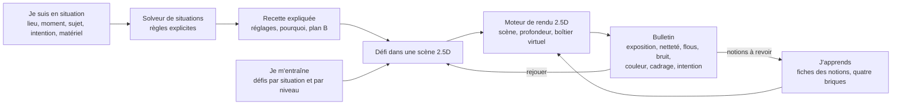

# Architecture

> **Deux parties.** La carte de l'application, ci-dessous, décrit le code tel qu'il est, et se tient à jour (règle sous son titre). L'architecture du produit, ensuite, est le brouillon du 7 novembre 2026, en partie caduc. Il devait être réécrit avec le choix de la pile technique, fait le même jour (Babylon.js, `docs/pile-technique.md`) ; il ne l'a pas été, et sa réécriture attend la fin des refontes du plan de corrections de l'audit (constat ARC-09, `docs/audit/architecture-application.md` ; plan : `docs/audit/README.md`, Sujet 29).

## Carte de l'application

Écrite le 22 novembre 2026, à la version 0.3.89, d'après la carte du rapport d'architecture de l'audit (`docs/audit/architecture-application.md`, « Carte de l'application », écrite pour la version 0.3.57, et sa contre-vérification) et le code (Sujet 29 du plan de corrections). Elle se met à jour dans la pull request qui ajoute, retire, déplace ou découpe un module de `app/`, ou qui change ce qu'elle en dit (rôle d'un module, ordre des créations, trajets, dépendances) : à chaque refonte, notamment. Ses nombres de lignes (`wc -l`, à la version 0.3.89, sauf ceux de `camera/settings.ts` et `camera/autofocus.ts`, recomptés à la version 0.4.9, ceux de `ui/cameraPanel.ts`, `ui/shutter.ts`, `ui/reviewInfo.ts`, `ui/balance.ts`, `ui/topView.ts`, `ui/challenges.ts`, `ui/ficheDialog.ts` et `ui/dialogs.ts`, recomptés à la version 0.4.10, celui de `credits.ts`, recompté à la version 0.4.14, et ceux de `main.ts`, `style.css`, `texts.ts`, `diagnosticModel.ts` et `ui/diagnosticView.ts`, recomptés à la version 0.4.15 ; chacune de ces quatre versions change ce que la carte en dit) donnent la taille de chaque module ; ils ne se refont qu'avec une telle mise à jour. Ce que chaque module simule, et ses sources : `docs/camera-physique.md` ; outillage, construction et publication : `docs/outillage.md` ; routine de test : même page, « Tests sur ordinateur et sur mobile ».

### Pages et constructions (`app/`)

- `app/simulateur/index.html` : la page du simulateur, entrée de Vite (`app/vite.config.ts`), avec les éléments que `app/src/main.ts` passe aux classes. Tout le code du simulateur tient en un seul fichier JavaScript.
- `app/activites/LUM-02/index.html` et `app/src/activities/` : l'activité de LUM-02, un schéma en 2D, construite à part (`app/vite.activites.config.ts`) ; `lum02.ts` (217 lignes) dessine le schéma et écrit les valeurs, avec ses propres textes, `lum02Model.ts` (69) calcule l'ombre, sans page, et `lum02.css` (167) est sa feuille de style.
- `app/scripts/build-pages.mjs` (612) : l'accueil et les fiches, pages statiques produites après Vite d'après `content/` (`docs/contenus.md`). `app/scripts/version.mjs` (avec ses types dans `version.d.mts`) lit le numéro de version dans `CHANGELOG.md`, pour le simulateur et pour l'accueil ; `app/scripts/copy-licences.mjs` copie les licences dans `dist/licences/`.
- `app/public/`, copié tel quel dans le site : la scène de parc (`scenes/parc/`, ses fichiers et son manifeste `scene.json`, que contrôle `scripts/check_scenes.py`) et la page des licences (`licences/index.html`).
- `npm run build` vérifie les types, construit le simulateur puis l'activité, copie les licences et produit les pages ; `npm test` lance les tests rapides (`app/package.json`). Types vérifiés par trois configurations : `app/tsconfig.json` pour `app/src/`, `app/tsconfig.node.json` pour les deux configurations de Vite, `app/tests/tsconfig.json` pour les tests.

### Le simulateur (`app/src/`)

- `main.ts` (626 lignes) assemble tout. Il crée la fenêtre de fiche, qui ne dépend pas de la scène, puis, si le navigateur a WebGL (`startOrFail`, version 0.4.4) : le moteur (viseur à la densité de l'écran plafonnée à 2, sauf avec `?diagnostic=densite-complete`) et le message de la perte du contexte graphique ; puis, si le contexte n'est pas déjà perdu (`startSimulator`), la lecture des capacités de rendu en flottants et la scène (avec `?diagnostic=textures-legeres`, version 0.4.15, chargée avec des textures allégées : le plus grand côté de texture que lit Babylon.js est abaissé le temps du chargement) ; enfin, dans cet ordre : le bruit du viseur, le magasin de réglages (version 0.4.9), le panneau du boîtier, l'autofocus, l'affichage de diagnostic (avec `?diagnostic` seulement), la profondeur de champ du viseur, les défis, le déclencheur (avec les affichages de l'écran de revue), l'indicateur d'équilibre et la vue de dessus. Chacun reçoit à sa création ceux d'avant dont il a besoin ; le magasin va au panneau, à l'autofocus, au déclencheur et aux affichages de l'écran de revue ; le panneau reçoit ensuite l'autofocus, la profondeur de champ et l'indicateur d'équilibre (`attachAutofocus`, `attachDepthOfField`, `attachBalance`), et le déclencheur lit la dernière mesure du bruit de l'indicateur, créé après lui, par une fonction. `main.ts` passe aux classes 71 éléments de la page (66 par `element(…)`, 5 par `getElementById`), dont quatre deux fois (`frame`, `focus-marker`, `review` et `review-image`), soit 67 éléments différents ; s'y ajoutent le canevas, lu au début du fichier, que reçoivent le moteur, la scène et le déclencheur, et son parent, où se place l'affichage de diagnostic. Un contexte déjà perdu à la création du moteur, ou une exception pendant ces créations, arrêtent le démarrage avec un message (`failStart`, version 0.4.4 ; `docs/outillage.md`, « Contexte perdu au démarrage ») ; depuis la version 0.4.15, un contexte perdu pendant le chargement de la scène aussi, avec la progression du chargement figée à l'arrêt, l'affichage de diagnostic restant affiché, sa lecture des textures figée (« Contexte perdu pendant le chargement »). Il tient aussi la progression du chargement, les messages d'échec (chargement, WebGL absent, contexte graphique perdu, démarrage arrêté) et la ligne des problèmes, en haut du viseur (l'élément `#diagnostic` de la page, qui n'est pas l'affichage de diagnostic). Il ouvre la fenêtre « Crédits », et fait fermer toutes les fenêtres de la page par un toucher sur le fond (`ui/dialogs.ts`, version 0.4.10). Depuis la version 0.4.10, le déclencheur reçoit aussi l'en-tête (`header`), le panneau, la vue de dessus et l'indicateur d'équilibre, qu'il rend inertes quand l'écran de revue couvre tout l'écran ; ces quatre éléments ne sont pas comptés ci-dessus.
- `scene.ts` (425) : la scène de parc. Fond et éclairage tirés d'une photo à 360°, sol invisible qui ne reçoit que les ombres, personnages, chien, banc et poubelle chargés en glTF ; la caméra 3D de l'appareil (`UniversalCamera`, sans le clavier, la molette ni la manette : les gestes la font tourner, la vue de dessus la déplace) ; horloge de la scène (instant, sujets en mouvement, décalage de l'œil : l'interface `SceneTimeControl`, déclarée dans `camera/photo.ts`) ; position de l'appareil au sol ; sujets et leurs yeux ; repères de la vue de dessus. `SceneFileError` nomme un fichier qui n'est pas arrivé.
- `camera/`, sans rendu : des modules qui se chargent aussi sans navigateur ; les tests rapides en chargent neuf, tous sauf `faces.ts`.
  - `exposure.ts` (88) : échelles par tiers de diaphragme, écart d'exposition.
  - `exposureModes.ts` (129) : modes M, A et S, correction d'exposition, ISO auto.
  - `bodies.ts` (107) : les trois boîtiers de référence (capteur, bruit, couverture de l'autofocus).
  - `settings.ts` (337) : le magasin de réglages (constat ARC-02, version 0.4.9). Une table où chaque réglage du boîtier et de ses aides a sa valeur de départ, sa validation et, s'il est mémorisé, sa place dans la mémoire du navigateur (`tutophoto.boitier`, `tutophoto.apercu`, `tutophoto.revue`, avec les champs d'avant la version 0.4.9) ; une lecture (`get`, `all`), une écriture (`set`) et un abonnement (`subscribe`). La classe reçoit la mémoire, que seule `browserStorage()`, appelée par `main.ts`, lit dans `window.localStorage` : le module ne touche ni à la page ni au rendu.
  - `viewfinder.ts` (105) : cadre aux proportions du capteur, champ de vue de la caméra 3D, lignes des grilles de cadrage.
  - `optics.ts` (326) : champ de vue, zone nette, cercle de confusion, position et traînée sur le capteur, distance du sol, fenêtre d'une projection, format de la photo, plan des rendus de la photo.
  - `noiseModel.ts` (163) : la loi du bruit, écrite en TypeScript et en GLSL côte à côte, le rapport signal sur bruit, les seuils de l'indicateur d'équilibre.
  - `histogram.ts` (91) : histogrammes et zones écrêtées de la photo.
  - `bulletin.ts` (147) : les mesures du bulletin de la photo (zone nette ; pour chaque sujet, netteté, traînée, place dans le cadre) et les critères des trois défis, calculés sur la géométrie de la vue et sur les réglages, pas sur les pixels de la photo.
  - `faces.ts` (151) : détection des visages et des yeux de la zone automatique ; il se charge sans navigateur, mais n'a pas de test.
  - `bulletin.ts` et `faces.ts` utilisent les vecteurs de Babylon.js ; les huit autres n'importent rien de Babylon.js.
- `camera/`, avec rendu.
  - `noise.ts` (176) : texture des tirages du bruit, liaison de ses paramètres aux shaders, post-traitement du bruit du viseur.
  - `viewfinderDof.ts` (282) : profondeur de champ approchée du viseur.
  - `autofocus.ts` (460) : carte de profondeur du viseur, rendue en flottants ; distance au point de mise au point (en AF-C, relue toutes les 0,2 s) ; zone automatique, détection des visages et des yeux. Le mode, AF-S ou AF-C, se lit dans le magasin de réglages, dont un changement ôte le verrou.
  - `photo.ts` (486) : la photo calculée au déclenchement, par accumulation de rendus, et la loupe de l'écran de revue, calculée de même.
- `ui/` : l'interface, chaque classe avec les éléments de la page que lui passe `main.ts`.
  - `cameraPanel.ts` (1 074) : le boîtier virtuel. Ce que les réglages montrent et changent à l'écran : molettes, cellule d'exposition, mise au point, mode de déclenchement, aperçus du viseur, vue et loupe du viseur, grilles, cinq fenêtres (boîtier de référence, aperçu, mise au point, déclenchement, exposition). Il lit les réglages dans le magasin, y écrit ce que l'on choisit et se met à jour par son abonnement (`settingsChanged`). La consigne de mise au point a ses deux phrases, celle de l'AF-S et celle de l'AF-C, posées l'une sur l'autre, celle du mode choisi seule visible (version 0.4.10).
  - `shutter.ts` (869) : toucher du viseur, déclencheur (vue par vue, rafale, retardateur), calcul de la photo et son refus sur un appareil sans rendu en flottants, écran de revue et sa loupe, bulletin. Il lit dans le magasin de réglages le mode de déclenchement, le mode de mise au point et le mode de zone. Quand l'écran de revue couvre tout l'écran (téléphone, fenêtre basse), il rend inerte ce qu'il cache (`updateCovered`, version 0.4.10), et y ramène le focus qu'une fenêtre fermée a laissé tomber (`keepFocusInReview`, appelé par `main.ts`).
  - `reviewInfo.ts` (227) : photo seule, histogrammes et hautes lumières de l'écran de revue ; l'affichage choisi est un réglage du magasin ; ce qui vient de s'afficher est amené au-dessus de la barre collée en bas de l'écran de revue.
  - `balance.ts` (319) : l'indicateur d'équilibre entre ouverture, vitesse et ISO ; replié au départ dans une fenêtre de 700 px de large ou de 500 px de haut au plus (version 0.4.10).
  - `topView.ts` (217) : la vue de dessus, d'où l'on déplace l'appareil ; repliée au départ dans les mêmes fenêtres que l'indicateur d'équilibre.
  - `challenges.ts` (230) : choix du défi (fenêtre « Défis », paramètre `?defi=`) et bulletin affiché sous la photo (`renderBulletin`). Ce bulletin ajoute aux mesures de `camera/bulletin.ts` l'écart d'exposition des réglages (`resolveExposure`), que lui passe `shutter.ts`, et une ligne du bruit qui est la dernière lecture de l'indicateur d'équilibre dans le viseur, pas une mesure de la photo (constat ARC-10 ; décision D21, « Décisions en attente » de `docs/etat-des-travaux.md`).
  - `ficheDialog.ts` (100) : la fiche ouverte par-dessus le simulateur.
  - `dialogs.ts` (38) : l'ouverture d'une fenêtre en haut de son contenu (`openDialog`, que prennent le panneau, les défis, la fenêtre de fiche et `main.ts`), et sa fermeture par un toucher sur le fond (`closeOnBackdrop`), constat INT-20 de l'audit, version 0.4.10.
  - `diagnosticView.ts` (144) : l'affichage de diagnostic, ouvert par `?diagnostic` ; il reçoit de `main.ts` le plus grand côté de texture lu à la création du moteur et le réglage des textures allégées, et `main.ts` y fige la lecture des textures quand le démarrage s'arrête sur une perte du contexte (version 0.4.15).
- Hors de `camera/` et de `ui/`.
  - `texts.ts` (377) : les 279 textes de l'interface du simulateur, en français, chacun sous une clé (`t()`), avec les espaces de la ponctuation française que pose `frenchSpaces.ts` (16), dont se sert aussi l'activité de LUM-02. L'activité et les pages statiques ont leurs propres textes (`activities/lum02.ts` ; `TEXT`, dans `app/scripts/build-pages.mjs`).
  - `version.ts` (18) : la version du site, que donne la construction.
  - `credits.ts` (94) : la fenêtre « Crédits », d'après le manifeste de la scène (`app/public/scenes/parc/scene.json`), et, sous la liste, le code de tiers du simulateur, avec un lien vers la page des licences (version 0.4.14).
  - `diagnosticModel.ts` (312) : la part sans rendu de l'affichage de diagnostic et des capacités de rendu en flottants, dont, depuis la version 0.4.15, le réglage des textures allégées et l'estimation de ce que demande une texture ; testée.
  - `ficheId.mjs` (13), avec ses types dans `ficheId.d.mts` (5) : la forme d'un identifiant de fiche, commune au simulateur et à `app/scripts/build-pages.mjs`.
  - `style.css` (1 415) ; la mise en page (version 0.4.10) y est décrite par ses commentaires : boutons du panneau en grille d'après la largeur du panneau (requêtes de conteneur), panneau à droite du viseur dans une fenêtre basse et large, écran de revue sur tout l'écran d'un téléphone.
- `app/tests/` : un fichier de tests rapides par module testé (`bodies`, `bulletin`, `diagnosticModel`, `exposure`, `exposureModes`, `histogram`, `lum02Model`, `noiseModel`, `optics`, `settings`, `viewfinder`), 94 tests à la version 0.3.89, 105 à la version 0.4.9, 109 à la version 0.4.15 ; `resolve.mjs` résout les imports écrits sans extension, `approx.ts` compare deux nombres à un écart permis près.

### Trajet d'un réglage

Bouton ou case de la page, puis écriture dans le magasin de réglages (`set`, `camera/settings.ts`, version 0.4.9), qui valide la valeur, écrit la clé de la mémoire du navigateur où elle se range et prévient ses abonnés : le panneau (`settingsChanged`, qui appelle `update()`, ou la seule mise à jour de la mise au point ou du mode de déclenchement, comme avant la version 0.4.9), l'autofocus (un changement de mode ôte le verrou) et les affichages de l'écran de revue. `update()` passe par `resolved()` (`resolveExposure`, `camera/exposureModes.ts`). De là, d'un côté le viseur : exposition appliquée par les matériaux de Babylon.js (`scene.imageProcessingConfiguration.exposure`), paramètres du bruit et du flou, champ de vue de la caméra ; de l'autre `current()`, que lisent le déclencheur (au déclenchement), l'indicateur d'équilibre (toutes les 0,3 s) et la vue de dessus (toutes les 0,25 s) ; le déclencheur lit aussi dans le magasin le mode de déclenchement, de mise au point et de zone. La mémoire du navigateur garde, par le magasin, les réglages (`tutophoto.boitier`), les aperçus (`tutophoto.apercu`) et l'affichage de l'écran de revue (`tutophoto.revue`) ; le défi choisi (`tutophoto.defi`), par `ui/challenges.ts`.

### Trajet d'une image

Deux chaînes, d'après la décision de Julien du 8 novembre 2026 (`docs/pile-technique.md`, « Décision ») : des effets approchés dans le viseur, une photo calculée au déclenchement.

- Viseur : les matériaux de Babylon.js appliquent l'exposition et la courbe ; viennent ensuite des post-traitements, sur une image de 8 bits par couche : la profondeur de champ (`camera/viewfinderDof.ts` : copie, flou à mi-résolution d'après la carte de profondeur de l'autofocus, composition), puis le bruit, toujours en dernier (`camera/noise.ts`), qui revient en lumière linéaire, ajoute le bruit et réencode.
- Photo (`camera/photo.ts`) : pendant le calcul, les matériaux rendent la lumière linéaire (`applyByPostProcess`). Chaque rendu, l'œil placé en un point du disque d'ouverture et à un instant de la pose, va dans une texture en demi-flottants et s'ajoute à une somme en flottants. Un shader de finition fait la moyenne, le lissage selon la profondeur, l'exposition, le bruit, l'écrêtage et la courbe. La photo est lue en 8 bits par couche, mesurée (histogrammes, zones écrêtées), puis encodée en JPEG (qualité 0,92), que l'écran de revue propose d'enregistrer.
- Le développement (exposition, courbe, écrêtage, bruit) est donc écrit deux fois, la loi du bruit exceptée, qui est commune (`camera/noiseModel.ts`). Les réunir est le Sujet 40 du plan de corrections (constat ARC-01).
- Pendant le calcul d'une photo ou d'une loupe de l'écran de revue, la photo emprunte la scène et la caméra du viseur : `Shutter.compute` (`ui/shutter.ts`) désactive le panneau, ce qui met aussi l'indicateur d'équilibre en pause, arrête la boucle de rendu, suspend le bruit, la profondeur de champ et l'autofocus du viseur et détache les gestes de la caméra, puis rétablit le tout (constat ARC-08 de l'audit, consigne pour le Sujet 40).

### Sens des dépendances

D'après les imports de `app/src/` :

- aucun fichier de `camera/` n'importe un fichier de `ui/`, ni `scene.ts` ;
- `scene.ts` ne prend à `camera/` que deux types (`FaceSubject` de `faces.ts`, `SceneTimeControl` de `photo.ts`) ; `ui/shutter.ts`, `ui/balance.ts` et `ui/topView.ts` importent `scene.ts` ;
- `SceneTimeControl` est déclarée dans `camera/photo.ts`, et `scene.ts`, `ui/shutter.ts`, `ui/balance.ts` et `ui/topView.ts` la lui prennent ; la distance du sol (`GroundInfo`, `groundDepth`), qui était aussi dans `photo.ts` à la version 0.3.57, est dans `camera/optics.ts` depuis la version 0.3.87 ;
- les modules de `camera/` sans rendu n'importent que d'autres modules sans rendu.

## Architecture du produit (brouillon du 7 novembre 2026)

_Section 2 de `REPRISE.md` (7 novembre 2026), copiée sans réécriture, sauf son titre et les niveaux de titre, la section « Langue » (versions 0.3.60 et 0.3.61), le paragraphe qui suit la table de vocabulaire (version 0.3.79), et, dans cette table et la liste qui la suit, cinq liens vers les pages de la mesure de Canon et de Sony, et la nature du X100T de Fujifilm, avec sa source (version 0.3.90)._

> **En partie caduque depuis le 7 novembre 2026.** Les scènes sont en 3D de synthèse, et non en 2.5D : le moteur de rendu 2.5D, les défis « dans une scène 2.5D » et la section « Format de scène 2.5D » ne valent plus. Ce qu'est l'application aujourd'hui : la carte, plus haut. Les trois portes d'entrée, le solveur de situations, le bulletin et le boîtier virtuel restent valables comme brouillon, comme cible du produit : le bulletin et le boîtier du simulateur ne font pas encore tout ce qui est décrit ici. Le bilinguisme a été retiré (section « Langue »). Le profil de capteur « 1 pouce » est à réexaminer, le public visé n'utilisant que des reflex et des hybrides. La partie « Droits » portait sur des photos réelles ; pour des scènes de synthèse, la question devient surtout celle des licences des modèles et des textures.

Trois portes d'entrée mènent au même moteur de rendu. Une situation décrite passe par le solveur de situations, qui produit une recette expliquée ; un défi se joue dans une scène 2.5D ; une notion se manipule dans son simulateur. Chaque photo simulée reçoit un bulletin, qui renvoie aux notions à revoir.

### Les trois portes d'entrée

- Je suis en situation : quelques questions (lieu, moment, sujet, mouvement, intention, matériel), puis la recette de réglages expliquée.
- Je m'entraîne : des défis classés par situation et par niveau, joués dans une scène 2.5D et notés par le bulletin.
- J'apprends : le référentiel, notion par notion, avec ses quatre briques ; le simulateur de chaque notion tourne sur le moteur de rendu.

### Solveur de situations

- Entrées : intérieur ou extérieur, moment et météo, sujet et vitesse, distance, intention (figer, suggérer le mouvement, isoler, tout net, ambiance), matériel (capteur, objectifs, trépied, flash, filtres, télécommande, drone, caisson étanche).
- Recette : mode, vitesse, ouverture, ISO ou ISO auto avec vitesse minimale, correction d'exposition, mode et zone AF, collimateur ou mise au point manuelle, limiteur, mesure, balance des blancs, entraînement, type d'obturateur, stabilisation, format, focale, et selon la situation filtres, flash, bracketing ou pose B. Chaque réglage vient avec son pourquoi, ses compromis et un plan B si la lumière baisse.
- Calcul : un solveur à règles explicites, pas une IA. Il fixe d'abord les contraintes (vitesse pour figer, profondeur de champ voulue), puis répartit la lumière restante. Chaque recette est donc testable et explicable.
- Défi : la même situation dans une scène, avec un objectif et des contraintes. On règle, on déclenche, on reçoit son bulletin.

### Bulletin

Le moteur de rendu mesure chaque photo simulée, puis renvoie vers les notions à revoir.

- Exposition : écart en IL, part de hautes lumières et d'ombres écrêtées.
- Netteté : sujet dans la zone nette ou non, écart de mise au point.
- Flous : traînée de bougé et de sujet, en pixels.
- Bruit : rapport signal/bruit sur le sujet.
- Couleur : écart de balance des blancs sur une zone neutre annotée.
- Cadrage : inclinaison de l'horizon, éléments parasites dans le cadre.
- Intention : atteinte ou non, par exemple le flou d'arrière-plan mesuré.

### Boîtier virtuel

- Générique : il porte tous les réglages des domaines EXP, BOI, MAP, MES, COU et LUM, et les réglages d'objectif d'OPT (focale, filtres).
- Profils d'appareil génériques : format de capteur (plein format, APS-C, Micro 4/3, 1 pouce), bruit, plage dynamique, vitesse de synchro flash, type d'obturateur, type d'AF, viseur optique ou électronique.
- Profils d'objectif génériques : focale, ouverture maximale et sa variation au zoom, distance minimale, distorsion, vignetage, piqué, nombre de lamelles, stabilisation.
- Vocabulaire de ta marque : un réglage affiche les termes de Canon, Nikon, Sony, Fujifilm ou d'autres. Les noms changent même d'un modèle à l'autre : le réglage de la zone AF s'appelle « AF method » sur le [Canon EOS R5](https://cam.start.canon/en/C003/manual/html/UG-04_AF-Drive_0050.html) et « AF area » sur l'[EOS R5 Mark II](https://cam.start.canon/en/C017/manual/html/UG-04_AF-Drive_0060.html). La correspondance se tient donc par famille d'appareils, chaque terme sourcé par le manuel du constructeur.

Exemple de correspondance par famille d'appareils, d'après les manuels anglais des constructeurs (termes des manuels français à relever) :

| Réglage générique | Canon | Nikon | Sony | Fujifilm |
| --- | --- | --- | --- | --- |
| AF ponctuel | [One-Shot AF](https://cam.start.canon/en/C003/manual/html/UG-04_AF-Drive_0040.html) | [AF-S](https://onlinemanual.nikonimglib.com/zr/en/18-02.html) | [AF-S](https://helpguide.sony.net/ilc/1650/v1/en/contents/TP0001486782.html) | [S (AF-S)](https://fujifilm-dsc.com/en-int/manual/gfx100/taking_photo/autofocus/index.html) |
| AF continu | [Servo AF](https://cam.start.canon/en/C003/manual/html/UG-04_AF-Drive_0040.html) (hybrides), [AI Servo AF](https://www.manualslib.com/manual/1063993/Canon-Eos-80d.html?page=499) (reflex) | [AF-C](https://onlinemanual.nikonimglib.com/zr/en/18-02.html) | [AF-C](https://helpguide.sony.net/ilc/1650/v1/en/contents/TP0001486782.html) | [C (AF-C)](https://fujifilm-dsc.com/en-int/manual/gfx100/taking_photo/autofocus/index.html) |
| Mode de zone AF | [AF area](https://cam.start.canon/en/C017/manual/html/UG-04_AF-Drive_0060.html) | [AF-area mode](https://onlinemanual.nikonimglib.com/zr/en/18-02.html) | [Focus Area](https://helpguide.sony.net/ilc/2110/v1/en/contents/TP1000640179.html) | [AF MODE](https://fujifilm-dsc.com/en-int/manual/gfx100/taking_photo/autofocus/index.html) |
| Mesure multizone | [Evaluative](https://cam.start.canon/en/C007/manual/html/UG-04_AF-Drive_0080.html) | [Matrix](https://onlinemanual.nikonimglib.com/zr/en/09-03-21.html) | [Multi](https://helpguide.sony.net/ilc/1830/v1/en/contents/TP0002351792.html) | [Multi](https://fujifilm-dsc.com/en-int/manual/x-t4/taking_photo/photometry/index.html) |
| Mesure pondérée centrale | [Center-weighted average](https://cam.start.canon/en/C007/manual/html/UG-04_AF-Drive_0080.html) | [Center-weighted](https://onlinemanual.nikonimglib.com/zr/en/09-03-21.html) | [Center](https://helpguide.sony.net/ilc/1830/v1/en/contents/TP0002351792.html) | [Center weighted](https://fujifilm-dsc.com/en-int/manual/x-t4/taking_photo/photometry/index.html) |
| Mesure spot | [Spot](https://cam.start.canon/en/C007/manual/html/UG-04_AF-Drive_0080.html) | [Spot](https://onlinemanual.nikonimglib.com/zr/en/09-03-21.html) | [Spot](https://helpguide.sony.net/ilc/1830/v1/en/contents/TP0002351792.html) | [Spot](https://fujifilm-dsc.com/en-int/manual/x-t4/taking_photo/photometry/index.html) |

Propres à certaines marques ou à certains modèles :

- AF qui bascule seul entre ponctuel et continu : [AI Focus AF](https://www.manualslib.com/manual/1063993/Canon-Eos-80d.html?page=499) chez Canon (reflex), [AF-A](https://onlinemanual.nikonimglib.com/zr/en/18-02.html) chez Nikon, [Automatic AF](https://helpguide.sony.net/ilc/1930/v1/en/contents/TP0002720640.html) chez Sony.
- Mesure sélective : [Partial](https://cam.start.canon/en/C007/manual/html/UG-04_AF-Drive_0080.html) chez Canon.
- Mesure qui protège les hautes lumières : [Highlight-weighted](https://onlinemanual.nikonimglib.com/zr/en/09-03-21.html) chez Nikon, [Highlight](https://helpguide.sony.net/ilc/1830/v1/en/contents/TP0002351792.html) chez Sony.
- Moyenne de toute l'image : [Entire Screen Avg.](https://helpguide.sony.net/ilc/1830/v1/en/contents/TP0002351792.html) chez Sony, [Average](https://fujifilm-dsc.com/en-int/manual/gfx100/taking_photo/photometry/index.html) chez Fujifilm.
- Mesure spot qui suit le collimateur : [Focus Point Link](https://helpguide.sony.net/ilc/2110/v1/en/contents/TP1000649034.html) chez Sony, [Interlock Spot AE & Focus Area](https://fujifilm-dsc.com/en/manual/x100t/shooting/photometry/index.html) chez Fujifilm, sur le X100T, un compact à objectif fixe ([Wikipedia](https://en.wikipedia.org/w/index.php?title=Fujifilm_X100&oldid=1380553046), source secondaire ; MES-12).

Cette table devait devenir un fichier de données (`data/vocabulaire.yaml`), un terme par marque et par famille d'appareils. Julien a retenu le 15 novembre 2026 un champ `terms` par notion (décision D3, `docs/historique.md`) : chaque notion du référentiel porte les termes des manuels en français des boîtiers lus, un bloc par boîtier, avec sa source (`docs/lire-le-referentiel.md`). Nommer le boîtier dans chaque bloc garde ce que disait la table : un terme vaut pour un modèle, pas pour toute la marque. Dans l'interface, une phrase de la fenêtre « Boîtier de référence » dit que les noms des modes et des menus restent ceux du Nikon Z 6 ; des libellés par marque seraient une extension (constat INT-10 de l'audit).

### Format de scène 2.5D

- Capture HDR calibrée en luminance réelle, soleil et reflets compris (filtre ND, bracketing étendu) ; une source écrêtée est signalée dans les métadonnées.
- Capture nette de bout en bout, à bas ISO et sans flou : le moteur ajoute flou et bruit, il ne sait pas en retirer.
- Capture plus large que le cadre simulé, assemblée en panorama autour de la pupille d'entrée si la rotation dépasse le champ de l'objectif. Recadrer ×k divise la définition par k : chaque scène déclare sa plage de focales et de rotation, et la définition source qui va avec.
- Carte de profondeur en mètres. Le modèle Depth Anything V2 Small, sous licence Apache-2.0, peut servir d'estimateur ([dépôt officiel](https://github.com/DepthAnything/Depth-Anything-V2)) ; il donne une profondeur inverse connue à une échelle et un décalage près ([Jiang et al., CVPR 2025](https://openaccess.thecvf.com/content/CVPR2025/supplemental/Jiang_DEFOM-Stereo_Depth_Foundation_CVPR_2025_supplemental.pdf)), recalée en 1/distance sur au moins deux distances mesurées sur place.
- Premier plan flou qui déborde sur le sujet (grillage, branche, feuillage) : fond et premier plan capturés en couches, car le flou laisse voir une partie de ce qui est caché derrière. L'occlusion partielle est l'une des deux difficultés majeures du rendu du bokeh ([Sheng et al., 2023](https://arxiv.org/abs/2308.08843)).
- Sujets mobiles détourés, avec trajectoire et vitesse : flous de mouvement et suivi AF.
- Annotations : visages, yeux, sujets et leur orientation, horizon, lignes, éléments parasites, zones neutres pour juger la balance des blancs, sources de lumière avec leur couleur et leur scintillement, éclairement mesuré sur le sujet (MES-11).
- Variantes depuis le même point : heures, météo, polarisant, flash seul (direct et rebondi), reflets, voilage, réflecteur. Variantes depuis quelques points voisins, pour les notions V1→V2 : distance du sujet à la fenêtre ou au fond, hauteur de prise de vue, poses du modèle, profondeur sous l'eau.
- Séquences d'images sans trou entre les images pour les poses longues, ou flou interpolé entre elles ([Tabellion et al., 2023](https://arxiv.org/abs/2308.01379)).
- Métadonnées : lieu, date, heure, matériel, auteur, licence, plage de focales et de rotation.

### Langue

- TutoPhoto est en français seul depuis la version 0.3.60 (décision de Julien du 15 novembre 2026). Avant, le projet était bilingue, français et anglais.
- Les textes de l'interface du simulateur restent sous une clé, dans une seule table (`app/src/texts.ts`).
- Depuis la version 0.3.61, les titres du référentiel (`data/`) et, dans le manifeste d'une scène, son titre, le rôle et les modifications de chaque élément sont des chaînes en français ; avant, c'étaient des objets à deux champs, `fr` et `en` (`docs/propositions.md`, section 5, « Retrait de l'anglais »).
- Les contenus juridiques s'écrivent pays par pays, ils ne se traduisent pas.

### Droits

- Chaque scène porte son auteur et sa licence.
- En France, utiliser l'image d'une personne identifiable demande en principe son autorisation expresse et spéciale, au titre du respect de la vie privée prévu par l'article 9 du Code civil ([Village de la Justice, Patrick Lingibé, 2019](https://www.village-justice.com/articles/droit-image-quelles-sont-les-regles-applicables,30783.html)). Dans un lieu public, l'accord est requis si la personne est isolée et reconnaissable ([Service-public.fr, vérifié le 6 mai 2022](https://www.service-public.gouv.fr/particuliers/vosdroits/F32103)) : un passant qu'un zoom peut isoler compte donc comme identifiable (autorisation, floutage ou figurant).
- Pour un mineur, les deux parents protègent en commun son droit à l'image et l'y associent selon son âge et sa maturité (art. 372-1 du Code civil, issu de la loi du 19 février 2024 : [Actu-Juridique, 20 février 2024](https://www.actu-juridique.fr/breves/personnes-famille/protection-du-droit-a-limage-de-lenfant-publication-de-la-loi/)). Une diffusion qui n'est pas un acte usuel demande l'accord des deux ([circulaire du 23 mai 2024](https://cnb.avocat.fr/sites/default/files/documents/circulaire_de_presentation_des_dispositions_de_loi_n_2024-120_du_19_fevrier_2024_visant_a_garantir_le_respect_du_droit_a_limage_des_enfants_-_240523.pdf)) : le projet le demande toujours.
- Une œuvre encore protégée visible dans une scène (architecture récente, sculpture, street art) demande l'accord de son auteur. L'exception de panorama ne couvre que les reproductions faites par des personnes physiques, hors de tout usage commercial (art. L122-5, 11° du CPI : [CMS, Prudence Cadio, 2017](https://cms.law/fr/fra/a-la-une/la-nouvelle-exception-de-panorama-et-la-reproduction-de-l-image-de-l-immeuble)), alors qu'une licence comme CC BY-SA permet l'usage commercial ([Creative Commons](https://creativecommons.org/licenses/by-sa/4.0/deed.en)).
- Chaque scène avec des personnes identifiables ou des œuvres protégées est donc livrée avec des autorisations écrites.
- Les scènes de drone suivent en plus les règles de vol du pays où elles sont prises (PLA-09) ; dans l'Union européenne, le cadre commun est fixé par les règlements (UE) 2019/947 et 2019/945 ([EASA, FAQ](https://www.easa.europa.eu/en/the-agency/faqs/regulations-uas-drone-explained)).
