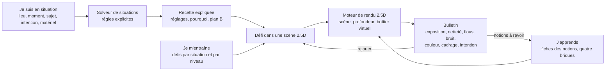

# Architecture produit

_Section 2 de `REPRISE.md` (7 novembre 2026), copiée sans réécriture ; seuls les niveaux de titre changent._

Trois portes d'entrée mènent au même moteur de rendu. Une situation décrite passe par le solveur de situations, qui produit une recette expliquée ; un défi se joue dans une scène 2.5D ; une notion se manipule dans son simulateur. Chaque photo simulée reçoit un bulletin, qui renvoie aux notions à revoir.

## Les trois portes d'entrée

- Je suis en situation : quelques questions (lieu, moment, sujet, mouvement, intention, matériel), puis la recette de réglages expliquée.
- Je m'entraîne : des défis classés par situation et par niveau, joués dans une scène 2.5D et notés par le bulletin.
- J'apprends : le référentiel, notion par notion, avec ses quatre briques ; le simulateur de chaque notion tourne sur le moteur de rendu.

## Solveur de situations

- Entrées : intérieur ou extérieur, moment et météo, sujet et vitesse, distance, intention (figer, suggérer le mouvement, isoler, tout net, ambiance), matériel (capteur, objectifs, trépied, flash, filtres, télécommande, drone, caisson étanche).
- Recette : mode, vitesse, ouverture, ISO ou ISO auto avec vitesse minimale, correction d'exposition, mode et zone AF, collimateur ou mise au point manuelle, limiteur, mesure, balance des blancs, entraînement, type d'obturateur, stabilisation, format, focale, et selon la situation filtres, flash, bracketing ou pose B. Chaque réglage vient avec son pourquoi, ses compromis et un plan B si la lumière baisse.
- Calcul : un solveur à règles explicites, pas une IA. Il fixe d'abord les contraintes (vitesse pour figer, profondeur de champ voulue), puis répartit la lumière restante. Chaque recette est donc testable et explicable.
- Défi : la même situation dans une scène, avec un objectif et des contraintes. On règle, on déclenche, on reçoit son bulletin.

## Bulletin

Le moteur de rendu mesure chaque photo simulée, puis renvoie vers les notions à revoir.

- Exposition : écart en IL, part de hautes lumières et d'ombres écrêtées.
- Netteté : sujet dans la zone nette ou non, écart de mise au point.
- Flous : traînée de bougé et de sujet, en pixels.
- Bruit : rapport signal/bruit sur le sujet.
- Couleur : écart de balance des blancs sur une zone neutre annotée.
- Cadrage : inclinaison de l'horizon, éléments parasites dans le cadre.
- Intention : atteinte ou non, par exemple le flou d'arrière-plan mesuré.

## Boîtier virtuel

- Générique : il porte tous les réglages des domaines EXP, BOI, MAP, MES, COU et LUM, et les réglages d'objectif d'OPT (focale, filtres).
- Profils d'appareil génériques : format de capteur (plein format, APS-C, Micro 4/3, 1 pouce), bruit, plage dynamique, vitesse de synchro flash, type d'obturateur, type d'AF, viseur optique ou électronique.
- Profils d'objectif génériques : focale, ouverture maximale et sa variation au zoom, distance minimale, distorsion, vignetage, piqué, nombre de lamelles, stabilisation.
- Vocabulaire de ta marque : un réglage affiche les termes de Canon, Nikon, Sony, Fujifilm ou d'autres. Les noms changent même d'un modèle à l'autre : le réglage de la zone AF s'appelle « AF method » sur le [Canon EOS R5](https://cam.start.canon/en/C003/manual/html/UG-04_AF-Drive_0050.html) et « AF area » sur l'[EOS R5 Mark II](https://cam.start.canon/en/C017/manual/html/UG-04_AF-Drive_0060.html). La correspondance se tient donc par famille d'appareils, chaque terme sourcé par le manuel du constructeur.

Exemple de correspondance par famille d'appareils, d'après les manuels anglais des constructeurs (termes des manuels français à relever) :

| Réglage générique | Canon | Nikon | Sony | Fujifilm |
| --- | --- | --- | --- | --- |
| AF ponctuel | [One-Shot AF](https://cam.start.canon/en/C003/manual/html/UG-04_AF-Drive_0040.html) | [AF-S](https://onlinemanual.nikonimglib.com/zr/en/18-02.html) | [AF-S](https://helpguide.sony.net/ilc/1650/v1/en/contents/TP0001486782.html) | [S (AF-S)](https://fujifilm-dsc.com/en-int/manual/gfx100/taking_photo/autofocus/index.html) |
| AF continu | [Servo AF](https://cam.start.canon/en/C003/manual/html/UG-04_AF-Drive_0040.html) (hybrides), [AI Servo AF](https://www.manualslib.com/manual/1063993/Canon-Eos-80d.html?page=499) (reflex) | [AF-C](https://onlinemanual.nikonimglib.com/zr/en/18-02.html) | [AF-C](https://helpguide.sony.net/ilc/1650/v1/en/contents/TP0001486782.html) | [C (AF-C)](https://fujifilm-dsc.com/en-int/manual/gfx100/taking_photo/autofocus/index.html) |
| Mode de zone AF | [AF area](https://cam.start.canon/en/C017/manual/html/UG-04_AF-Drive_0060.html) | [AF-area mode](https://onlinemanual.nikonimglib.com/zr/en/18-02.html) | [Focus Area](https://helpguide.sony.net/ilc/2110/v1/en/contents/TP1000640179.html) | [AF MODE](https://fujifilm-dsc.com/en-int/manual/gfx100/taking_photo/autofocus/index.html) |
| Mesure multizone | [Evaluative](https://cam.start.canon/fa/C007/manual/html/UG-04_AF-Drive_0080.html) | [Matrix](https://onlinemanual.nikonimglib.com/zr/en/09-03-21.html) | [Multi](https://helpguide.sony.net/ilc/1830/v1/en/contents/TP0002351792.html) | [Multi](https://fujifilm-dsc.com/en-int/manual/x-t4/taking_photo/photometry/index.html) |
| Mesure pondérée centrale | [Center-weighted average](https://cam.start.canon/fa/C007/manual/html/UG-04_AF-Drive_0080.html) | [Center-weighted](https://onlinemanual.nikonimglib.com/zr/en/09-03-21.html) | [Center](https://helpguide.sony.net/ilc/1830/v1/en/contents/TP0002351792.html) | [Center weighted](https://fujifilm-dsc.com/en-int/manual/x-t4/taking_photo/photometry/index.html) |
| Mesure spot | [Spot](https://cam.start.canon/fa/C007/manual/html/UG-04_AF-Drive_0080.html) | [Spot](https://onlinemanual.nikonimglib.com/zr/en/09-03-21.html) | [Spot](https://helpguide.sony.net/ilc/1830/v1/en/contents/TP0002351792.html) | [Spot](https://fujifilm-dsc.com/en-int/manual/x-t4/taking_photo/photometry/index.html) |

Propres à certaines marques ou à certains modèles :

- AF qui bascule seul entre ponctuel et continu : [AI Focus AF](https://www.manualslib.com/manual/1063993/Canon-Eos-80d.html?page=499) chez Canon (reflex), [AF-A](https://onlinemanual.nikonimglib.com/zr/en/18-02.html) chez Nikon, [Automatic AF](https://helpguide.sony.net/ilc/1930/v1/en/contents/TP0002720640.html) chez Sony.
- Mesure sélective : [Partial](https://cam.start.canon/fa/C007/manual/html/UG-04_AF-Drive_0080.html) chez Canon.
- Mesure qui protège les hautes lumières : [Highlight-weighted](https://onlinemanual.nikonimglib.com/zr/en/09-03-21.html) chez Nikon, [Highlight](https://helpguide.sony.net/dsc/1910/v1/en/contents/TP0002055602.html) chez Sony.
- Moyenne de toute l'image : [Entire Screen Avg.](https://helpguide.sony.net/ilc/1830/v1/en/contents/TP0002351792.html) chez Sony, [Average](https://fujifilm-dsc.com/en-int/manual/gfx100/taking_photo/photometry/index.html) chez Fujifilm.
- Mesure spot qui suit le collimateur : [Focus Point Link](https://helpguide.sony.net/ilc/2110/v1/en/contents/TP1000649034.html) chez Sony, [Interlock Spot AE & Focus Area](https://fujifilm-dsc.com/en/manual/x100t/shooting/photometry/index.html) chez Fujifilm (MES-12).

À terme, cette table devient un fichier de données (par exemple `data/vocabulaire.yaml`), un terme par marque et par famille d'appareils, chacun avec sa source.

## Format de scène 2.5D

- Capture HDR calibrée en luminance réelle, soleil et reflets compris (filtre ND, bracketing étendu) ; une source écrêtée est signalée dans les métadonnées.
- Capture nette de bout en bout, à bas ISO et sans flou : le moteur ajoute flou et bruit, il ne sait pas en retirer.
- Capture plus large que le cadre simulé, assemblée en panorama autour de la pupille d'entrée si la rotation dépasse le champ de l'objectif. Recadrer ×k divise la définition par k : chaque scène déclare sa plage de focales et de rotation, et la définition source qui va avec.
- Carte de profondeur en mètres. Le modèle Depth Anything V2 Small, sous licence Apache-2.0, peut servir d'estimateur ([dépôt officiel](https://github.com/DepthAnything/Depth-Anything-V2)) ; il donne une profondeur inverse connue à une échelle et un décalage près ([Jiang et al., CVPR 2025](https://openaccess.thecvf.com/content/CVPR2025/supplemental/Jiang_DEFOM-Stereo_Depth_Foundation_CVPR_2025_supplemental.pdf)), recalée en 1/distance sur au moins deux distances mesurées sur place.
- Premier plan flou qui déborde sur le sujet (grillage, branche, feuillage) : fond et premier plan capturés en couches, car le flou laisse voir une partie de ce qui est caché derrière. L'occlusion partielle est l'une des deux difficultés majeures du rendu du bokeh ([Sheng et al., 2023](https://arxiv.org/abs/2308.08843)).
- Sujets mobiles détourés, avec trajectoire et vitesse : flous de mouvement et suivi AF.
- Annotations : visages, yeux, sujets et leur orientation, horizon, lignes, éléments parasites, zones neutres pour juger la balance des blancs, sources de lumière avec leur couleur et leur scintillement, éclairement mesuré sur le sujet (MES-11).
- Variantes depuis le même point : heures, météo, polarisant, flash seul (direct et rebondi), reflets, voilage, réflecteur. Variantes depuis quelques points voisins, pour les notions V1→V2 : distance du sujet à la fenêtre ou au fond, hauteur de prise de vue, poses du modèle, profondeur sous l'eau.
- Séquences d'images sans trou entre les images pour les poses longues, ou flou interpolé entre elles ([Tabellion et al., 2023](https://arxiv.org/abs/2308.01379)).
- Métadonnées : lieu, date, heure, matériel, auteur, licence, plage de focales et de rotation.

## Bilinguisme

- Chaque texte passe par une clé. Une notion n'est couverte que si ses quatre briques existent en français et en anglais.
- Les intitulés du référentiel forment la première version du glossaire FR/EN.
- Les contenus juridiques s'écrivent pays par pays, ils ne se traduisent pas.

## Droits

- Chaque scène porte son auteur et sa licence.
- En France, utiliser l'image d'une personne identifiable demande en principe son autorisation expresse et spéciale, au titre du respect de la vie privée prévu par l'article 9 du Code civil ([Village de la Justice, Patrick Lingibé, 2019](https://www.village-justice.com/articles/droit-image-quelles-sont-les-regles-applicables,30783.html)). Dans un lieu public, l'accord est requis si la personne est isolée et reconnaissable ([Service-public.fr, vérifié le 6 mai 2022](https://www.service-public.gouv.fr/particuliers/vosdroits/F32103)) : un passant qu'un zoom peut isoler compte donc comme identifiable (autorisation, floutage ou figurant).
- Pour un mineur, les deux parents protègent en commun son droit à l'image et l'y associent selon son âge et sa maturité (art. 372-1 du Code civil, issu de la loi du 19 février 2024 : [Actu-Juridique, 20 février 2024](https://www.actu-juridique.fr/breves/personnes-famille/protection-du-droit-a-limage-de-lenfant-publication-de-la-loi/)). Une diffusion qui n'est pas un acte usuel demande l'accord des deux ([circulaire du 23 mai 2024](https://cnb.avocat.fr/sites/default/files/documents/circulaire_de_presentation_des_dispositions_de_loi_n_2024-120_du_19_fevrier_2024_visant_a_garantir_le_respect_du_droit_a_limage_des_enfants_-_240523.pdf)) : le projet le demande toujours.
- Une œuvre encore protégée visible dans une scène (architecture récente, sculpture, street art) demande l'accord de son auteur. L'exception de panorama ne couvre que les reproductions faites par des personnes physiques, hors de tout usage commercial (art. L122-5, 11° du CPI : [CMS, Prudence Cadio, 2017](https://cms.law/fr/fra/a-la-une/la-nouvelle-exception-de-panorama-et-la-reproduction-de-l-image-de-l-immeuble)), alors qu'une licence comme CC BY-SA permet l'usage commercial ([Creative Commons](https://creativecommons.org/licenses/by-sa/4.0/deed.en)).
- Chaque scène avec des personnes identifiables ou des œuvres protégées est donc livrée avec des autorisations écrites.
- Les scènes de drone suivent en plus les règles de vol du pays où elles sont prises (PLA-09) ; dans l'Union européenne, le cadre commun est fixé par les règlements (UE) 2019/947 et 2019/945 ([EASA, FAQ](https://www.easa.europa.eu/en/the-agency/faqs/regulations-uas-drone-explained)).
